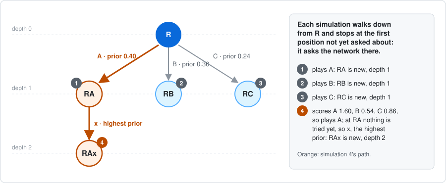

# How gwRL learns

This is the central design document of the learning system. It explains, from
the top down, how the program learns to play the 1936–1941 Japan–China
campaign: what the game engine gives the learner, how a move is chosen, what the
networks read and compute, how they are trained, how runs are organised and how
strength is checked. Each layer starts in plain words, then names the code that
does it.

The document is revised whenever a question digs into part of the design (see
`AGENTS.md`). Measurements and the reasons for past changes stay in the dated
[Stage A records](../stage_a/README.md), which this document links to.

Deeper pages:

- [The network's input](network_input.md): how a decision becomes numbers, with
  worked examples.

## Contents

1. [The big picture](#1-the-big-picture)
2. [The game engine: positions, decisions and moves](#2-the-game-engine-positions-decisions-and-moves)
3. [Choosing a move: search](#3-choosing-a-move-search)
4. [What a network reads](#4-what-a-network-reads)
5. [What a network computes](#5-what-a-network-computes)
6. [How the networks learn](#6-how-the-networks-learn)
7. [Running training](#7-running-training)
8. [Measuring strength](#8-measuring-strength)
9. [Known gaps and open questions](#9-known-gaps-and-open-questions)
10. [Glossary](#10-glossary)

## 1. The big picture

Three agents, one per alliance (Axis, Allies and Comintern), learn the campaign
by playing it against each other many thousands of times. Training repeats one
loop:

1. **Play a batch of games.** At every decision, the alliance to move runs a
   search: it imagines possible continuations, guided by its own network, and
   picks a move. The networks do not change during the batch.
2. **Keep some decisions as training samples.** A sample is a saved record of
   one decision: what the network read there, how many of the search's
   simulations began with each legal move and, added when the game ends, the
   final scores. [Section 6](#6-how-the-networks-learn) shows a real one.
3. **Train the three networks** on those samples and recent older ones, so that
   their move probabilities come closer to the search's shares and their
   predicted scores closer to the final ones.
4. **Save the networks** and play the next batch with them.

![The training loop. 1: play a batch of games with the networks frozen; at every decision the alliance to move searches, asking its network many times, and a random 5% of decisions are kept as samples. When a game ends, its scores are added to its samples. 2: the samples join a replay buffer of recent samples; a sample records what the network read, how many simulations began with each move and, once the game ends, the final scores. 3: training steps update the three networks, one per alliance: each network's move probabilities shift toward the search's shares and its predicted scores toward the final ones. 4: the saved networks play the next batch.](figures/training_loop.svg)

The idea comes from AlphaZero. The search chooses better than the bare network,
the network learns to imitate the search and to predict outcomes, and a better
network makes the next searches better. Whether that works for this game on this
hardware is unproven: no run has yet shown robust playing strength.

## 2. The game engine: positions, decisions and moves

The rules are written in C++ (`src/`, `include/game/`) and reach Python as
`gwrl_cpp.CampaignEnv`, wrapped by `studies/shared/campaign_adapter.py`.

**Nations and alliances.** Each alliance plays for its nations: the Axis for
Japan, the Allies for the KMT, and the Comintern for the CCP and Mongolia. The
eight Chinese warlords start under nobody's control; some rules can later hand
one to an alliance.

**A game is a sequence of positions.** Every position is one of three things:

- **a decision:** one alliance chooses one move from a list of legal moves;
- **a chance event:** the engine rolls dice;
- **the end** of the game, after the eleventh round (1941).

Reactions are decisions too: the defender picks casualties, an attacker chooses
whether to retreat, and so on. A full eleven-round game holds well over a
thousand decisions.

**A legal move is a small record:** a kind plus labelled details. For example,
the CCP cavalry in Shensi attacking Hopeh is a move of kind `movement_route`:

| Detail | Value |
| --- | --- |
| `unit` | `setup_ccp_land_china_shensi_cavalry_1` |
| `path` | `[land_china_shensi, land_china_hopeh]` |
| `combat` | `true` |
| `mode` | `ordinary` |

Long orders, such as a fleet's, are built one step at a time with bounded
choices: see the [AI order interface](../stage_a/action_interface_2026_10_24.md).

**The final score.** Only the end of the game is scored; there is no reward
along the way. Each alliance's wealth is its income plus a tenth of the value of
its units, its infrastructure, its treasury and its paid construction. Its score
is its own wealth minus the other two alliances' wealth combined
(`src/campaign_objective.cpp`). The three scores form one vector,
`[Axis, Allies, Comintern]`.

**What the learner asks of the engine:** the legal moves, play a move, roll the
dice, is the game over, the final scores, a copy of the game for search, and the
position's planning key, which identifies a position exactly.

## 3. Choosing a move: search

When an alliance must decide, the program does not just ask the network which
move to play. It runs a search (`studies/shared/multiplayer_mcts.py`, class
`VectorMCTS`), made of many simulations: 64 per decision in current runs.

**Every simulation starts from the same place: the current position.** It plays
on its own copy of the game, so the real game does not change. It does not play
to the end of the game: it walks forward only until it reaches a position that no
earlier simulation has asked the network about, asks about that one, and stops.
So the first simulations look one move ahead, and later ones look further along
the lines that earlier ones found promising. What the simulations find is kept
in a tree, which the next simulation reads.

**One simulation, step by step:**

1. Copy the game at the current position (`clone_for_search`).
2. At a decision the search has already evaluated, give every legal move a
   score (below) and play the move with the highest score on the copy; a tie is
   broken at random.
3. At a chance event, roll the dice on the copy.
4. At a decision no simulation has evaluated yet, ask the deciding alliance's
   network for the position's value for all three alliances and a prior for each
   legal move, and stop.
5. Stop also at the end of the game (using the true scores), at the depth limit
   (using the network's value), or on returning to a position already on this
   simulation's path.
6. Add the three values found to every position and move on the path, with one
   more visit each.

**The score** of a move adds two terms:

$$
\text{score} = \underbrace{\frac{\bar v - v_{\min}}{v_{\max} - v_{\min}}}_{\text{first term}} + \underbrace{c_{\text{puct}} \times P \times \frac{\sqrt{N + 1}}{n + 1}}_{\text{second term}}
$$

- **The first term, what earlier simulations found.** $\bar v$ is the move's
  average result so far for the alliance that is choosing. A simulation's result
  is the network's value of the position where it stopped, or the true final
  scores at the end of the game. $v_{\min}$ and $v_{\max}$ are the lowest and
  highest averages, for that alliance, that any move anywhere in this search's
  tree has had so far; the range only widens. So the first term places the
  move's average on a scale from 0, the worst seen, to 1, the best. A move no
  simulation has tried yet gets 1, as good as the best, so untried moves usually
  come first.
- **The second term, what the network expected.** $P$ is the move's prior, $n$
  how many simulations have played this move here, $N$ how many have played any
  move here, and $c_{\text{puct}}$ is 1.5. It is large for a move the network
  likes that has been tried little, and it shrinks each time the move is tried.

Each alliance judges moves by its own value: this is Max-N search, not a search
for an equilibrium. Values are rescaled per alliance before they enter the score.

**Depth** is how many steps a simulation walked from the current position before
it stopped, counting moves and dice rolls. The limit is 16 in current runs.

**How the tree grows: a toy example.** The current position R has three legal
moves, A, B and C. Before the first simulation the network evaluates R, which
gives priors for A, B and C.

Simulations 1 to 3 each try a move nobody has tried. Simulation 4 scores the three
moves again. Say the network's priors are A 0.5, B 0.3 and C 0.2, and the results
so far rescale to A 1, C 0.5 and B 0. Each move has one visit of three, so its
second term is $1.5 \times P \times \sqrt{3 + 1} \div (1 + 1)$: A scores
1 + 0.75 = 1.75, B 0 + 0.45 = 0.45 and C 0.5 + 0.3 = 0.8, and the simulation
plays A. At RA no move has been tried, so
every first term is 1 and the move with the highest prior, x, wins. RAx is new, so
the simulation stops there.

So a simulation chooses its path one step at a time, by these scores, at every
position it passes. It does not look for the deepest branch: it goes deep only
where the scores keep sending it. Each simulation adds one new position to the
tree, so the lines the scores keep choosing are explored deeper and deeper.

**What the search remembers.** The tree holds, for every position the search has
met, identified by its planning key, the moves tried there with their visit
counts, value totals and priors (`Node` and `Edge`), and a saved copy of the game
at that position (`Node.game`). A simulation walks the tree on these saved
positions. Following a move already played from a position needs only the tree:
the engine rolls no dice inside a move, so a move from a position always reaches
the same position. The simulation copies a saved position only to play a move no
simulation has played from there yet, or to roll dice. In the toy example,
simulation 4 follows A to RA in the tree alone, copies the saved RA and plays only
x.

**The dice.** Each simulation rolls its own dice, from a stream seeded per
simulation, so one move can lead to different outcomes in different simulations,
and the tree keeps a branch per outcome; the real game's dice are untouched.
Each copy a simulation makes continues that simulation's stream where its last
copy left it (`clone_for_search_continuing`), so the dice come out exactly as if
the simulation had played its whole path on one copy.

**A real example** ([measurements](../stage_a/search_replays_2026_11_04.md)). At a
round-5 Japanese Combat Movement decision with 24 legal moves, the network was
asked 65 times: once for the current position and once per simulation. 24
simulations, all among the first 31, each tried a different one of the 24 moves
and stopped after one step. The other 40 went deeper, 37 of them through two
moves, which ended with 27 and 12 of the 64 visits: 21 stopped after two steps
and the rest after three to nine. The deepest, nine steps, chose to end Combat
Movement and followed positions earlier simulations had evaluated: the start of a
battle, a retreat, a retreating unit and the next battle, with four dice rolls on
the way. The 64
simulations together played 57 moves and 38 dice rolls, and the tree kept 77
positions. At a decision with 104 legal moves, 55 of the 64 simulations stopped
after one step.

**What the copies cost and save.** Every position the search evaluates still comes
from the real rules, played by the engine. A saved copy takes about 144 KB, so
that tree held about 11 MB; each tree is dropped after its decision. Until
4 November the tree kept no positions, and every simulation copied the current
position and played its whole path again: 123 moves instead of 57 in the example,
and about half of the time game threads spent not waiting for the network
([measurements](../stage_a/search_replays_2026_11_04.md)). Saving copies gave
identical search results on 151 real positions and played 59% fewer moves. In a
matched training batch it raised games per hour while playing from 152 to 184,
for 0.5 GB more peak memory ([record](../stage_a/search_copies_2026_11_04.md)).

**After all simulations**, the number of times each first move was tried shows the
search's preference, and the two terms of the score explain it. A move whose
simulations keep scoring better than the others' is chosen again and again,
until its second term has shrunk enough for the others to catch up. Moves whose
results are about the same share the remaining simulations roughly in
proportion to their priors, since only the second term tells them apart. So the
visit shares end up far from the network's priors mainly where the search found
a move better than the rest: that move gains, and every other move gives up
simulations in proportion to its prior. The move actually played is drawn at
random in proportion to these visit counts (temperature 1), and the visit shares
become the sample's policy target (`studies/campaign/learning.py`, `_decide`);
[section 6](#6-how-the-networks-learn) shows a real sample.

**Exploration.** During training, random noise (Dirichlet, alpha 0.3, mixed in at
25%) is added to the network's priors at the starting position, so the search
sometimes tries moves the network dislikes. Evaluation turns it off.

**A decision with only one legal move** is played at once, with no search and no
network call. It is still recorded as a sample.

## 4. What a network reads

For every position the search asks about, the engine's encoder
(`src/zone_encoding.cpp`) turns the position into one bundle of numbers with three
parts:

1. **The board:** each of the 37 zones (31 land, 6 sea) answers the same 42,737
   zone questions, such as "how many CCP cavalry are here?".
2. **The position as a whole:** 6,637 questions, such as the round, the phase,
   whose turn it is, treasuries and wars.
3. **Each legal move:** 12,673 questions, such as which kind of move it is, which
   unit it moves and which zones it names.

Answers are whole numbers, and only the non-zero ones are stored. Each move is
also linked to the zones it starts from, passes through and acts on, so the
network can read those zones' board answers with the move. Facts that never
change, such as terrain and borders, come with the layout once.

The encoder reads the engine's memory directly; no text is written or parsed.
But the engine identifies everything by name (unit types, marks on units, battle
notes, a move's details), so the encoder translates names into question numbers
through fixed lists. Encoding costs about 0.17 ms per decision, about 4% of a
game process's work.

The details, with worked examples, are in [The network's input](network_input.md).

## 5. What a network computes

Each alliance has its own network: `CampaignPolicyValueNet` in
`studies/campaign/neural.py`. For a decision it returns three **values**, its
estimates of the three alliances' final scores, and a **probability** for every
legal move, its first guess at which moves the search should try. Its size is
written width × message layers: 64×2 in the Mac profile's measurements, 256×8 in
the night run of 2 November; which plays better is
[open](#how-wide-and-how-deep). The examples below use 64×2 and the decision of
[the input page](network_input.md#2-three-parts): game seed 5, the CCP's first
Combat Movement decision, with 13 legal moves.

**The structure.** Inside the network, every zone, the position as a whole and
every legal move is described by a *vector*: a list of numbers, as many as the
width. For that decision:

**Learned rows.** A network is a large set of numbers that training adjusts
(section 6), its *parameters*: 4,104,392 of them at 64×2. Almost all, 97%, sit in
three tables that hold one row of 64 numbers for every question: 42,737 rows for
the zone questions, 6,637 for the position's and 12,673 for the moves'. Each of a
row's 64 numbers is one parameter, so the zone table alone holds
42,737 × 64 = 2,735,168 of them. A row belongs to a question, not to a zone:
`units:ccp:cavalry` has one row, the network's own description, in 64 numbers,
of "a CCP cavalry is here", added in whichever zone that is true. No number in a
row has a meaning chosen by hand. Training moves them until the answers that
matter push the vectors in useful directions, and it moves a row only when it
trains on decisions that answer the row's question
([section 6](#6-how-the-networks-learn)).

**Learned layers** hold most of the other 3%. A learned layer multiplies a vector
by a learned table of numbers and adds a learned vector; most then bend the
result with a fixed curve (GELU). Without the curves, any stack of layers would
amount to a single multiplication and could only add effects up.

**A zone's vector is a sum of rows.** Shensi answers 12 of the 42,737 zone
questions in that decision ([listed here](network_input.md#3-questions-and-answers));
its other 42,725 answers are zero. Each answered question picks out its own row
from the zone table and multiplies it by a weight that depends on the answer, and
Shensi's vector starts as the sum of those 12 weighted rows.

**The weight** is a fixed formula of the answer $a$, written by hand, not learned
(`_signed_log` in `studies/campaign/features.py`):

$$
w(a) = \operatorname{sign}(a)\,\ln(1 + |a|)
$$

where $\ln$ is the natural logarithm. Answers are counts and yes-or-no flags, so
in practice $a \ge 0$ and the weight is $\ln(1 + a)$; no answer was negative in
60 decisions sampled from a game, and the sign only keeps the formula defined for
negative numbers:

| Answer $a$ | Weight $w(a)$ | Compared with an answer of 1 |
| ---: | ---: | ---: |
| 1 | $\ln 2 \approx 0.69$ | 1 |
| 2 | $\ln 3 \approx 1.10$ | 1.58 |
| 3 | $\ln 4 \approx 1.39$ | 2 |
| 10 | $\ln 11 \approx 2.40$ | 3.46 |
| 100 | $\ln 101 \approx 4.62$ | 6.66 |

Larger counts matter more but not in proportion: ten militia add their row 3.46
times as strongly as one, not ten times, so a big stack does not drown out
everything else in its zone. That an answer of 1 counts 0.69 rather than 1 makes
no difference, because the row it multiplies is learned and training can make it
as large as it needs; the formula fixes only how counts compare with one another.
The curve was chosen, not compared with others ([open question](#how-should-a-count-count)).

Here are three of Shensi's twelve answers, with the width cut to 3 and invented
row numbers (a fresh network's rows are all zero, and a trained network's numbers
mean nothing one by one):

| Question | Answer | Weight | Its row (3 numbers) | Weight × row |
| --- | ---: | ---: | --- | --- |
| `possessor:ccp` | 1 | 0.69 | [0.50, 0.10, −0.20] | [0.35, 0.07, −0.14] |
| `units:ccp:cavalry` | 1 | 0.69 | [0.20, −0.40, 0.30] | [0.14, −0.28, 0.21] |
| `units:ccp:militia` | 2 | 1.10 | [0.10, 0.30, 0.00] | [0.11, 0.33, 0.00] |
| **Sum** | | | | **[0.60, 0.12, 0.07]** |

The other nine answers add their rows the same way, and the real rows have 64
numbers. Hopeh, next door, answers 8 questions, among them a warlord militia and
three railroads, so its vector starts as a sum of 8 rows.

**One table serves every zone.** `units:ccp:cavalry` has one row, added wherever
CCP cavalry stand, so what the network learns about cavalry in Shensi applies in
Hopeh too. It does not carry across combinations: KMT cavalry has a separate row
([open question](#one-row-per-combination-or-rows-built-from-parts)). To tell
the zones apart, each zone vector also gets a learned row for the zone itself,
and its 39 fixed map facts, such as production value, terrain and original
owner, through a learned layer. Then its 64 numbers are rescaled to
a standard spread (layer normalization), so a zone with 43 answers, like sea zone
P15 with Japan's fleet, does not get a vector many times larger than a zone with
one.

**Why this is called a lookup.** Picture the board input as a table with one
line per zone and one column per question, almost all zeros:

| Zone | `possessor:ccp` | `units:ccp:cavalry` | `possessor:warlord_beiping_hopeh` | `rail_to:land_china_shensi` | … 42,733 more columns |
| --- | ---: | ---: | ---: | ---: | --- |
| `land_china_shensi` | 1 | 1 | 0 | 0 | … |
| `land_china_hopeh` | 0 | 0 | 1 | 1 | … |
| … 35 more zones | | | | | |

That is why questions are also called columns. Multiplying each zone's whole line
of 42,737 weighted answers by the zone table, as a textbook network layer would,
gives the same 37 sums (checked on Shensi, up to float rounding), but for
Shensi alone it would multiply 42,725 zeros. So the network fetches only the rows
of the answered columns, a *column lookup*, and adds them up: 689 rows for this
decision, 326 + 119 + 244.

**Three kinds of sums.** The position vector is the same kind of sum over the
position's 119 answers, with the position table, and each move vector over the
move's own answers, with the move table: 21 rows for the cavalry attack on Hopeh
([its answers](network_input.md#example-1-a-cavalry-attack)), 4 for `end_phase`. A
coordinator call (section 7) does this for every zone of every position, every
position and every move at once: about 6,000 rows for a call of four positions
([record](../stage_a/coordinator_lookups_2026_11_04.md)).

**Messages along the borders.** A zone vector so far describes only its own zone.
The map has 80 borders, each counted in both directions: 160 directed borders. In
each message layer:

1. every zone sends a message along each border leaving it: its own vector through
   a learned layer, plus the border's 22 fixed facts, such as a river, a railway or
   a narrow crossing, through another, the sum bent by the curve;
2. every zone averages the messages it receives;
3. every zone adds a correction to its vector, computed by a learned layer from its
   old vector, that average and the position vector; then the position vector adds
   a correction computed from itself and the average zone vector.

Shensi borders Hopeh, Suiyuan, Szechwan and Tsinghai. After the first layer its
vector reflects what they hold, such as Hopeh's warlord militia; after the second,
also what borders them, such as Beiping next to Hopeh. Through the borders, after
k layers a zone's vector reflects zones up to k borders away; through the position
vector, from the second layer on, it also reads the average of all zones.

**The value.** A learned layer combines the position vector with the mean and the
maximum of the 37 zone vectors into one summary vector of the position. Two more
learned layers turn the summary into three numbers: the predicted final scores of
the Axis, the Allies and the Comintern, divided by 100.

**A score for each move.** Each move vector is rescaled like the zone vectors and
joined with three zone vectors, taken after the message layers: the zone it starts
from, the zone it acts on and the average of its path zones. A move that names no
zone, such as `end_phase`, gets a learned "no zone" vector for the first two and
zeros for the path. A learned layer turns these 4 × 64 numbers into one combined
vector of the move, and two more turn that, with the summary, into one score. So
the cavalry attack on Hopeh reads its own 21 answers ("a CCP cavalry with 2 moves
left, in Shensi, attacking along Shensi–Hopeh") together with Shensi's vector as
its start, Hopeh's as the zone it acts on, and the average of both as its path.

**Probabilities in stages.** The moves are grouped by kind, then by what acts, then
by how it travels, then by what it acts on. At each stage the network scores every
group from the summary and the average combined vector of the group's moves, and
gives the groups under one parent probabilities that add up to 1; the exact move
comes last. In that decision:

| Stage | Groups | In this decision |
| --- | ---: | --- |
| Kind | 2 | a movement (12 moves), ending the phase (1) |
| What acts | 4 | the cavalry, the first and the second mountain infantry (4 moves each), and ending the phase |
| How it travels | 13 | each unit to Hopeh, Suiyuan, Szechwan or Tsinghai, and ending the phase |
| What it acts on | 13 | no further split: these moves name no target apart from their path |
| The exact move | 13 | one move in each group |

So the probability of the cavalry attack on Hopeh is P(a movement) × P(the cavalry,
among the three units) × P(to Hopeh, among its four destinations). Every listed
move gets a probability; none is padded, merged or dropped. Which details count as
"what acts" and so on comes from the roles explained in
[The network's input](network_input.md#roles).

**Rows start at zero** (since 3 November 2026). A question that training has never
reached adds nothing, instead of a random row added at full strength. On fixed
data this gave a slightly lower held-out value error (0.0076 against 0.0081) and
the same policy loss: no harm shown, not a strength gain. A fresh network
therefore gives every position the same values
([section 6](#6-how-the-networks-learn) says what that means for a run's first
batch).

**Most of a network is rows:** 3.97 M of the 4.10 M parameters at 64×2 (97%), and
15.88 M of 20.30 M at 256×8 (78%), whose wider layers weigh more. A decision reads
only the rows of its answers: 689 of 62,047 in that example.

Measurements of this network are in the
[zone network record](../stage_a/zone_network_2026_11_02.md).

## 6. How the networks learn

A batch of games is played with all three networks frozen. Some of their
decisions are saved as samples, and after the batch the networks are trained on
them.

**What a sample is.** A sample is one decision of a self-play game, saved so that
training can show it to the networks again and compare their answers with
better ones. It stores four things (`_decide` and `play_episode` in
`studies/campaign/learning.py`):

| Part | What it stores | What training does with it |
| --- | --- | --- |
| 1. What the network read | The decision's input ([section 4](#4-what-a-network-reads)): the non-zero answers about the board, about the position as a whole and about each legal move, and the zones each move names. It is not a copy of the game. | Shows the decision to the networks again. |
| 2. Who chose | The alliance to move. | Only that alliance's network learns move probabilities from the sample; all three learn values from it. |
| 3. How the search split its simulations | Each legal move's share: how many of the search's simulations began with that move, divided by their number. | The policy target: the move probabilities the network should give. |
| 4. How the game ended | The three alliances' final scores, written into every sample of the game when it ends. | The value target: the values the network should predict, the scores divided by 100. |

**A real sample**, from a game the networks played after one training batch
([record](../stage_a/training_sample_2026_11_05.md)):

![One real sample, from round 5 of a self-play game: the Comintern chooses the CCP's Combat Movement. 1, what the network read: 840 answers about the board from all 37 zones, 191 about the position as a whole, 80 about the five legal moves, and each move's zones, 12 KB in all; in Hopeh, for example, possessor:kmt = 1 and project:kmt:major_shipyard = 1. 2, who chose: the Comintern, for the CCP. 3, how the search split its 64 simulations, stored as shares: the mountain infantry in Shensi attacking Hopeh 36 visits, share 0.56, the network's own probability 0.10, the move played; attacking Suiyuan 2, 0.03, 0.10; attacking Szechwan 5, 0.08, 0.09; attacking Tsinghai 9, 0.14, 0.18; ending Combat Movement 12, 0.19, 0.53. 4, how the game ended, stored as the value target: Axis +49.0, the network predicted +25.1; Allies −63.8, predicted −42.4; Comintern −106.2, predicted −102.4.](figures/training_sample.svg)

In round 5 the CCP's mountain infantry in Shensi could attack one of four
neighbouring KMT zones, or the CCP could end Combat Movement. Part 1 is the
position as the Comintern's network read it. Among its answers, Hopeh's say the
KMT holds it and is building a shipyard and a fortification there, and none
says a unit is there.

The shares in part 3 differ most from the network's probabilities for two
moves, the attack on Hopeh and ending Combat Movement. Both differences have
one cause: the search found one move better than the rest
([trace](../stage_a/training_sample_2026_11_05.md#how-the-64-simulations-were-spent)).

**How the 64 simulations were split.** The simulations ran one after another,
numbered 1 to 64 in the order they ran. Each began by giving the five moves the
score of [section 3](#3-choosing-a-move-search) and playing the move with the
highest score. The figure shows the move each began with.

![The 64 simulations of the search at decision 612, numbered in the order they ran, in two rows of 32, each marked with the move it began with. Simulations 1 to 14 tried every move; the two that began with the attack on Hopeh, 6 and 11, stopped before its battle. Simulation 15 was the first to play through the battle, in which the CCP takes Hopeh, at a position rated −101.42. From 15 to 51 the attack on Hopeh was chosen 32 times out of 37; simulation 33's scores are in the table below. Simulation 53 stopped at the depth limit at a position rated −106.02, and simulations 54 to 64 all began with the other moves.](figures/sample_simulations.svg)

**Simulations 1 to 14** tried every move. The attack's two, simulations 6 and 11,
stopped before its battle, with Hopeh still the KMT's, and scored like every
other move: about −102.2 for the Comintern.

**Simulation 15** was the first to play on through the end of Combat Movement and
the battle, which the CCP won. The network rated the position it reached, with
the CCP holding Hopeh, −101.42: better than any result before it.

**Simulations 15 to 51** began with the attack 32 times out of 37. From 15 on,
all 34 of its simulations stopped at positions where the CCP held Hopeh, and the
network rated 24 of them between −101.43 and −101.16; no simulation of another
move did better than −102.16. The table gives the five scores just before
simulation 33, after 32 simulations:

| Move | Simulations so far ($n$) | Average result for the Comintern ($\bar v$) | First term | Prior after noise ($P$) | Second term | Score |
| --- | ---: | ---: | ---: | ---: | ---: | ---: |
| Shensi → Hopeh | 18 | −101.50 | 0.77 | 0.085 | 0.04 | **0.81** |
| Shensi → Suiyuan | 1 | −102.40 | 0.16 | 0.072 | 0.31 | 0.47 |
| Shensi → Szechwan | 1 | −102.63 | 0.00 | 0.177 | 0.76 | 0.76 |
| Shensi → Tsinghai | 7 | −102.26 | 0.25 | 0.268 | 0.29 | 0.54 |
| End Combat Movement | 5 | −102.39 | 0.17 | 0.399 | 0.57 | 0.74 |

**The first term** places a move's average on a scale that runs from the worst
average the search had met so far, which counts as 0, to the best, which counts
as 1. Before simulation 33 these were −102.63, the result of the Szechwan
attack's one simulation, and −101.16, the result of simulation 20, deep in the
attack's line. (A move that only one simulation has tried has that simulation's
result as its average.) The attack's average sat 77% of the way up:

$$
\frac{-101.50 - (-102.63)}{-101.16 - (-102.63)} = \frac{1.13}{1.47} \approx 0.77
$$

The other moves' averages lay 0 to 0.37 points above the worst, 0 to 25% of the
way up. The attack's lead over the next best move, Tsinghai, was 0.76 points:
small next to final scores in the tens or hundreds, but the results this search
had seen spanned only 1.47 points, so on its scale the lead was large.

**The second term** was small for the attack, because it had already been tried
18 times:

$$
1.5 \times 0.085 \times \frac{\sqrt{32 + 1}}{18 + 1} \approx 0.04
$$

Szechwan's was 0.76: it had been tried once, and the noise had raised its prior
to 0.177. The attack's score, 0.81, still beat Szechwan's 0.76, so simulation 33
began with the attack. Five of simulations 15 to 51, numbers 16, 32, 38, 42 and
51, began with another move, whose second term outweighed the attack's lead at
that moment.

**Simulation 53**, one of the attack's, stopped at the depth limit at a position
rated −106.02, far below anything before. The bottom of the scale moved from
−102.64 to −106.02, so all five first terms crowded between 0.70 and 0.90, and
the second terms decided: 0.025 for the attack after 36 simulations, 0.37 to
0.65 for the others. Simulations 54 to 64 all began with the other moves. So the
attack ended with 36 of the 64, although the exploration noise had lowered its
prior from 0.10 to 0.085.

**The other moves shared what was left, by prior.** Their simulations scored
about the same, −102.3 to −102.5 on average, so only the second term of the
score told them apart. That term grows with the prior, so the remaining 28
simulations went to them roughly in proportion to their priors after the
noise, which left each with about half that prior:

| Move | Network's probability | Prior after noise | Visits if the 28 went exactly by that prior | Visits | Share |
| --- | ---: | ---: | ---: | ---: | ---: |
| Shensi → Suiyuan | 0.10 | 0.07 | 2.2 | 2 | 0.03 |
| Shensi → Szechwan | 0.09 | 0.18 | 5.4 | 5 | 0.08 |
| Shensi → Tsinghai | 0.18 | 0.27 | 8.2 | 9 | 0.14 |
| End Combat Movement | 0.53 | 0.40 | 12.2 | 12 | 0.19 |

Ending Combat Movement had by far the largest prior, so it lost the most: the
noise cut 0.53 to 0.40, and halving left 0.19. The other three started small.
The noise had raised Szechwan's and Tsinghai's priors, and halving brought them
back near the network's numbers; Suiyuan's fell to a third, but only from 0.10
to 0.03. Their agreement is a coincidence of small numbers, not the search
confirming the network: it found no difference among them.

The sample stores the shares. The move played was drawn from them, and it was
the attack on Hopeh. The game ended with Axis +49.0, Allies −63.8 and Comintern
−106.2, and every sample of the game stores these three scores.

**Why the search's shares are the target.** The network answers in one look. The
search also asks it about every position its 64 simulations reach, and returns
most often to the moves whose continuations score best for the alliance
choosing ([section 3](#3-choosing-a-move-search)). In the example, the one look
did not see that the attack would take Hopeh; the simulations that played
through the battle did. Where the search finds a difference, its split is
therefore a better judgment than the network's first guess. Training moves the
network's probabilities toward the split, so the network's next first guesses
come closer to what a search would conclude, and the next batch's searches start
from them. The final scores are what really happened after the decision, so they
teach the network to predict how a position will end.

**In a run's first batch** the shares carry little. Fresh networks give every
position the same values, because their rows start at zero
([section 5](#5-what-a-network-computes)): on 5 November a fresh 64×2 network
gave the same three values at four different positions of a game
([record](../stage_a/training_sample_2026_11_05.md#a-fresh-network-gives-every-position-the-same-values)).
A first-batch search therefore splits its simulations by the network's
arbitrary first guesses, the exploration noise and the rare game ends it
reaches; only the final scores carry information. From the second batch on, the
values differ between positions.

The numbers in the rest of this section are those of the Mac training command in
the [campaign learning guide](../../studies/campaign/README.md#training-on-the-mac),
which calls them the speed test's settings, not tuned values.

**Which decisions are kept.** A random 5% of each game's decisions, because a
game's thousand-odd positions are close to one another. A decision with only one
legal move, played without a search, can be kept too: its share is 1, so it
teaches only the values. Games cut off before their end give no samples in
`--complete-episodes` runs.

**Where samples wait: the replay buffer.** A sample is made in a game process at
the moment of its decision, and its final scores are added when its game ends. A
batch is 32 games played at once, by 8 game processes of 4 games each. The
processes hand their samples to the main training process, which adds them to its
*replay buffer* once all 32 games have ended. The buffer is a list of the latest
samples, at most 8,000, from which the oldest leave first. On 5 November one batch
kept 1,611 samples from 33,062 decisions, so a full buffer holds about the last
five batches
([record](../stage_a/training_sample_2026_11_05.md#the-update-after-the-batch)).

**An update** follows each batch. It runs in the main training process, on the
CPU, while the game processes wait, and it is 700 training steps in a row. Each
step does four things (`CampaignLearner.update` in `studies/campaign/learning.py`):

1. **Draw.** It picks 32 different samples at random from the whole buffer, so
   one step mixes decisions of many games and of all three alliances. Nothing is
   played: a step only reads stored decisions.
2. **Read.** Each of the three networks reads the 32 decisions in one call. It
   gives its three values for every decision, and its move probabilities for
   those where its alliance was choosing.
3. **Compare.** Two losses measure, for each network, how far its answers are
   from the samples' targets:
   - **value loss:** the squared error between the network's three values and
     the final scores, averaged over all 32 samples;
   - **policy loss:** the cross-entropy between the network's move probabilities
     and the search's shares, averaged over the samples where this network's
     alliance was choosing. On 5 November a step held 16 of the Axis's decisions
     on average, and 8 each of the Allies' and the Comintern's.
4. **Step.** Each network takes one Adam step on the sum of its two losses, and
   all three step together.

The next step draws a new 32. After the 700th, the networks are saved as a model
export, and the next batch of games plays with them. The 32 games take about 15
minutes to play, and the 700 steps under a minute: 851 and 49 seconds on
5 November, 881 and 46 seconds on 2 November.

![Where a training step's 32 samples come from. 1: a batch of 32 games plays at once, 8 game processes of 4 games each, with the networks frozen; at each decision a random draw keeps it as a sample with chance 5%, and when a game ends its final scores are added to its samples; on 5 November one batch kept 1,611 samples from 33,062 decisions. 2: when all of the batch's games have ended, their samples join the replay buffer in the main training process, the latest 8,000 samples, about five batches, drawn as five bars from the oldest batch, whose samples leave first, to the newest; purple dots spread over all five bars mark one step's 32 samples, drawn at random. 3: one training step, 700 per update, each with a new draw: draw 32 different samples at random from the whole buffer; each of the three networks reads all 32 in one call; it compares its values with the final scores on all 32, and its move probabilities with the shares on its own alliance's samples; each network takes one Adam step. 4: after the 700th step the networks are saved for the next batch. With 64×2 networks on the CPU, a batch's 32 games take about 15 minutes to play and its 700 steps under a minute; no game plays during the steps.](figures/training_update.svg)

In the training command the 32 is `--batch-size` and the 700 is `--epochs`. Both
names mislead here: a step's 32 samples are not the batch of games, and the 700
steps are not passes through the buffer.

**What a step changes.** For every parameter, training works out its *gradient*:
which way, and how strongly, a small change to that number would lower the loss
on the step's 32 samples. Adam then moves every parameter a small way against its
gradient, about the learning rate, 0.001, in size, scaled per parameter by how
large its recent gradients have been. Every sample passes through the learned
layers, so nearly all of their numbers change in every step. A row's gradient is
zero unless its question is answered in one of the 32 samples, because an
unanswered question's row was never added in. So a step changes the rows of the
questions those samples answer, and Adam's momentum (a running average of past
gradients that shrinks by a tenth each step) keeps moving a recently answered row
for a few dozen steps more. A row whose question has never appeared in a trained
sample stays at zero. Checked with a test loss on two real decisions: the first
step gave a gradient to exactly the 150 rows its decision answers and changed
only those; the second step also moved the 59 rows that only the first decision
answered. Over one update's 700 steps, a question answered in many samples has
its row moved hundreds of times, and a question absent from the replay buffer
not at all, apart from that momentum.

**Why a few random samples per step.** One sample's gradient points the way that
one decision would move the parameters. The average over 32 different decisions
comes nearer to the way the game's decisions in general would: the random error of
an average of $n$ independent samples shrinks like $1/\sqrt{n}$. And one step on
32 decisions costs far less than 32 steps on one: it took 78 ms, and a step on a
single sample 21 ms, timed on 5 November
([record](../stage_a/training_sample_2026_11_05.md#the-update-after-the-batch)).
Averaging all 8,000 in every step would read 250 times as many decisions per step
but shrink that error only about 16 times, $\sqrt{250}$. So for the same time,
many cheap steps with a little noise make more progress than a few exact ones;
that is the usual reasoning behind small batches, not something measured here.
Drawing at random keeps a step from being 32 neighbouring positions of one game,
which would push the networks 32 times in nearly the same direction; keeping only
5% of decisions serves the same purpose. Both choices are standard. DQN, which
learned Atari games, took mini-batches of 32 experiences drawn at random from a
replay memory; AlphaGo trained its value network on one position from each
self-play game; AlphaGo Zero took batches of 2,048 positions drawn at random from
its latest 500,000 games (Sutton and Barto, *Reinforcement Learning: An
Introduction*, 2nd edition, sections 16.5, 16.6.1 and 16.6.2). Whether 32 and 700
suit this game has not been tested.

**How often a sample is drawn.** Each update draws 700 × 32 = 22,400 times. Once
the buffer is full, a sample is drawn 2.8 times per update and stays about five
updates, until newer samples push it out:

$$
\text{draws per sample} \approx \underbrace{\frac{700 \times 32}{8{,}000}}_{\text{per update}} \times \underbrace{\frac{8{,}000}{1{,}611}}_{\text{updates in the buffer}} = \frac{22{,}400}{1{,}611} \approx 14
$$

The buffer's size cancels: it sets how old a sample may be, about five batches,
not how often a sample is drawn. Longer games keep more samples per batch, and
each is then drawn less often: 8 times on 31 October, when a batch of longer games
kept about 2,750 samples
([record](../stage_a/training_sample_2026_11_05.md#draws-per-kept-sample-in-recorded-runs)).
A run's first samples are drawn more often, because the buffer is not yet full: in
the first update of the 5 November run, its 1,611 samples shared all 22,400 draws,
14 each in that one update.

## 7. Running training

**Layout.** The Mac profile (`studies/campaign/profiles/mac.json`) runs 8 game
processes of 4 games each. One coordinating process evaluates all their positions
together, on the CPU: for this small network the GPU's cost per call outweighs its
speed. Training uses 11 of the 12 allowed cores and stays within the 30 GB memory
limit. `tools/supervise_campaign_training.py` handles the time budget, restarts and
memory stops. How to start, stop and resume a run is in the
[campaign learning guide](../../studies/campaign/README.md).

**The coordinator.** Game threads do not run the network themselves. A game
thread that needs an evaluation writes the position's input into shared memory
and waits. In each round the coordinator reads every waiting request, groups them
by alliance network, merges each group into one batch, runs that network once and
sends back each position's priors and values (`studies/campaign/shared_evaluator.py`).
A larger batch costs less per position: 0.70 ms for one position, 1.38 ms for
four ([record](../stage_a/coordinator_lookups_2026_11_04.md)). On 2 November the
network's forward pass was three quarters of the coordinator's time, and the
column lookups (section 5) were its largest single part, 26%
([profile](../stage_a/search_replays_2026_11_04.md#2-november-one-profiled-training-batch)).
Since the search keeps copies of its positions, the coordinator is busy 90% of the
time and limits this layout.

**Throughput** is counted as decisions searched per hour, with learning settings
under which each kept sample was drawn 8 to 12 times
([section 6](#6-how-the-networks-learn)):

| Setup | Network | Decisions per hour |
| --- | --- | ---: |
| 31 October: graph input, network on the GPU | older graph network | about 54,000 |
| 2 November, best: zone input, network on the CPU | 64×2 | about 144,000 |
| Night of 2 November, batches 1–2: batched on the GPU | 256×8 | about 151,000 |

On 2 November the Mac profile played 124 eleven-round games per hour with learning
(64×2, CPU evaluation). The night run's network had about five times the
parameters at no cost in throughput, but it did not make the agents stronger: the
learning, not the speed, is the current limit.

On 4 November the search began keeping a copy of the game at each tree position
(section 3). In a matched batch of the Mac profile, with little training, that
raised decisions per hour while playing by 15%, from about 162,000 to 188,000;
the coordinator, busy 90% of the time, now limits that layout
([record](../stage_a/search_copies_2026_11_04.md)).

**Failures.** A game that fails costs only that game. Its seed is recorded, and a
rules dead end (a decision with no legal move) saves its position in the run's
`failed-positions/` folder. Two random-play checks run before long runs: the
fuzzer (`tools/fuzz_campaign_dead_ends.py`) looks for dead ends and for moves
that leave the game unchanged, and `tools/check_zone_names.py` for names the
network's input does not list.

## 8. Measuring strength

**Held-out evaluation** (`studies/campaign/evaluation.py`) fixes the networks
being tested, turns exploration noise off and plays them against simple scripted
opponents (`balanced` and `cautious`), one side at a time, on seeds that training
never used.

**Repeated-state guard.** Evaluation stops a game after 20 visits to the same full
position and reports it as unfinished, with no final score.

**Evaluation loops, night of 2 November.** In 3 of 26 games the trained networks
repeated one combat-phase move 20 times and were stopped; the untrained networks
never did in 39 games. The move was a patrol plane declaring an attack it had
already declared, which changed nothing: an engine loophole. A search values a
move that changes nothing exactly as the current position, so a network that
preferred the position to the likely battle chose it every time once the noise
was off. The engine stopped offering the duplicate (commit `68ebd15`), and the
fuzzer now flags any move that leaves the game unchanged (`b26511f`). The lesson
is general: search will find and use any move that does nothing, so the engine
must not offer one.

Small samples do not establish strength. The scripted opponents are simple
controls, not expert play.

## 9. Known gaps and open questions

Known gaps are parts of the system that are missing, broken or unmeasured. Open
design questions are choices the design made without testing the alternative;
each says what the design does now, what the alternative would be, what is
measured and what would settle it.

### Known gaps

- **Some details are summarized, not named.** Tests check the names the
  engine's source writes, and in 480 random games no name falls into an "other"
  question. But a mark's argument other than a place or a nation, such as which
  railroad was damaged this turn, is counted for the whole position, and a
  battle note's numbers are added into one answer. See
  [names the encoder doesn't know](network_input.md#keeping-the-lists-complete).
- **Upgrades of units aboard ships at sea.** RB 12.3 asks for a Supply Path to
  the land zone the unit is in, so a unit aboard a ship at sea may not be
  upgraded, but the engine offers such upgrades: 89 of 241 random games did.
  Since 5 November an upgrade may not leave a transport carrying a unit it may
  not carry
  ([RCL-021](../../game_content/rules/clarifications.md#rcl-021-upgrading-a-unit-aboard-a-transport)),
  which ended the case where an air transport came to carry motorized infantry.
  The engine still lets a nation's own unit stay aboard its air transport after
  the noncombat move, which the rules never describe. Whether to bar upgrades at
  sea awaits the user
  ([record](../stage_a/zone_name_check_early_end_2026_11_05.md#upgrades-on-units-aboard-a-transport)).
- **Heap corruption.** On the night of 2 November a game process crashed twice
  early in batch 3: the engine freed memory and kept using it. About 4.5 hours of
  replays in builds with memory checks did not reproduce it. Two crashes close
  together and none under changed timing suggest a race between game threads in
  one process, but that is unproven. A ThreadSanitizer run is the suggested next
  step.
- **Learning strength is unmeasured.** Neither the larger network nor the zone
  input has yet made the agents stronger. Two design questions below may be part
  of the reason: the [objective](#is-the-final-wealth-gap-the-right-goal) and
  [flat search targets](#are-64-simulations-enough-on-large-menus).
- **Input pruning left out two rules** it could not prove for the whole game:
  warlords never owning ships or planes, and per-flag unit-class rules.
- **The coordinator limits the Mac layout.** It was busy 90% of the time in the
  latest matched batch. A fused column lookup (PyTorch's `embedding_bag`) made the
  network's forward pass 23% to 49% faster with identical outputs
  ([record](../stage_a/coordinator_lookups_2026_11_04.md)); it is not yet in the
  code. More games per process, for larger batches, and a second coordinator are
  the other options, untested.

### Open design questions

#### One row per combination, or rows built from parts?

**Now.** Every question names a full combination and has its own row (section 5).
`unit_stat:axis:infantry:move_1`, an Axis infantry with one move left, and
`unit_stat:allies:infantry:move_1`, the same for the Allies, share nothing. What
training learns about one does not carry over to the other, and a combination
that training rarely meets keeps a row near zero.

**Alternative.** Build each row from its parts: one row for the alliance, one for
the unit type, one for the property. Every part is trained wherever it appears,
and the tables shrink about tenfold: unit statistics would need 5 + 45 + 74 = 124
part rows instead of their 13,321 combination rows, and the three tables about
6,400 instead of 62,047.

**The catch.** Added parts lose which part went with which. With Axis infantry
with one move left and Axis tanks with two in one zone, a sum of parts cannot
tell whether the infantry or the tanks have the one move, and the layers after
the lookup would have to learn what the current rows give directly. Combining
each answer's parts through a small learned layer, or keeping a combination row
alongside the parts, keeps that distinction at some cost per answer.

**Measured:** nothing yet. **Would settle it:** both versions trained with equal
compute, compared on held-out value error and in evaluation games.

#### How wide and how deep?

**Now.** 64×2 in the Mac profile's measurements and 256×8 in the night run of
2 November (section 5). After k message layers a zone's vector reflects zones up
to k borders away, so a 64×2 network sees two borders, plus the average of all
zones through the position vector. Inferred, not measured: in China many threats
are three or more borders away.

**Measured:** the cost of each size ([section 7](#7-running-training),
[zone network record](../stage_a/zone_network_2026_11_02.md)). **Unmeasured:**
whether a larger network plays better at equal compute, and whether depth or
width matters more. **Would settle it:** equal-compute runs at a few sizes,
including deep but narrow ones such as 64×6.

#### How should a count count?

**Now.** An answer $a$ adds its row times $\operatorname{sign}(a)\ln(1 + |a|)$
([section 5](#5-what-a-network-computes)): 1 counts 0.69, 2 counts 1.10 and 10
counts 2.40. The curve was chosen, not compared.

**Alternatives:** counts in proportion, or separate questions for count ranges
(1, 2 to 3, 4 to 7, more), so each range learns its own effect. **Would settle
it:** held-out value error on fixed data first, which is cheap, then games.

#### One network per alliance, or one shared network?

**Now.** Each alliance has its own network. All three value heads learn from every
kept decision, but each policy only from its own alliance's decisions
(`CampaignLearner.update` in `studies/campaign/learning.py`).

**Alternative.** One network told which alliance is choosing. Its policy would
learn from all three alliances' decisions, and the coordinator would make one
larger call where it now makes up to three smaller ones; its calls carried 3.9
positions on average on 2 November
([record](../stage_a/coordinator_lookups_2026_11_04.md)). **The catch:** one
network must hold three different strategies.

**Measured:** nothing. **Would settle it:** an equal-compute comparison. The
[plan](../plans/japan_china_full_rules_plan.md#2-training-approach) lists
sharing as optional future work.

#### Is the final wealth gap the right goal?

**Now.** Each alliance maximizes its wealth minus the other two alliances'
combined wealth after the July 1941 round, the approved objective
([plan](../plans/japan_china_full_rules_plan.md#wealth-definition-and-approved-accounting-decisions)).

**Measured.** In the
[decision review](../stage_a/decision_review_2026_10_31.md#the-objective-rewards-a-passive-japan),
a Japan that never attacks beat the scripted attacking Japan in 4 of 4
three-round seeds and 3 of 4 eleven-round seeds. Japan's first attack makes every
warlord join China at once, ends the KMT–CCP civil war and costs about 100 IPP of
units. So the goal itself may teach a passive Japan, however well the networks
learn.

**Would settle it:** the owner's decision on the objective. A changed objective
can be checked first with the same scripted comparison.

#### Are 64 simulations enough on large menus?

**Now.** A search runs 64 simulations, and the share of visits each first move
received becomes the policy target (section 3).

**Measured** on 31 October: at Japan's opening, with 308 options, the search tried
63 of them, almost all once, and in an eleven-round game 60% of Japan's Combat
Movement decisions had at least 64 options
([decision review](../stage_a/decision_review_2026_10_31.md#training-findings)).
Such targets say little more than which moves were tried. Since then Combat
Movement menus have shrunk to about a third
([record](../stage_a/combat_movement_combats_only_2026_11_01.md)); the spread of
targets has not been measured again.

**Alternatives:** more simulations where menus are large, fewer options per
decision, or Gumbel root search, which the review suggests because it was
designed for fewer simulations than options. **Would settle it:** measuring the
targets on current menus, then comparing learning at equal compute.

#### Search-guided self-play or direct policy learning, and which opponents?

**Now.** AlphaZero-style: every decision is searched, and all three alliances play
their latest networks.

**Open.** The [plan](../plans/japan_china_full_rules_plan.md#2-training-approach)
keeps masked PPO, a policy trained without a search at every decision, as a
competing method, and older networks as extra opponents for when evaluation shows
overfitting to the current ones. Neither has been tried. **Would settle it:** the
equal-compute comparison the plan describes.

#### Should the engine leave out choices that are never better?

**Now.** Since 5 November the engine leaves out two moves that do what another
move on the same menu does, at greater cost, on the user's decision: a
strategic rail move to a zone the unit also reaches by an ordinary move, which
spends rail capacity and ends the unit's movement, and the printed price once
Improved Construction offers the discount (RB 8.2.1 offers the discount or the
condensed stages). In random games they were 3.0% of options and, in 1 game of
240, 1,930 options. The engine still offers copies of one move for each of
several identical units, and lets a player skip the free recruitment roll.

**Alternative.** Leave those out too:

| Choice | Why it is never better | In random games |
| --- | --- | ---: |
| The same move for another of several identical units | the positions differ only in the units' names | 10.2% of options |
| Ending the Place Units Phase without the recruitment roll | the roll is free and every result helps (RB 12.7) | skipped 472 times in 48 games |

**The catch.** A move may go only if it is never better in any position, and
some that look so are not. Cargo kept aboard a landed air transport cannot be
carpet-bombed, since carpet bombing attacks only land units, so taking every
unit off its transport before the Place Units Phase would change the game. The
user kept that choice and instead barred upgrades that would leave a transport
with cargo it may not carry
([RCL-021](../../game_content/rules/clarifications.md#rcl-021-upgrading-a-unit-aboard-a-transport)).
Merging identical units touches the menu, the network input and the search, so
it needs its own check.

**Measured:** the shares above
([record](../stage_a/never_better_choices_2026_11_05.md)). Fewer options would
also help the 64 simulations of the question above. **Would settle it:** the
user's decision on the two left, then learning compared at equal compute.

## 10. Glossary

- **Alliance (player):** Axis, Allies or Comintern; each chooses for its nations.
- **Position (state):** everything about the game at one moment.
- **Decision:** a position where one alliance must choose a move.
- **Legal move (option, action):** one choice the rules allow at a decision.
- **Chance event:** a position where the engine rolls dice.
- **Planning key:** a text that identifies a position exactly.
- **Search (MCTS):** the simulations that pick a move at a decision.
- **Simulation:** one imagined walk forward from the current position, on a copy
  of the game.
- **Depth:** how many steps, moves and dice rolls, a simulation walked from the
  current position before it stopped.
- **Search tree:** what a search remembers between simulations: for each position
  it has met, its planning key, the statistics of the moves tried there and a
  saved copy of the game at that position.
- **Prior:** the network's probability for a move, before searching.
- **Visit count:** how often the search tried a move.
- **Value:** the network's estimate of the final scores, one per alliance.
- **Question (column):** one numbered input slot with a fixed meaning.
- **Answer:** the whole number a position gives to a question.
- **Family:** a group of questions with one name pattern, such as `units`.
- **Vector:** a list of numbers, as many as the width, that describes a zone, the
  position or a move inside a network.
- **Width:** how many numbers each vector and row has: 64 in a 64×2 network.
- **Row:** the learned numbers, as many as the width, that a network keeps for one
  question. An answer adds its question's row, weighted, to a vector.
- **Column lookup:** fetching the rows of the questions a position answers and
  adding them up.
- **Parameters:** all the numbers training adjusts: the rows and the learned layers.
- **Layout version:** an identifier of the full set of questions and fixed map
  facts; a network refuses inputs of another layout.
- **Sample:** one saved decision: what the network read, who chose, how the
  search split its simulations among the moves and the final scores.
- **Share:** a move's visit count divided by the number of simulations.
- **Policy target:** a sample's shares, the move probabilities a network is
  trained toward.
- **Value target:** a sample's final scores, divided by 100, the values a network
  is trained toward.
- **Replay buffer:** the recent samples that training draws from.
- **Batch:** the games played between two updates.
- **Update:** the training steps after a batch.
- **Training step:** one draw of 32 samples from the replay buffer, read by the
  three networks, and one Adam step for each. The training command calls the 32
  `--batch-size` and the steps per update `--epochs`.
- **Model export:** the saved networks after an update.
- **Checkpoint:** a full save of a run, for resuming it.
