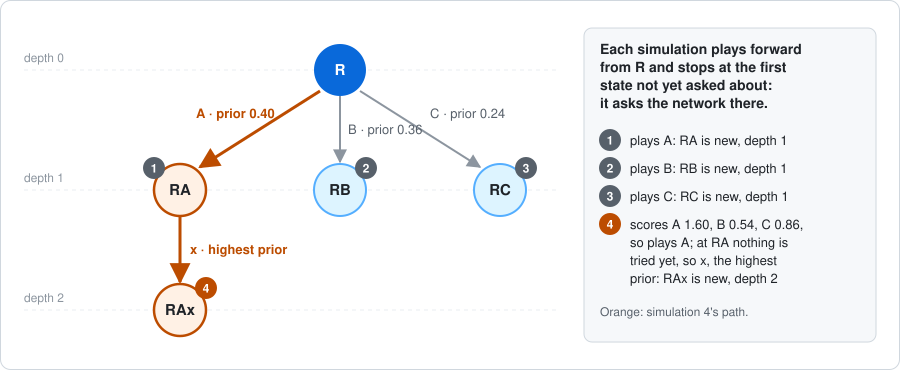

# How gwRL learns

This is the central design document of the learning system: how the program
learns to play the 1936–1941 Japan–China campaign. It builds the system up from
its bricks. Each section defines its parts, with a picture or a real example,
before any later section uses them, and the last sections put the whole training
loop together. One real decision, called decision 612 and introduced in
[section 2](#23-legal-moves-and-the-running-example), is the example throughout.
A section's last part, headed "More detail", can be skipped on a first reading.

The document is revised whenever a question digs into part of the design (see
`AGENTS.md`). The measurements behind its numbers are in the dated
[records of the archive](../archive/README.md#dated-records), which it links to
as evidence. The page
[The network's input](network_input.md) goes deeper into how a decision becomes
numbers.

## Contents

1. [In brief](#1-in-brief)
2. [The game, as the learner sees it](#2-the-game-as-the-learner-sees-it)
3. [What a network gives at a decision](#3-what-a-network-gives-at-a-decision)
4. [Choosing a move: search](#4-choosing-a-move-search)
   - [4.1 Why search](#41-why-search) · [4.2 One simulation](#42-one-simulation) ·
     [4.3 The search score](#43-the-search-score-of-a-move) ·
     [4.4 A toy search](#44-a-toy-search) ·
     [4.5 After the simulations](#45-after-the-simulations-visits-and-shares) ·
     [4.6 A real search](#46-a-real-search-decision-612) ·
     [4.7 More detail](#47-more-detail-on-the-search)
5. [How a decision becomes numbers](#5-how-a-decision-becomes-numbers)
   - [5.1 Questions and answers](#51-questions-and-answers) ·
     [5.2 Three parts](#52-three-parts-the-board-the-position-and-the-moves) ·
     [5.3 Grids of answers](#53-the-input-as-grids-of-answers) ·
     [5.4 A move's answers](#54-a-moves-answers-and-the-zones-it-is-linked-to) ·
     [5.5 Facts that never change](#55-facts-that-never-change) ·
     [5.6 More detail](#56-more-detail-how-the-encoder-builds-the-input)
6. [Inside a network, brick by brick](#6-inside-a-network-brick-by-brick)
   - [6.1 Vectors](#61-vectors) · [6.2 Learned layers](#62-learned-layers) ·
     [6.3 The first layer](#63-the-first-layer-rows-and-tables) ·
     [6.4 A zone's vector](#64-a-zones-vector) ·
     [6.5 Position and move vectors](#65-the-position-vector-and-the-move-vectors) ·
     [6.6 Messages](#66-messages-along-the-borders) ·
     [6.7 The values](#67-the-values) ·
     [6.8 The move probabilities](#68-the-move-probabilities) ·
     [6.9 The whole network](#69-the-whole-network) ·
     [6.10 More detail](#610-more-detail-how-other-game-networks-read-their-input)
7. [Self-play and training samples](#7-self-play-and-training-samples)
8. [Training the networks](#8-training-the-networks)
   - [8.1 The loss](#81-the-loss) · [8.2 The gradient](#82-the-gradient) ·
     [8.3 Adam](#83-adam) ·
     [8.4 Steps and updates](#84-one-training-step-and-one-update) ·
     [8.5 Which numbers a step moves](#85-which-numbers-a-step-moves) ·
     [8.6 Why a few random samples](#86-why-a-few-random-samples-per-step) ·
     [8.7 How often a sample is drawn](#87-how-often-a-sample-is-drawn)
9. [The whole loop, and running it](#9-the-whole-loop-and-running-it)
10. [Measuring strength](#10-measuring-strength)
11. [Known gaps and open questions](#11-known-gaps-and-open-questions)
12. [Glossary](#12-glossary)

## 1. In brief

Three agents, one per alliance (Axis, Allies and Comintern), learn the campaign
by playing it against each other many thousands of times, in the manner of
AlphaZero:

- **They look ahead before they move.** At every decision the agent whose turn
  it is plays possible continuations on copies of the game, a *search*
  (section 4), guided by its own neural network (sections 3, 5 and 6).
- **They keep some of their decisions** as training *samples*: each with what the
  search preferred there and how the game ended (section 7).
- **They learn from them.** Play comes in *batches* of games. After each batch,
  an *update* adjusts each network to propose what the search preferred and to
  predict how games end (section 8). Better networks make the next searches
  better, and the loop repeats (section 9).

Whether that works for this game on this hardware is unproven: no run has yet
shown robust playing strength ([section 10](#10-measuring-strength)).

## 2. The game, as the learner sees it

The rules are written in C++ (`src/`, `include/game/`) and reach Python as
`gwrl_cpp.CampaignEnv`, wrapped by `studies/shared/campaign_adapter.py`.

### 2.1 Alliances and nations

Each alliance plays for its nations: the Axis for Japan, the Allies for the KMT,
and the Comintern for the CCP and Mongolia. The eight Chinese warlords start
under nobody's control; some rules can later hand one to an alliance.

### 2.2 Positions: decisions, chance events and the end

A *position* is everything about the game at one moment. A game is a chain of
positions, and each position is one of three kinds:

- **a decision:** one alliance chooses one move from a list of *legal moves*, the
  moves the rules allow there;
- **a chance event:** the engine rolls dice;
- **the end** of the game, after the eleventh round (1941).

Reactions are decisions too: the defender picks casualties, an attacker chooses
whether to retreat, and so on. A full eleven-round game holds well over a
thousand decisions.

![A row of five positions joined by arrows: a decision, where one alliance chooses one legal move; a move leads to the next decision, often by the same alliance; a move leads to a chance event, where the engine rolls dice, say for a battle; the dice lead to further decisions, over a thousand of them; the chain ends after round 11 with the final scores. Below: one real game, played on 5 November with the networks after one update (seed 1105), had 1,349 decisions and 183 chance events; its 612th decision is the running example, in round 5 the Comintern choosing the CCP's Combat Movement from 5 legal moves; it ended Axis +49.0, Allies −63.8, Comintern −106.2.](figures/game_positions.svg)

### 2.3 Legal moves, and the running example

**A legal move is a small record:** a kind plus labelled details. The running
example of this document is decision 612 of a game the networks played on
5 November, after their first update
([record](../archive/records/training_sample_2026_11_05.md)). In round 5, during the CCP's
Combat Movement, the Comintern chooses for the CCP. The CCP's mountain infantry in
Shensi has one movement point left and may attack one of four neighbouring zones
the KMT holds, Hopeh, Suiyuan, Szechwan or Tsinghai, or the CCP may end its Combat
Movement. So the decision has 5 legal moves. The attack on Hopeh, as the engine
writes it:

| Detail | Value |
| --- | --- |
| `kind` | `movement_route` |
| `unit` | `setup_ccp_land_china_shensi_mountain_infantry_1` |
| `path` | `[land_china_shensi, land_china_hopeh]` |
| `combat` | `true` |
| `mode` | `ordinary` |

The other three attacks differ only in the path's second zone. The fifth move,
ending the phase, has the kind `end_phase` and no details. Long orders, such as a
fleet's, are built one step at a time with bounded choices: see
[the rules engine, section 3](../engine/README.md#3-positions-and-moves).

### 2.4 The final score

Only the end of the game is scored; there is no reward along the way. Each
alliance's wealth is its income plus a tenth of the value of its units, its
infrastructure, its treasury and its paid construction. Its score is its own
wealth minus the other two alliances' wealth combined
(`src/campaign_objective.cpp`). The three scores form one list,
`[Axis, Allies, Comintern]`. The game of decision 612 ended Axis +49.0, Allies
−63.8 and Comintern −106.2.

### 2.5 What the learner asks of the engine

The legal moves, play a move, roll the dice, is the game over, the final scores,
a copy of the game for search, and the position's *planning key*, a text that
identifies a position exactly.

## 3. What a network gives at a decision

In reinforcement-learning terms an agent needs a *policy*, how likely it is to
choose each legal move, and a *value function*, how good a position is for it.
Here one neural network per alliance gives both, for any decision its alliance
faces (`CampaignPolicyValueNet` in `studies/campaign/neural.py`). Given a
decision, it returns:

- **three values:** its estimates of the three alliances' final scores. Inside,
  the network works in hundreds of points: it outputs 0.251 for a score of +25.1.
- **a probability for every legal move,** adding up to 1: its first guess at
  which move to play. The search (section 4) calls these the moves' *priors*.

This is what the Comintern's network gave at decision 612:

![Left: decision 612, what the network is given: the position (the board, round 5, Combat Movement, the CCP's turn) and the 5 legal moves: 1 to 4, the mountain infantry in Shensi attacking Hopeh, Suiyuan, Szechwan or Tsinghai, and 5, ending Combat Movement. Middle: the Comintern's network, 4.1 million learned numbers. Right, what it gives: values, its estimate of each alliance's final score: Axis +25.1, Allies −42.4, Comintern −102.4; and move probabilities, its first guess, which the search calls priors: 0.10, 0.10, 0.09, 0.18 and 0.53 for moves 1 to 5.](figures/network_outputs.svg)

The network gives values for all three alliances, not only its own, because a
search (section 4) needs to know how each position it reaches looks to whichever
alliance chooses there.

Until section 6 the network is a closed box: what goes in and what comes out is
all the next section needs. Inside are 3.9 million learned numbers, its
*parameters*; training (section 8) adjusts them. Section 5 shows how a decision
is turned into numbers the network can read, and section 6 how it turns them into
values and probabilities.

The first guess is not the last word. At decision 612 the network favoured
ending the phase, 0.53, over the attack on Hopeh, 0.10. The search, looking
ahead, preferred the attack ([section 4.6](#46-a-real-search-decision-612)), and
the game ended with the Comintern at −106.2 where the network had predicted
−102.4.

## 4. Choosing a move: search

### 4.1 Why search

The network answers in one look. A search looks ahead: it plays moves on copies
of the game, asks the network about the positions it reaches, and combines the
answers. Where looking ahead finds something the one look missed, the search
chooses better than the network alone. The search is Monte Carlo tree search in
AlphaZero's style (`studies/shared/multiplayer_mcts.py`, class `VectorMCTS`),
made of many *simulations*: 64 per decision in current runs.

### 4.2 One simulation

**Every simulation starts from the same place: the current position.** It plays
on its own copy of the game, so the real game does not change. It does not play
to the end of the game: it walks forward only until it reaches a position that no
earlier simulation has asked the network about, asks about that one, and stops.
So the first simulations look one move ahead, and later ones look further along
the continuations that earlier ones found promising.

**What the simulations find is kept in a tree,** which the next simulation reads.
For every position the search has met, the tree holds the moves tried there,
each with its *visit count*, how many simulations played it, and the total of the
values those simulations found.

**One simulation, step by step:**

1. Copy the game at the current position (`clone_for_search`).
2. At a decision the search has already asked the network about, give every
   legal move a search score (section 4.3) and play the move with the highest
   score on the copy; a tie is broken at random.
3. At a chance event, roll the dice on the copy.
4. At a decision no simulation has asked the network about yet, ask the deciding
   alliance's network for the position's values for all three alliances and a
   prior for each legal move, and stop.
5. Stop also at the end of the game, using the true scores; on returning to a
   position already on this simulation's path; or after 16 steps, the depth
   limit. The last two use an estimate of the position reached
   ([section 4.7](#47-more-detail-on-the-search)).
6. Add the three values found to every position and move on the path, with one
   more visit each.

### 4.3 The search score of a move

In item 2 above, the search gives each legal move a *search score*, the sum of
two terms:

$$
\text{search score} = \underbrace{\frac{\bar v - v_{\min}}{v_{\max} - v_{\min}}}_{\text{first term}} + \underbrace{c_{\text{puct}} \times P \times \frac{\sqrt{N + 1}}{n + 1}}_{\text{second term}}
$$

- **The first term, what earlier simulations found.** $\bar v$ is the move's
  average result so far for the alliance that is choosing. A simulation's result
  is the network's value of the position where it stopped, or the true final
  scores at the end of the game. $v_{\min}$ and $v_{\max}$ are the lowest and
  highest averages, for that alliance, that any move anywhere in this search's
  tree has had so far; the range only widens. So the first term places the
  move's average on a scale from 0, the worst seen, to 1, the best. Until the
  search has seen two different averages the scale has no width, and every
  tried move's first term is 0.5. A move no simulation has tried yet gets 1, as
  good as the best, so untried moves usually come first.
- **The second term, what the network expected.** $P$ is the move's prior, $n$
  how many simulations have played this move here, $N$ how many have played any
  move here, and $c_{\text{puct}}$ is 1.5. It is large for a move the network
  likes that has been tried little, and it shrinks each time the move is tried.

Each alliance judges moves by its own value: this is Max-N search, not a search
for an equilibrium. Values are rescaled per alliance before they enter the score.

### 4.4 A toy search

The current position R has three legal moves, A, B and C. Before the first
simulation the search asks the network about R, which gives priors for A, B and
C: say 0.40, 0.36 and 0.24.

Simulations 1 to 3 each try a move nobody has tried, and simulation 4 goes one
move deeper. Before each simulation the search scores the three moves, first term
plus second term:

| Before simulation | A | B | C | Plays |
| ---: | ---: | ---: | ---: | --- |
| 1 | 1 + 0.60 = 1.60 | 1 + 0.54 = 1.54 | 1 + 0.36 = 1.36 | A |
| 2 | 0.5 + 0.42 = 0.92 | 1 + 0.76 = 1.76 | 1 + 0.51 = 1.51 | B |
| 3 | 1 + 0.52 = 1.52 | 0 + 0.47 = 0.47 | 1 + 0.62 = 1.62 | C |
| 4 | 1 + 0.60 = 1.60 | 0 + 0.54 = 0.54 | 0.5 + 0.36 = 0.86 | A |

- **Before simulation 1** nothing has been tried, so every first term is 1 and the
  priors decide.
- **Before simulation 2** A has the only result seen, so its first term is 0.5.
- **Before simulation 3** say A's simulation ended better than B's: A's average
  rescales to 1 and B's to 0. C, untried, still gets 1, and its larger second
  term wins.
- **Before simulation 4** say C's result lay halfway between A's and B's, so it
  rescales to 0.5. Each move has one visit of three, so its second term is
  $1.5 \times P \times \sqrt{3 + 1} \div (1 + 1)$, 0.60 for A.

So simulation 4 plays A. At RA no move has been tried, so every first term is 1
and the move with the highest prior, x, wins. RAx is new, so the simulation stops
there.

So a simulation chooses its path one step at a time, by these scores, at every
position it passes. It does not look for the deepest branch: it goes deep only
where the scores keep sending it. Each simulation adds one new position to the
tree, so the continuations the scores keep choosing are explored deeper and
deeper.

### 4.5 After the simulations: visits and shares

**Visits and shares.** After all 64 simulations, the number of times each first
move was tried, its visit count, shows the search's preference. A move's *share*
is its visit count divided by the number of simulations. The move actually played
is drawn at random in proportion to the visit counts (temperature 1), and the
shares become part of a training sample (section 7).

**How the shares come to differ from the priors.** A move whose simulations keep
scoring better than the others' is chosen again and again, until its second term
has shrunk enough for the others to catch up. Moves whose results are about the
same share the remaining simulations roughly in proportion to their priors, since
only the second term tells them apart. So the shares end up far from the
network's priors mainly where the search found a move better than the rest: that
move gains, and every other move gives up simulations in proportion to its prior.

**Exploration noise.** During training, random noise (Dirichlet, alpha 0.3,
mixed in at 25%) is added to the network's priors at the position being decided,
the root of the search tree, so the search sometimes tries moves the network
dislikes. Held-out evaluation, which measures strength (section 10), turns it off.

**A decision with only one legal move** is played at once, with no search and no
network call.

### 4.6 A real search: decision 612

At decision 612 the noise changed the five priors of [section
3](#3-what-a-network-gives-at-a-decision): it lowered the attack on Hopeh from
0.10 to 0.085 and ending the phase from 0.53 to 0.40, and raised the attacks on
Szechwan and Tsinghai to 0.177 and 0.268. The simulations ran one after another,
numbered 1 to 64 in the order they ran. Each began by scoring the five moves and
playing the move with the highest score. The figure shows the move each began with
([trace](../archive/records/training_sample_2026_11_05.md#how-the-64-simulations-were-spent)).

![The 64 simulations of the search at decision 612, numbered in the order they ran, in two rows of 32, each marked with the move it began with. Simulations 1 to 14 tried every move; the two that began with the attack on Hopeh, 6 and 11, stopped before its battle. Simulation 15 was the first to play through the battle, in which the CCP takes Hopeh, at a position rated −101.42. From 15 to 51 the attack on Hopeh was chosen 32 times out of 37; simulation 33's scores are in the table below. Simulation 53 stopped at the depth limit at a position rated −106.02, and simulations 54 to 64 all began with the other moves.](figures/sample_simulations.svg)

**Simulations 1 to 14** tried every move. The attack's two, simulations 6 and 11,
stopped before its battle, with Hopeh still the KMT's, and scored like every
other move: about −102.2 for the Comintern.

**Simulation 15** was the first to play on through the end of Combat Movement and
the battle, which the CCP won. The network rated the position it reached, with
the CCP holding Hopeh, −101.42: better than any result before it.

**Simulations 15 to 51** began with the attack 32 times out of 37. From 15 on,
all 34 of its simulations stopped at positions where the CCP held Hopeh, and the
network rated 24 of them between −101.43 and −101.16; no simulation of another
move did better than −102.16. The table gives the five scores just before
simulation 33, after 32 simulations:

| Move | Simulations so far ($n$) | Average result for the Comintern ($\bar v$) | First term | Prior after noise ($P$) | Second term | Score |
| --- | ---: | ---: | ---: | ---: | ---: | ---: |
| Shensi → Hopeh | 18 | −101.50 | 0.77 | 0.085 | 0.04 | **0.81** |
| Shensi → Suiyuan | 1 | −102.40 | 0.16 | 0.072 | 0.31 | 0.47 |
| Shensi → Szechwan | 1 | −102.63 | 0.00 | 0.177 | 0.76 | 0.76 |
| Shensi → Tsinghai | 7 | −102.26 | 0.25 | 0.268 | 0.29 | 0.54 |
| End Combat Movement | 5 | −102.39 | 0.17 | 0.399 | 0.57 | 0.74 |

**The first term** places a move's average on a scale that runs from the worst
average the search had met so far, which counts as 0, to the best, which counts
as 1. Before simulation 33 these were −102.63, the result of the Szechwan
attack's one simulation, and −101.16, the result of simulation 20, deep in the
attack's continuation. (A move that only one simulation has tried has that simulation's
result as its average.) The attack's average sat 77% of the way up:

$$
\frac{-101.50 - (-102.63)}{-101.16 - (-102.63)} = \frac{1.13}{1.47} \approx 0.77
$$

The other moves' averages lay 0 to 0.37 points above the worst, 0 to 25% of the
way up. The attack's lead over the next best move, Tsinghai, was 0.76 points:
small next to final scores in the tens or hundreds, but the results this search
had seen spanned only 1.47 points, so on its scale the lead was large.

**The second term** was small for the attack, because it had already been tried
18 times:

$$
1.5 \times 0.085 \times \frac{\sqrt{32 + 1}}{18 + 1} \approx 0.04
$$

Szechwan's was 0.76: it had been tried once, and the noise had raised its prior
to 0.177. The attack's score, 0.81, still beat Szechwan's 0.76, so simulation 33
began with the attack. Five of simulations 15 to 51, numbers 16, 32, 38, 42 and
51, began with another move, whose second term outweighed the attack's lead at
that moment.

**Simulation 53**, one of the attack's, went 16 steps deep, to the depth limit,
and reached a new position where Japan decides. So the Axis network rated it, the
only one of the search's 64 stops rated by that network alone, and it put the
Comintern at −106.02, far below anything before. Five of the attack's simulations
reached the depth limit: 44, 49, 50, 52 and 53. The low value says more about
the network than the position: simulations 49 and 50 stopped at chance events,
which all three networks rate together
([section 4.7](#47-more-detail-on-the-search)), and there the Axis network gave
the Comintern about 5 points less than the Comintern's own network did
([record](../archive/records/depth_limit_2026_11_09.md#simulation-53-at-decision-612)).
The bottom of the scale, at −102.64 since simulation 38 tried Szechwan again,
moved to −106.02, so all five first terms
crowded between 0.70 and 0.90, and the second terms decided: 0.025 for the
attack after 36 simulations, 0.37 to 0.65 for the others. Simulations 54 to 64
all began with the other moves. So the attack ended with 36 of the 64, although
the exploration noise had lowered its prior from 0.10 to 0.085.

**The other moves shared what was left, by prior.** Their simulations scored
about the same, −102.3 to −102.5 on average, so only the second term of the
score told them apart. That term grows with the prior, so the remaining 28
simulations went to them roughly in proportion to their priors after the
noise, which left each with about half that prior:

| Move | Network's probability | Prior after noise | Visits if the 28 went exactly by that prior | Visits | Share |
| --- | ---: | ---: | ---: | ---: | ---: |
| Shensi → Suiyuan | 0.10 | 0.07 | 2.2 | 2 | 0.03 |
| Shensi → Szechwan | 0.09 | 0.18 | 5.4 | 5 | 0.08 |
| Shensi → Tsinghai | 0.18 | 0.27 | 8.2 | 9 | 0.14 |
| End Combat Movement | 0.53 | 0.40 | 12.2 | 12 | 0.19 |

Ending Combat Movement had by far the largest prior, so it lost the most: the
noise cut 0.53 to 0.40, and halving left 0.19. The other three started small.
The noise had raised Szechwan's and Tsinghai's priors, and halving brought them
back near the network's numbers; Suiyuan's fell to a third, but only from 0.10
to 0.03. Their agreement is a coincidence of small numbers, not the search
confirming the network: it found no difference among them.

The attack on Hopeh ended with a share of 0.56. The move played was drawn from
the shares, and it was the attack.

### 4.7 More detail on the search

**Depth** is how many steps a simulation took from the current position before it
stopped, counting moves and dice rolls. The *depth limit* is the most steps a
simulation may take: 16 in current runs (`--max-depth 16` in the training command,
`MctsConfig.max_depth` in the code; held-out evaluation, section 10, takes its
own, 4 unless set). After its 16th step a simulation stops wherever it is, even at
a position the tree already holds, and uses an estimate of that position:

| What the 16th step reached | What the simulation uses |
| --- | --- |
| A decision no simulation has asked the network about | The deciding alliance's network's value, as at any new position, so the limit changes nothing |
| A decision asked about before | The value its network gave it then; nothing new joins the tree |
| A chance event | The average of the three networks' values, since no alliance decides there |

**Why there is a limit.** It is as old as the search (commit `6480d5b`, 23
October). That first version had nothing else to end a simulation caught in a
loop: some sequences of moves could bring the game back to exactly a position
already on the simulation's path, and on such a loop every position is already in
the tree, so the rule to stop at a new position never fires. Two hours later the
search began to stop at such a repetition (item 5 of the list in section 4.2,
commit `47eb3d6`). Since then a simulation ends without the limit too: it never
repeats a position, it stops at the first decision no simulation has asked the
network about, and each simulation adds at most one such decision to the tree, so
no walk can outrun what earlier simulations added. What the limit does now is cap
how far ahead a search can look along one continuation. Like the other learning
settings, 16 is the value of the 2 November speed test (section 9.2), not a tuned
one.

**How much it matters** ([record](../archive/records/depth_limit_2026_11_09.md)). A
replay of the game of decision 612, with the networks after one update, ran
68,800 simulations in 1,075 searches: 41% stopped after one step, 90% within five
and 18 at the limit, in 10 searches, all at decisions with two to five legal
moves, where the simulations crowd into few continuations; none returned to a
position
already on its path. Nine of the 18 had reached a new position and would have
stopped there anyway; eight stopped at a chance event and one at a known
decision. Searched again without the limit, those ten positions' deepest
simulations took 16 to 19 steps; at five of them 1 to 6 of the 64 visits moved to
other moves, and the most-visited move stayed the same at all ten. So in this
game the limit hardly mattered. At the eight chance events, though, the three
networks' values for the same position differed by 2.5 to 17 points, more than a
search's moves usually differ;
[section 11](#one-network-per-alliance-or-one-shared-network) takes that up.
Better-trained networks may crowd the simulations into fewer continuations and
meet the
limit more often; that has not been measured.

**What the search remembers.** The tree holds, for every position the search has
met, identified by its planning key, the moves tried there with their visit
counts, value totals and priors (`Node` and `Edge`), and a saved copy of the game
at that position (`Node.game`). A simulation walks the tree on these saved
positions. Following a move already played from a position needs only the tree:
the engine rolls no dice inside a move, so a move from a position always reaches
the same position. The simulation copies a saved position only to play a move no
simulation has played from there yet, or to roll dice. In the toy example,
simulation 4 follows A to RA in the tree alone, copies the saved RA and plays only
x.

**The dice.** Each simulation rolls its own dice, from a stream seeded per
simulation, so one move can lead to different outcomes in different simulations,
and the tree keeps a branch per outcome; the real game's dice are untouched.
Each copy a simulation makes continues that simulation's stream where its last
copy left it (`clone_for_search_continuing`), so the dice come out exactly as if
the simulation had played its whole path on one copy.

**A search at a larger decision**
([measurements](../archive/records/search_replays_2026_11_04.md)). At a round-5 Japanese
Combat Movement decision with 24 legal moves, the network was asked 65 times: once
for the current position and once per simulation. 24 simulations, all among the
first 31, each tried a different one of the 24 moves and stopped after one step.
The other 40 went deeper, 37 of them through two moves, which ended with 27 and 12
of the 64 visits: 21 stopped after two steps and the rest after three to nine. The
deepest, nine steps, chose to end Combat Movement and followed positions earlier
simulations had evaluated: the start of a battle, a retreat, a retreating unit and
the next battle, with four dice rolls on the way. The 64 simulations together
played 57 moves and 38 dice rolls, and the tree kept 77 positions. At a decision
with 104 legal moves, 55 of the 64 simulations stopped after one step.

**What the copies cost and save.** Every position the search reaches still comes
from the real rules, played by the engine. A saved copy takes about 144 KB, so
that tree held about 11 MB; each tree is dropped after its decision. Until
4 November the tree kept no positions, and every simulation copied the current
position and played its whole path again: 123 moves instead of 57 in the example,
and about half of the time the game threads (section 9.2) spent not waiting for
the network
([measurements](../archive/records/search_replays_2026_11_04.md)). Saving copies gave
identical search results on 151 real positions and played 59% fewer moves. In a
matched training batch it raised games per hour while playing from 152 to 184,
for 0.5 GB more peak memory ([record](../archive/records/search_copies_2026_11_04.md)).

## 5. How a decision becomes numbers

A network computes with numbers, so every decision it is asked about is first
turned into numbers: the network's *input*. The engine's encoder
(`src/zone_encoding.cpp`) builds it once per decision. Search copies of the same
position share it, and a training sample stores it (section 7).

### 5.1 Questions and answers

**A question** is a numbered slot with one fixed meaning, such as "how many CCP
mountain infantry are in this zone?". Its name, here
`units:ccp:mountain_infantry`, is a readable label for that meaning; the network
only sees the number. A name is built as `family:part:part`. The *family* says
what kind of fact it is, `units` being how many units of a nation and type are
somewhere, and the parts say which nation, which unit type, which zone and so on.

**An answer** is a whole number: a count ("how many?"), 1 for "yes", or a value
such as the round. Almost every answer is 0, so only the non-zero answers are
stored.

These are all the non-zero answers of the zone Shensi at decision 612:

| Question | Answer | Meaning |
| --- | ---: | --- |
| `possessor:ccp` | 1 | the CCP holds Shensi |
| `turn_start_possessor:ccp` | 1 | and held it when the turn began |
| `units:ccp:militia` | 1 | one CCP militia is here |
| `units:ccp:mountain_infantry` | 1 | one CCP mountain infantry |
| `unit_stat:comintern:militia:count` | 1 | one Comintern militia |
| `unit_stat:comintern:militia:move_0` | 1 | ... with no movement points left |
| `unit_stat:comintern:mountain_infantry:count` | 1 | one Comintern mountain infantry |
| `unit_stat:comintern:mountain_infantry:move_1` | 1 | ... with 1 movement point left |
| `rail_to:land_china_hopeh` | 1 | a railroad runs from here to Hopeh |

Shensi's other 42,523 zone questions have the answer 0. Hopeh, next door, has 28
non-zero answers: the KMT holds it and is building a fortification and a major
shipyard there, and none of its answers says a unit is there.

### 5.2 Three parts: the board, the position and the moves

The input for one decision has three parts:

1. **The board:** each of the 37 zones (31 land, 6 sea) answers the same list of
   42,532 zone questions, such as `units:ccp:mountain_infantry`.
2. **The position as a whole:** one list of 4,076 position questions, such as the
   round, the phase, whose turn it is, treasuries and wars.
3. **Each legal move:** every move on the menu answers the same list of 12,627
   move questions about itself, such as which kind of move it is, which unit it
   moves and which zones it names.

At decision 612 the board has 840 non-zero answers, from 2 in Szechwan to 86 in
sea zone P14, the position 176, and the moves 80: 19 for each attack and 4 for
ending the phase.

### 5.3 The input as grids of answers

Picture each part as a grid of answers: the board as one line per zone and one
column per zone question, the position as one line, and the moves as one line per
legal move. That is why questions are also called *columns*. Almost every cell
is 0, and only the non-zero cells are stored.

![Two grids of real answers from decision 612. The board: one line per zone, one column per zone question; shown are Shensi, Hopeh, Suiyuan, Szechwan and Tsinghai, and 8 of the 42,532 columns. Shensi answers 1 to possessor:ccp, units:ccp:militia, units:ccp:mountain_infantry and rail_to:land_china_hopeh; Hopeh 1 to possessor:kmt and project:kmt:fortification; Suiyuan 1 to possessor:kmt and 3 to units:kmt:militia; Szechwan 1 to possessor:kmt; Tsinghai 1 to possessor:kmt, 1 to units:kmt:militia and 2 to units:kmt:infantry; every other cell shown is 0. In all, Shensi has 9 non-zero answers, Hopeh 28, Suiyuan 12, Szechwan 2 and Tsinghai 13, and the 37 zones 840. The position: one line of 4,076 questions, with round 5, completed_rounds 4, rounds_left 7, phase:combat_movement 1, turn_nation:ccp 1, turn_nation:japan 0 and phase:noncombat_movement 0; 176 non-zero answers in all.](figures/answer_grid.svg)

A line of a grid holds one zone's, the position's or one move's answers. In the
usual picture of a neural network, the lines are its input layer, which the
network's first layer reads ([section 6.3](#63-the-first-layer-rows-and-tables)).
A line is not what section 6 calls a row: a row holds learned numbers.

### 5.4 A move's answers, and the zones it is linked to

![A grid of real answers from decision 612's five legal moves, one line per move, with 10 of the 12,627 move columns. Each of the four attacks answers 1 to kind:movement_route, unit:0_source:ccp:mountain_infantry, unit_stat:0_source:move_1, zone:1_path:land_china_shensi, the path column of its own destination and true:combat, and has 19 non-zero answers in all; ending the phase answers 1 to kind:end_phase and has 4. On the right, the links: each attack starts from Shensi and acts on its destination; ending the phase links to no zone. In all 80 non-zero answers.](figures/move_answers.svg)

These are all 19 answers of the attack on Hopeh:

| Question | Answer | Meaning |
| --- | ---: | --- |
| `schedule:play`, `player:comintern`, `nation:ccp` | 1 each | an ordinary move in play, the Comintern choosing for the CCP |
| `kind:movement_route` | 1 | a movement |
| `parameter:combat`, `parameter:mode`, `parameter:path`, `parameter:unit` | 1 each | it has these four details |
| `unit:0_source:ccp:mountain_infantry` | 1 | the unit that acts is a CCP mountain infantry |
| `unit_stat:0_source:count` | 1 | one unit |
| `unit_stat:0_source:move_1` | 1 | with 1 movement point left |
| `unit_zone:0_source:land_china_shensi` | 1 | standing in Shensi |
| `unit_turn_origin:0_source:land_china_shensi` | 1 | where it started the turn |
| `unit_rank:0_source:0` | 1 | the first of the identical mountain infantry there |
| `zone:1_path:land_china_shensi`, `zone:1_path:land_china_hopeh` | 1 each | its path goes through Shensi and Hopeh |
| `list_length:path` | 2 | the path has 2 zones |
| `value:mode:ordinary` | 1 | ordinary movement |
| `true:combat` | 1 | it starts a combat |

Ending the phase has only the four answers every move has: `schedule:play`,
`player:comintern`, `nation:ccp` and `kind:end_phase`.

**Zones in a move's questions.** A board answer belongs to its zone's line, so a
zone question never names its zone. A move involves several zones, so a move's
answer about a zone names it inside the question, as in
`zone:1_path:land_china_hopeh`. The parts `0_source` and `1_path` are *roles*:
they say whether a detail names what acts, the route, or what the move acts on
([details](network_input.md#roles)).

**Links.** Each move is also linked to three places on the board: the zone it
starts from, the zone it acts on and its path's zones. The attack on Hopeh starts
from Shensi, acts on Hopeh and travels through Shensi and Hopeh; ending the phase
names no zone. Through the links the network reads those zones' descriptions
together with the move's own answers
([section 6.8](#68-the-move-probabilities)).

### 5.5 Facts that never change

Some facts never change during a game, so they come with the layout once, not
with each decision:

- **39 facts per zone,** such as terrain, production value, capitals, victory
  cities, original owners and home countries. Shensi's: it is land, worth 2 IPP,
  mountainous, originally the CCP's, and part of the CCP's and the KMT's home
  countries; its other 33 facts are 0.
- **22 facts per border.** The map has 80 borders, each counted in both
  directions: 160 *directed borders*. The border from Shensi to Hopeh is land to
  land, crosses a river, carries a railway connection and is passable.

The *layout version*, now `campaign-zone-v1-9e192fe5c085f13e`, is a hash of every
question name and every fixed fact. A network refuses inputs of another layout,
and a run cannot resume across a layout change.

### 5.6 More detail: how the encoder builds the input

The encoder reads the engine's memory directly; no text is written or parsed.
The engine holds zones, nations, unit types, facility types and technologies
as numbers, and each one's number is its column in the encoder's list of its
kind ([names held as numbers](../engine/names.md)). Marks are numbered too, but the encoder asks
about them through its own lists of their names. Everything else it identifies
by name (battle notes, a move's details), so the encoder translates those
names into question numbers through fixed lists. Encoding costs about 0.17 ms per decision, about 4% of a
game process's work.

[The network's input](network_input.md) explains the families, the roles, how
each kind of detail becomes answers, how the lists of names are kept complete,
which questions were removed as impossible, and why the engine works with names.

## 6. Inside a network, brick by brick

This section opens the box of [section 3](#3-what-a-network-gives-at-a-decision).
It builds a network from small parts and shows each on decision 612, with the
Comintern's network after its first update, the network that faced that decision.
A network's size is written width × message layers, both explained below: 64×2
here and in the Mac profile's measurements (section 9.2), 256×8 in the night run
of 2 November.
Which plays better, and how big a network this game needs, is
[open](#how-big-should-the-network-and-the-search-be).

In the usual picture of a neural network, the lines of answers of section 5 are
its *input layer*, and learned layers follow. Section 6.2 defines a learned
layer, and section 6.3 shows the first one, the layer that reads the answers.
Nothing else stands between the answers and the network: the rest of this
section builds on that first layer.

### 6.1 Vectors

A *vector* is a list of numbers. Inside the network, every zone, the position as a
whole and every legal move is described by a vector of 64 numbers, the network's
*width*. At decision 612, Shensi's vector begins −0.294, 1.957, −1.422, −0.203,
and goes on to 64 numbers ([section 6.4](#64-a-zones-vector) derives them).

A vector is the network's own description of its zone, position or move: no
number in it has a meaning chosen by hand. The network computes every vector from
the answers of section 5 and its learned numbers, and training (section 8) adjusts
the learned numbers until the vectors are useful for predicting values and good
moves.

### 6.2 Learned layers

A *learned layer* turns a vector of $n$ numbers into a vector of $m$ numbers: it
multiplies it by a learned matrix of $m \times n$ numbers, its *weights*, adds a
learned vector of $m$ numbers, its *bias*, and most layers then bend each result
with a fixed curve, GELU. A toy layer with 3 inputs, 1, 2 and 3, and 2 outputs,
$y_1$ and $y_2$, whose weights are 0.5, 0.2 and 0.1, with bias 0.1, for the first
output, and 0.1, 0.3 and −0.4, with bias 0, for the second:

$$
y_1 = \operatorname{GELU}(0.5 \times 1 + 0.2 \times 2 + 0.1 \times 3 + 0.1) = \operatorname{GELU}(1.3) \approx 1.17
$$

$$
y_2 = \operatorname{GELU}(0.1 \times 1 + 0.3 \times 2 - 0.4 \times 3 + 0) = \operatorname{GELU}(-0.5) \approx -0.15
$$

The figure draws this layer the usual way, as Sutton and Barto do in
*Reinforcement Learning: An Introduction* (2nd edition, section 9.7): each input
and each output is a *unit*, every input unit has a *link* to every output unit,
and every link carries one weight.

![The toy layer drawn as units and links. Left: three input units hold 1, 2 and 3, and two output units are y1 and y2. Every input is linked to every output, and each link carries one learned weight: from input 1, 0.5 to y1 and 0.1 to y2; from input 2, 0.2 and 0.3; from input 3, 0.1 and −0.4. With the biases 0.1 and 0, y1 adds up to 1.3, which GELU turns into 1.17, and y2 to −0.5, which becomes −0.15. Right: the same layer read input by input. The weights that leave one input are its row: input 1's row is (0.5, 0.1), input 2's (0.2, 0.3) and input 3's (0.1, −0.4). 1 × (0.5, 0.1) + 2 × (0.2, 0.3) + 3 × (0.1, −0.4) + (0.1, 0) = (1.3, −0.5) before the curve. An input of 0 adds nothing, so its row can be skipped.](figures/learned_layer.svg)

**A row: the weights that leave one input.** Read by input instead of by output,
the layer is a sum of rows. The weights on the links that leave one input, one
for each output, are that input's *row*: input 1's row is (0.5, 0.1). Before the
curve, the outputs are each input times its row, added up, plus the bias:

$$
(1.3, -0.5) = 1 \times (0.5, 0.1) + 2 \times (0.2, 0.3) + 3 \times (0.1, -0.4) + (0.1, 0)
$$

An input of 0 adds nothing, so a layer can skip the rows of its zero inputs. The
network's first layer, in section 6.3, has almost only such inputs.

**The curve.** GELU multiplies a number by the chance that a standard normal
variable falls below it, $\operatorname{GELU}(x) = x \Phi(x)$: large positive
numbers pass almost unchanged and negative ones are squashed toward 0. Without
such curves any stack of layers would amount to a single multiplication and could
only add effects up.

A layer's weights and biases are parameters, adjusted by training (section 8).
When a layer reads several vectors, they are first joined end to end into one:
three vectors of 64 numbers make one of 192.

**Layer normalization** rescales a vector's numbers to an average of 0 and a
spread (standard deviation) of 1, then multiplies each by a learned number and
adds another. It keeps vectors on a common scale, whatever went into them.

### 6.3 The first layer: rows and tables

**The input layer.** A zone's line of answers (section 5.3) is the input layer for
that zone: one input unit for each of the 42,532 zone questions. An input unit
holds its answer after a fixed scaling, explained below, which turns an answer of
1 into 0.69 and leaves 0 at 0. The first learned layer links every input unit to
each of 64 output units, the 64 places of a vector; as the code computes it, it
has no bias and no curve. Its 64 outputs are the first part of the zone's vector,
to which section 6.4 adds two more.

![Decision 612, the Comintern's network after one update. Left, the input layer: Shensi's line of answers, one input unit per zone question, 42,532 in all, each holding its answer after a fixed scaling, 0.69 for an answer of 1 and 0 for an answer of 0. Shown are rows 0 possessor:ccp (0.69), 1 possessor:dadao (0), 14 turn_start_possessor:ccp (0.69), 186 units:ccp:militia (0.69), 188 units:ccp:mountain_infantry (0.69), 304 units:kmt:fighter (0), 9,841 and 9,842, the Comintern militia's count and moves left (0.69 each), 9,989 and 9,991, the Comintern mountain infantry's count and moves left (0.69 each), 29,244 rail_to:land_china_hopeh (0.69) and the last, 42,531 battle_order (0). Right, the first layer: 64 output units, of which outputs 1 to 4 and 64 are shown, with −0.001, 0.137, −0.118, −0.104 and −0.073. Every input unit has a link to every output unit. The links that leave units:ccp:mountain_infantry carry its row, row 188 of the zone table, beginning 0.019, 0.001, −0.030, 0.021. Each output adds up input times weight over its 42,532 links; the inputs of 0 add nothing, so the output is 0.69 times row 0 plus 0.69 times row 14 and so on to row 29,244, and only 9 rows are fetched. In all 42,532 × 64 = 2,722,048 links, whose weights make up the zone table.](figures/first_layer.svg)

**Rows and tables.** As in the toy layer, the 64 weights on the links that leave
one input unit are that question's *row*. The first layer's weights, stored one
row per question in question order, are a *table*. Each part of the input has its
own first layer and so its own table:

| Table | Rows | One row for each |
| --- | ---: | --- |
| Zone table | 42,532 | zone question |
| Position table | 4,076 | position question |
| Move table | 12,627 | move question |

A question's number is its row's number: `units:ccp:mountain_infantry` is
question 188 of the zone questions, and its row is row 188 of the zone table. In
machine-learning terms a table is an *embedding table* and a row an *embedding*.

**Skipping the zeros: a column lookup.** Each output adds up all 42,532 inputs,
each times its weight, so the 64 outputs together are the sum of every input
times its row. An input of 0 adds nothing, and 42,523 of Shensi's 42,532 inputs
are 0. So the network fetches only the rows of the 9 non-zero inputs, multiplies
each by its input and adds them up. With $x_q$ for the input of question $q$ and
$r_q$ for its row,

$$
\text{output of the first layer} = \sum_{q} x_q r_q
$$

where only the questions with $x_q \neq 0$ count. Multiplying Shensi's whole line
of 42,532 inputs by the zone table, as a matrix multiplication, gives the same 64
numbers (checked: equal to within $3 \times 10^{-8}$, float rounding), but it
would multiply 42,523 zeros. Fetching only the rows of the answered columns is a
*column lookup*. One PyTorch operation, `embedding_bag`, does it for every zone at
once: it fetches each answered row, multiplies it by its input and adds it to its
zone's sum, without first copying the fetched rows into a temporary array (`_bag`
in `studies/campaign/neural.py`, since 12 November;
[record](../archive/records/coordinator_lookups_2026_11_12.md)). The table view
of the same layer, with real rows:

![Top: one row, the 64 learned numbers the Comintern's network keeps for the zone question units:ccp:mountain_infantry, row 188 of its zone table after one update, drawn as 64 coloured cells, blue for negative and red for positive numbers up to ±0.15; its first numbers are 0.019, 0.001, −0.030, 0.021, −0.007, 0.018, −0.015 and −0.028. Left: the zone table, one row per zone question, 42,532 rows of 64 numbers; shown with their row numbers are rows 0 to 3 (possessor:ccp, possessor:dadao, possessor:japan, possessor:kmt), 14 (turn_start_possessor:ccp), 186 and 188 (units:ccp:militia and units:ccp:mountain_infantry), 304 (units:kmt:fighter, still all zeros because no kept sample had a KMT fighter), 9,841, 9,842, 9,989 and 9,991 (Comintern militia and mountain infantry counts and movement points left), 29,244 (rail_to:land_china_hopeh) and the last, 42,531 (battle_order). The 9 rows Shensi's answers pick are highlighted. A fresh network's rows are all zeros; after one update 1,840 have moved. Right: Shensi's 9 answers, each 1, enter as ln 2 ≈ 0.69 each, so Shensi's vector starts as 0.69 times row 0 plus 0.69 times row 14 and so on to row 29,244; the sum's first numbers are −0.001, 0.137, −0.118 and −0.104. The network fetches only these 9 rows: Shensi's other 42,523 answers are 0.](figures/rows_and_tables.svg)

**The scaling of an answer.** An input unit holds not its answer $a$ but a fixed
formula of it, written by hand, not learned (`_signed_log` in
`studies/campaign/features.py`):

$$
x = \operatorname{sign}(a) \ln(1 + |a|)
$$

where $\ln$ is the natural logarithm. Answers are counts and yes-or-no flags, so
in practice $a \ge 0$ and the input is $\ln(1 + a)$; no answer was negative in 60
decisions sampled from a game, and the sign only keeps the formula defined for
negative numbers:

| Answer $a$ | Input $x$ | Compared with an answer of 1 |
| ---: | ---: | ---: |
| 1 | $\ln 2 \approx 0.69$ | 1 |
| 2 | $\ln 3 \approx 1.10$ | 1.58 |
| 3 | $\ln 4 \approx 1.39$ | 2 |
| 10 | $\ln 11 \approx 2.40$ | 3.46 |
| 100 | $\ln 101 \approx 4.62$ | 6.66 |

Larger counts matter more but not in proportion: ten militia add their row 3.46
times as strongly as one, not ten times, so a big stack does not drown out
everything else in its zone. That an answer of 1 counts 0.69 rather than 1 makes
no difference, because the row it multiplies is learned and training can make it
as large as it needs; the formula fixes only how counts compare with one another.
Scaling inputs to comparable sizes before a network is common practice; this
curve was chosen, not compared with others
([open question](#how-should-a-count-count)).

**Shensi's sum, in numbers.** Each of Shensi's answers is 1, so each input is
0.69. The first 4 of the 64 numbers of each row, from the Comintern's network
after one update:

| Question | Its row's first 4 numbers | × 0.69 |
| --- | --- | --- |
| `possessor:ccp` | −0.006, −0.002, −0.028, −0.010 | −0.004, −0.002, −0.020, −0.007 |
| `turn_start_possessor:ccp` | −0.006, −0.003, −0.027, −0.009 | −0.004, −0.002, −0.019, −0.007 |
| `units:ccp:militia` | −0.016, 0.058, −0.030, −0.042 | −0.011, 0.040, −0.021, −0.029 |
| `units:ccp:mountain_infantry` | 0.019, 0.001, −0.030, 0.021 | 0.013, 0.001, −0.021, 0.014 |
| `unit_stat:comintern:militia:count` | −0.016, 0.047, −0.028, −0.048 | −0.011, 0.033, −0.019, −0.034 |
| `unit_stat:comintern:militia:move_0` | −0.016, 0.047, −0.028, −0.048 | −0.011, 0.033, −0.019, −0.034 |
| `unit_stat:comintern:mountain_infantry:count` | 0.019, 0.001, −0.030, 0.021 | 0.013, 0.001, −0.021, 0.014 |
| `unit_stat:comintern:mountain_infantry:move_1` | 0.012, 0.066, 0.004, −0.038 | 0.008, 0.046, 0.003, −0.027 |
| `rail_to:land_china_hopeh` | 0.008, −0.017, 0.025, 0.005 | 0.006, −0.012, 0.018, 0.003 |
| **Sum** | | **−0.001, 0.137, −0.118, −0.104** |

Two pairs of rows are identical, the militia's count and moves left, and the
mountain infantry's `units` and `count` questions: in every sample so far these
questions were answered together, so training moved them alike
([section 8.5](#85-which-numbers-a-step-moves)).

**A row belongs to a question, not to a zone.** `units:ccp:mountain_infantry` has
one row, the network's own description, in 64 numbers, of "a CCP mountain
infantry is here", added in whichever zone that is true. No number in a row has a
meaning chosen by hand. Nor is a row computed from the answer: it stays the same
from position to position until training changes it, and the answer only sets how
strongly it is added.

**Each of a row's numbers is one parameter,** so the zone table alone holds
42,532 × 64 = 2,722,048 parameters, and the three tables 3.79 million of the
network's 3.92 million.

**Rows start at zero** (since 3 November 2026), and training moves a row only when
it trains on samples that answer the row's question
([section 8.5](#85-which-numbers-a-step-moves)). After the first update of the
5 November run, 1,840 of the zone table's 42,532 rows had moved; the row of
`units:kmt:fighter` was still all zeros, because no kept sample had a KMT fighter.
Starting at zero means a question training has never reached adds nothing,
instead of a random row added at full strength. In a test on a fixed set of
saved samples it gave a slightly lower value error on samples held out of
training (0.0076 against 0.0081) and the same policy loss
([section 8.1](#81-the-loss)): no harm shown, not a strength gain.

Computing a first layer by adding up the rows of its non-zero inputs is common
wherever inputs are mostly 0; chess programs compute theirs the same way
([section 6.10](#610-more-detail-how-other-game-networks-read-their-input)).

### 6.4 A zone's vector

A zone's vector, before the borders come in, adds three things and normalizes
the result:

1. **the first layer's output:** the rows of the zone's non-zero answers, each
   times its input (section 6.3);
2. **the zone's identity vector:** 64 learned numbers for each of the 37 zones,
   so the network can tell zones apart. Unlike the tables' rows, these start
   random;
3. **its 39 fixed facts** (section 5.5), turned into 64 numbers by a learned
   layer without a curve.

Then layer normalization rescales the sum. For Shensi at decision 612, the first 4
of the 64 numbers:

| Part | First 4 numbers |
| --- | --- |
| 1. The first layer: 9 rows, each times 0.69 | −0.001, 0.137, −0.118, −0.104 |
| 2. Shensi's identity vector | 0.204, 1.874, −1.609, 0.437 |
| 3. Its fixed facts, through a learned layer | −0.449, −0.205, 0.425, −0.504 |
| Total | −0.246, 1.807, −1.302, −0.171 |
| After layer normalization: Shensi's vector | −0.294, 1.957, −1.422, −0.203 |

**Still one layer, in the usual picture.** The identity vector is the row of one
more kind of input: 37 input units that say which zone this is, 1 for Shensi and
0 for the other 36. The facts' layer adds 39 input units, one per fact, and a
bias. So everything before the layer normalization is one learned layer with
42,532 + 37 + 39 = 42,608 inputs, which the code computes in three pieces.

After one update the answers are still a small part of it: measured over all 64
numbers, the first layer's output is about a sixth the size of Shensi's identity
vector (1.3 against 8.0, root of the sum of squares) and smaller than its facts'
part (2.1). So this early network's description of Shensi still says mostly
"this is Shensi", whatever stands there. Inferred: that is part of why young
networks rate different positions much alike.

**One table serves every zone.** `units:ccp:mountain_infantry` has one row, added
wherever CCP mountain infantry stand, so what the network learns about mountain
infantry in Shensi applies in Hopeh too. It does not carry across combinations:
KMT infantry has a separate row
([open question](#one-row-per-combination-or-rows-built-from-parts)).

Layer normalization also keeps a busy zone from dominating: sea zone P14, with 86
answers at decision 612, does not get a vector many times larger than Szechwan,
with 2.

### 6.5 The position vector and the move vectors

**The position vector** is built the same way from the position's answers and the
position table: its first layer adds up the rows of its 176 non-zero answers at
decision 612, each times its input, then layer normalization. It has no identity
vector and no fixed facts.

**A move vector** is built the same way from the move's own answers and the move
table: 19 rows for each attack at decision 612 and 4 for ending the phase, then
layer normalization.

A coordinator call (section 9.2) does these lookups for every zone of every
position, every position and every move at once: about 6,000 rows for a call of
four positions ([record](../archive/records/coordinator_lookups_2026_11_04.md)).

### 6.6 Messages along the borders

A zone vector so far describes only its own zone. *Message layers* let each zone
hear from its neighbours along the 160 directed borders. In each message layer:

1. every zone sends a message along each border leaving it: its own vector
   through a learned layer, plus the border's 22 fixed facts, such as a river, a
   railway or a narrow crossing, through another, the sum bent by the curve;
2. every zone averages the messages it receives;
3. every zone adds a correction to its vector, computed by a learned layer (with
   its curve and a layer normalization) from its old vector, that average and the
   position vector; then the position vector adds a correction computed the same
   way from itself and the average zone vector.

With $h_z$ for zone $z$'s vector, $u$ for the position vector and $f_{s \to t}$ for
the facts of the border from $s$ to $t$, the message along that border is

$$
\text{message}_{s \to t} = \operatorname{GELU}\big(\text{layer}_1(h_s) + \text{layer}_2(f_{s \to t})\big)
$$

and then every zone $t$, and after them the position vector, change by

$$
h_t \leftarrow h_t + \text{layer}_3\big(h_t,\ \text{average of the messages into } t,\ u\big)
$$

$$
u \leftarrow u + \text{layer}_4\big(u,\ \text{average of all } h_z\big)
$$

Every zone sends at the same time, so information spreads one border per layer:

![Two panels of a schematic map around Shensi. Message layer 1: every zone hears from its neighbours at the same time: arrows run into Shensi from its four neighbours, Hopeh, Suiyuan, Szechwan and Tsinghai, and into those four from the 12 zones beyond them. After it, Shensi's vector reflects its 4 neighbours. Message layer 2: Shensi hears its neighbours again, and their vectors now carry what they heard from the zones beyond, so after it Shensi's vector also reflects those 12 zones. Every zone sends along all its borders at once, so 2 layers reach zones up to 2 borders away.](figures/message_layers.svg)

After the first layer Shensi's vector reflects what its four neighbours hold;
after the second, also the 12 zones two borders away, such as Beiping beyond
Hopeh. In general, after $k$ message layers a zone's vector reflects zones up to
$k$ borders away, and through the position vector, from the second message layer
on, the average of all zones. Each message layer has its own learned layers; a
64×2 network has 2 message layers.

### 6.7 The values

A learned layer (with its curve and a layer normalization) combines the position
vector with the average and the largest value, number by number, of the 37 zone
vectors after the message layers into one *summary vector* of the position. Two
more learned layers, the *value head*, turn the summary into three numbers: the
predicted final scores of the Axis, the Allies and the Comintern, in hundreds of
points. At decision 612 they were 0.251, −0.424 and −1.024: +25.1, −42.4 and
−102.4 (section 3).

### 6.8 The move probabilities

**A logit for each move.** Each move vector is joined with three zone vectors,
taken after the message layers, through the move's links (section 5.4): the zone
it starts from, the zone it acts on and the average of its path zones. A move that
names no zone, such as ending the phase, gets a learned "no zone" vector for the
first two and zeros for the path. A learned layer turns these 4 × 64 numbers into
one combined vector of the move, and two more, the *policy head*, turn that,
together with the summary, into one number, the move's *logit*: a raw preference,
which a softmax turns into a probability. So the attack on Hopeh reads its own 19
answers ("a CCP mountain infantry with 1 movement point left, in Shensi, attacking
along Shensi–Hopeh") together with Shensi's vector as its start, Hopeh's as the
zone it acts on, and the average of both as its path.

**From logits to probabilities: softmax.** A list of logits becomes probabilities
that add up to 1 by a *softmax*: each logit $s_i$ becomes

$$
p_i = \frac{e^{s_i}}{\sum_j e^{s_j}}
$$

so a higher logit means a higher probability, and only differences between
logits matter.

**Probabilities in stages.** The softmax is not taken over all moves at once. The
moves are grouped four times over: by kind, then within a kind by what acts, then
by how it travels, then by what it acts on. At each of these four stages a small
learned head gives every group a logit, from the summary and the average combined
vector of the group's moves, and a softmax over the groups under one parent turns
those logits into probabilities that add up to 1. Last, a softmax over the moves'
own logits, among the moves of one final group, picks the exact move. A move's
probability is the product of the probabilities along its branch of the tree:

![A tree from decision 612 through the stages kind, what acts, how it travels, what it acts on and the move. Kind: a movement with probability 0.469, or ending the phase with 0.531. Under a movement, what acts: the mountain infantry, probability 1, the only unit that can move. How it travels: to Hopeh 0.219, to Suiyuan 0.204, to Szechwan 0.184, to Tsinghai 0.394. What it acts on: no split, probability 1. The moves' probabilities, the products along their paths: 0.102, 0.096, 0.086 and 0.185 for the four attacks, and 0.531 for ending the phase, whose later stages have one branch each.](figures/policy_stages.svg)

These four attacks name their destination only as the last zone of their path,
not in a detail of their own, so "what it acts on" does not split them, and
their destinations separate them at "how it travels". The link to the zone a move
acts on (section 5.4) does use the path's last zone, so the network still reads
Hopeh's vector as the zone the attack acts on
([details](network_input.md#roles)).

At a larger decision the stages split more: at the CCP's first Combat Movement
decision of one game, with 13 legal moves, three units could each move to four
zones, so "what acts" had three branches under "a movement"
([the input page](network_input.md#2-three-parts) describes that decision). Every
listed move gets a probability; none is padded, merged or dropped. Which details
count as "what acts" and so on comes from the roles explained in
[The network's input](network_input.md#roles).

### 6.9 The whole network

All the bricks together, for decision 612:

![For decision 612 at width 64: the board's 840 answers, filed by zone, go through the zone table of 42,532 rows to 37 zone vectors; the position's 176 answers through the position table of 4,076 rows to one position vector; the moves' 80 answers, filed by move, through the move table of 12,627 rows to 5 move vectors. Two message layers update every zone vector from its neighbours along the 160 directed borders and from the position vector, and the position vector from the average zone. A learned layer turns the position vector and the zones' mean and maximum into a summary vector, and the value head turns that into three values, one per alliance. Each move vector is joined with the vectors of the zones it starts from, acts on and passes through; with the summary, the policy head turns it into the move's logit, giving 5 logits and 5 probabilities, built in stages.](figures/network_structure.svg)

**Its size.** A 64×2 network has 3,924,424 parameters. Most, 3.79 million or 97%,
are the rows of the three first layers; the other layers hold the rest. At 256×8
there are 19.58 million, 77% of them rows, since wider layers weigh more. A decision reads only the rows of its
answers: at decision 612, 1,096 row lookups (840 + 176 + 80) of 581 different
rows, out of 59,235.

**A fresh network gives every position the same values.** Its rows are all zero,
so every answer adds nothing: each zone's vector is only its identity vector and
its fixed facts, the same in every position, and so are the position vector, the
summary and the values. On 5 November a fresh 64×2 network gave the same three
values at four different positions of a game
([record](../archive/records/training_sample_2026_11_05.md#a-fresh-network-gives-every-position-the-same-values)).
Its move probabilities still differ between moves, because a move's combined
vector also carries the vectors of the zones it is linked to.

Measurements of this network are in the
[zone network record](../archive/records/zone_network_2026_11_02.md).

### 6.10 More detail: how other game networks read their input

Reading a decision through a first layer of rows is the usual way to read sparse
inputs. The shape of the network after it follows published networks for games
played on maps rather than AlphaZero's grids:

| Network | Its input | Its first learned layer | Its move output |
| --- | --- | --- | --- |
| AlphaGo Zero, for Go | 17 grids of 19 × 19 numbers, each 0 or 1 | a convolution: at every point, the same learned numbers for the facts at and around that point | a fixed list of 362: one per point and one for passing |
| Stockfish's NNUE, for chess | for each side's view, 40,960 numbers, at most 30 of them 1 (HalfKP) | adds up the weights that leave its non-zero inputs | none: it gives a value only |
| DipNet, for Diplomacy | the features of each of the board's 81 locations | a graph convolution along the map's adjacency | one order per location in turn, invalid orders masked |
| This network | 42,532 answers per zone, 4,076 for the position and 12,627 per move, almost all 0 | adds up the rows of its non-zero inputs, with one table for every zone | one logit per listed move, from the move's own vector |

**The first layer is the usual one.** Adding up the weights of the few non-zero
inputs, instead of multiplying them all, is how a layer is computed wherever
inputs are mostly 0. Sutton and Barto describe it for linear value functions over
binary features, such as tile coding (section 9.5.4). Stockfish's NNUE computes
its first layer this way and, after a move, adds and subtracts only the rows of
the inputs that changed
([nnue-pytorch documentation](https://github.com/official-stockfish/nnue-pytorch/blob/master/docs/nnue.md)).
AlphaGo Zero's first convolution does the same on a grid: its inputs are 0 or 1,
so at each point it adds up learned numbers for the facts at and around that
point, with the same numbers at every point, as one table serves every zone here
(Sutton and Barto, section 16.6.2, describe its input).

**Why not a grid.** The 37 zones are not a grid: each has its own neighbours,
along 160 directed borders, so messages travel along borders (section 6.6)
rather than across a grid. A zone can answer any of 42,532 questions, where a
point of a Go board answers 17. And the legal moves are no fixed list: decision
612 has 5, others over a hundred (section 4.7), and their kinds change with the
phase. So the network gives every listed move a logit from its own vector
(section 6.8) instead of keeping one output for each possible move.

**Networks for games on maps.** Networks for games on an irregular map, with many
kinds of unit and a changing list of orders, are built like this one: a vector
for each place or unit, layers that mix the vectors along the map's connections
or by attention, and a score for each order from vectors of its own. DipNet, a
network for the board game Diplomacy, is a published example
([Paquette et al. 2019](https://arxiv.org/abs/1909.02128)): its 16
graph-convolution layers mix the locations' vectors along the map, and it writes
the orders one location at a time. Layers like the message layers of section 6.6
make a *graph neural network*, in which the position vector plays the part of a
vector shared by the whole graph
([Battaglia et al. 2018](https://arxiv.org/abs/1806.01261)).

**This project's own choices.** Three choices are this project's own and have not
been compared with alternatives: one row per named combination of facts, such as
one for CCP mountain infantry and another for KMT infantry
([open question](#one-row-per-combination-or-rows-built-from-parts)); the
logarithm that scales an answer ([open question](#how-should-a-count-count)); and
the grouping of moves into the stages of section 6.8.

## 7. Self-play and training samples

### 7.1 A batch of games

Training alternates between playing and learning. A *batch* of games is played
with all three networks frozen: 24 games at once, 6 game processes of 4 games
each ([section 9.2](#92-running-training-on-the-mac)). At every decision the
alliance to move searches (section 4) and plays the move drawn from the shares.
The settings in sections 7 and 8 are those of the Mac training command in the
[campaign learning guide](../../studies/campaign/README.md#training-on-the-mac),
which calls them the speed test's settings, not tuned values. The worked
examples come from the 5 November run, when a batch was 32 games, in 8 game
processes, and an update 700 training steps. Today an update is 525 steps,
which draws each kept sample as often from batches of 24 games (section 8.7).

**Which decisions are kept.** A random 5% of each game's decisions, because a
game's thousand-odd positions are close to one another. A decision with only one
legal move, played without a search, can be kept too: its share is 1, so it
teaches only the values. Every game is played to its end. A guard,
`--transitions-per-batch`, stops a game that runs far too long, 20,000 positions
in the Mac command against about 1,500 in a normal game; then the batch is
discarded without samples and the run stops, to be resumed with a higher guard
(`--extend-episode-budget`), which replays the batch exactly.

### 7.2 What a sample stores

A *sample* is one decision of a self-play game, saved so that training can show
it to the networks again and compare their answers with better ones. It stores
four things (`_decide` and `play_episode` in `studies/campaign/learning.py`):

| Part | What it stores | What training does with it |
| --- | --- | --- |
| 1. What the network read | The decision's input (section 5): the non-zero answers about the board, about the position as a whole and about each legal move, and each move's links. It is not a copy of the game. | Shows the decision to the networks again. |
| 2. Who chose | The alliance to move. | Only that alliance's network learns move probabilities from the sample; all three learn values from it. |
| 3. How the search split its simulations | Each legal move's share (section 4.5). | The *policy target*: the move probabilities the network should give. |
| 4. How the game ended | The three alliances' final scores, written into every sample of the game when it ends. | The *value target*: the values the network should predict, the scores divided by 100. |

**Decision 612, as a sample.** The game of decision 612 was played for this
example and kept every decision
([record](../archive/records/training_sample_2026_11_05.md)); this is its sample:

![One real sample, from round 5 of a self-play game: the Comintern chooses the CCP's Combat Movement. 1, what the network read: 840 answers about the board from all 37 zones, 176 about the position as a whole, 80 about the five legal moves, and each move's zones, 12 KB in all; in Hopeh, for example, possessor:kmt = 1 and project:kmt:major_shipyard = 1. 2, who chose: the Comintern, for the CCP. 3, how the search split its 64 simulations, stored as shares: the mountain infantry in Shensi attacking Hopeh 36 visits, share 0.56, the network's own probability 0.10, the move played; attacking Suiyuan 2, 0.03, 0.10; attacking Szechwan 5, 0.08, 0.09; attacking Tsinghai 9, 0.14, 0.18; ending Combat Movement 12, 0.19, 0.53. 4, how the game ended, stored as the value target: Axis +49.0, the network predicted +25.1; Allies −63.8, predicted −42.4; Comintern −106.2, predicted −102.4.](figures/training_sample.svg)

Part 1 is the input of section 5, 12 KB in all. Part 3 is the search of
[section 4.6](#46-a-real-search-decision-612): its shares differ most from the
network's probabilities for the attack on Hopeh and for ending Combat Movement,
both because the search found the attack better than the rest. Part 4 is the
game's end: Axis +49.0, Allies −63.8 and Comintern −106.2, which every sample of
the game stores. The record counts 191 position answers, not 176: when it was
made, twelve more said that a nation's income had been worked out and three that
Japan, the KMT and the CCP keep a treasury. Both are true of every position and
are no longer asked.

### 7.3 Why these targets

**The shares.** The network answers in one look. The search also asks it about
every position its 64 simulations reach, and returns most often to the moves
whose continuations score best for the alliance choosing (section 4). At decision
612, the one look did not see that the attack would take Hopeh; the simulations
that played through the battle did. Where the search finds a difference, its
split is therefore a better judgment than the network's first guess. Training
moves the network's probabilities toward the split, so the network's next first
guesses come closer to what a search would conclude, and the next batch's
searches start from them.

**The final scores** are what really happened after the decision, so they teach
the network to predict how a position will end.

**In a run's first batch** the shares carry little. A fresh network gives every
position the same values ([section 6.9](#69-the-whole-network)), so a
first-batch search splits its simulations by the network's arbitrary first
guesses, the exploration noise and the rare game ends it reaches; only the final
scores carry information. From the second batch on, the values differ between
positions.

## 8. Training the networks

Training changes a network's parameters so that, on the saved samples, its move
probabilities come closer to the shares and its values closer to the final
scores. This section builds that from its parts: a number that measures how far
off the network is, the *loss*; the direction that lowers it, the *gradient*; the
rule that takes a step, *Adam*; and the schedule of steps, the *update*.

### 8.1 The loss

The loss has two parts. On one sample, with the network's values $v_k$, the final
scores divided by 100 as $z_k$, the shares $\pi_m$ and the network's
probabilities $p_m$:

- **the value loss** is the average squared error of the three values:

$$
L_{\text{value}} = \frac{1}{3} \sum_{k=1}^{3} \left( v_k - z_k \right)^2
$$

- **the policy loss** is the *cross-entropy* between the shares and the
  probabilities:

$$
L_{\text{policy}} = -\sum_{m} \pi_m \ln p_m
$$

On decision 612's sample, for the Comintern's network:

| Alliance | Value $v_k$ | Target $z_k$ | Error | Squared |
| --- | ---: | ---: | ---: | ---: |
| Axis | 0.251 | 0.490 | −0.239 | 0.057 |
| Allies | −0.424 | −0.638 | 0.214 | 0.046 |
| Comintern | −1.024 | −1.062 | 0.038 | 0.001 |
| **Value loss, the average** | | | | **0.035** |

| Move | Share $\pi_m$ | Probability $p_m$ | Share × (−ln probability) |
| --- | ---: | ---: | ---: |
| Shensi → Hopeh | 0.5625 | 0.102 | 1.282 |
| Shensi → Suiyuan | 0.0313 | 0.096 | 0.073 |
| Shensi → Szechwan | 0.0781 | 0.086 | 0.192 |
| Shensi → Tsinghai | 0.1406 | 0.185 | 0.238 |
| End Combat Movement | 0.1875 | 0.531 | 0.119 |
| **Policy loss, the sum** | | | **1.903** |

The cross-entropy is lowest when the probabilities equal the shares, here 1.221,
the shares' own entropy; the gap of 0.682 is what training can remove on this
sample. Most of the loss comes from the attack on Hopeh, to which the search gave
0.56 and the network 0.10.

In a training step the two losses are averaged over the step's samples: the
value loss over all of them, the policy loss over those where the network's own
alliance chose (section 8.4). The step lowers their sum.

### 8.2 The gradient

A step nudges each of the network's 3.92 million parameters the way that lowers
the loss. For that, training first works out every parameter's *gradient*
(`loss.backward()`): how fast the loss on the step's samples would change if that
one number were raised a little. A positive gradient means that raising the
number would raise the loss, so it should go down; a negative one, that it should
go up. The larger the gradient, the more the loss responds to that number.

**An example.** The value head's last layer adds a learned bias to every
Comintern value the network predicts. In the first step of the 5 November update,
the fresh network predicted the Comintern's final scores 109 points too high on
average on the step's samples, so raising that bias would have raised the loss
further: its gradient was positive, 0.728, and the step lowered it
([record](../archive/records/adam_steps_2026_11_09.md)).

### 8.3 Adam

The plainest rule, gradient descent, moves every parameter against its
gradient by a fixed multiple of it, the *learning rate*. Its steps then follow
the gradients' sizes, which differ enormously: in the first step of the
5 November update, the Comintern network's nonzero gradients ranged from
$4 \times 10^{-17}$ to 171. And a gradient from 32 random samples is noisy: it
points a little differently in every step. Training uses Adam instead
(`torch.optim.Adam` in `CampaignLearner._optimizer`), a standard rule built for
both problems (Kingma and Ba, *Adam: A Method for Stochastic Optimization*,
2015). For every parameter it keeps two running averages, both starting at
zero:

- $m$, the average of the parameter's recent gradients: each step keeps 90% of
  it and adds 10% of the new gradient $g$, so it mostly reflects the last ten or
  so steps;
- $v$, the average of its recent squared gradients: each step keeps 99.9% of it
  and adds 0.1% of the new gradient squared, so its square root is the
  gradient's typical size over roughly the last thousand steps.

At step number $t$, counted over the whole run, Adam moves the parameter by

$$
\Delta = -\eta \times \frac{\hat m}{\sqrt{\hat v} + \epsilon},
\qquad
\hat m = \frac{m}{1 - 0.9^{t}},
\qquad
\hat v = \frac{v}{1 - 0.999^{t}}
$$

where $\eta$ is the learning rate, 0.001. The divisions by $1 - 0.9^{t}$ and
$1 - 0.999^{t}$ correct the averages for having started at zero, which would
otherwise make them too small in the first steps, and $\epsilon = 10^{-8}$ only
keeps the division safe. Apart from the learning rate, these are PyTorch's
defaults.

The fraction cancels the gradient's size and keeps how steadily it points one
way. A parameter whose gradients keep their sign moves about 0.001 per step,
whether they are large or small; one whose gradients keep changing sign has a
small average beside its typical size and moves much less. In the very first
step the corrected averages are the gradient and its size, so every parameter
moves by exactly the learning rate, unless its gradient is so small that
$\epsilon$ counts. **An Adam step** is this rule applied once to every parameter
of one network, by `optimizer.step()`. Each of the three networks has its own
Adam, whose averages carry over from one update to the next and are saved in
checkpoints, the full saves from which a run can resume.

**A real update, run again** ([record](../archive/records/adam_steps_2026_11_09.md)).
Re-running the 5 November update from that run's fresh networks and its 1,611
samples gave exactly the networks that update had produced. In the first step,
211,741 of the Comintern network's 221,675 numbers with a nonzero gradient moved
by 0.001, to within 0.00001; the rest had gradients below about $10^{-6}$, where
$\epsilon$ shrinks the step. The bias of section 8.2 shows how the steps change
after that:

| Step | Gradient | Average gradient ($\hat m$) | Typical size ($\sqrt{\hat v}$) | Change |
| ---: | ---: | ---: | ---: | ---: |
| 1 | 0.728 | 0.728 | 0.728 | −0.001000 |
| 2 | 0.322 | 0.514 | 0.563 | −0.000914 |
| 3 | 0.099 | 0.361 | 0.463 | −0.000780 |
| 4 | −0.004 | 0.255 | 0.401 | −0.000635 |
| 5 | −0.066 | 0.176 | 0.360 | −0.000490 |
| 10 | 0.027 | 0.046 | 0.257 | −0.000178 |
| 50 | −0.00006 | 0.003 | 0.115 | −0.000026 |
| 700 | −0.016 | −0.0013 | 0.030 | +0.000044 |

From step 4 on, the gradients pointed now one way, now the other (356 of the
700 were negative), so their average shrank, while the typical size still
remembered the large first gradients: at step 700 the first step's gradient
still made up 60% of the average squared gradient. The steps shrank
accordingly. The average still leaned the first way, so the bias kept falling
until step 39; over all 700 steps it moved by 0.78 points of predicted score.
The network's other numbers did most of the correcting: in the first step each
of them with a gradient also moved by 0.001, the way that lowered the loss. The
network's value loss was 0.62 on the first step's samples and 0.0065 on the
fourth step's, after three steps: an error of about 79 points per value, then 8
(root mean square). These are samples it is trained on, so this measures fit,
not foresight.

### 8.4 One training step, and one update

**Where samples wait: the replay buffer.** A sample is made in a game process at
the moment of its decision, and its final scores are added when its game ends.
The game processes hand their samples to the main training process, which adds
them to its *replay buffer* once all the games of the batch have ended. The buffer
is a list of the latest samples, at most 8,000, from which the oldest leave
first. On 5 November one batch kept 1,611 samples from 33,062 decisions, so a
full buffer holds about the last five batches
([record](../archive/records/training_sample_2026_11_05.md#the-update-after-the-batch)).

**An update** follows each batch. It runs in the main training process, on the
CPU, while the game processes wait, and it is many *training steps* in a row, 700
in the 5 November run and 525 today. Each step does four things
(`CampaignLearner.update` in `studies/campaign/learning.py`):

1. **Draw.** It picks 32 different samples at random from the whole buffer, so
   one step mixes decisions of many games and of all three alliances. Nothing is
   played: a step only reads stored decisions.
2. **Read.** Each of the three networks reads the 32 decisions in one call. It
   gives its three values for every decision, and its move probabilities for
   those where its alliance was choosing.
3. **Compare.** It computes each network's losses (section 8.1), averaged over
   the samples they use. On 5 November a step held 16 of the Axis's decisions on
   average, and 8 each of the Allies' and the Comintern's.
4. **Step.** Each network takes one Adam step (section 8.3) to lower the sum of
   its two losses; all three step together.

The next step draws a new 32. After the last, the networks are saved as a *model
export*, and the next batch of games plays with them. Playing takes minutes and
the steps under a minute: on 5 November the 32 games took 851 seconds and the
700 steps 49, and on 15 November a batch of today's 24 games played in 499
seconds, also 64×2.

![Where a training step's 32 samples come from. 1: a batch of 24 games plays at once, 6 game processes of 4 games each, with the networks frozen; at each decision a random draw keeps it as a sample with chance 5%, and when a game ends its final scores are added to its samples; on 5 November one batch of 32 games kept 1,611 samples from 33,062 decisions. 2: when all of the batch's games have ended, their samples join the replay buffer in the main training process, the latest 8,000 samples, about five batches, drawn as five bars from the oldest batch, whose samples leave first, to the newest; purple dots spread over all five bars mark one step's 32 samples, drawn at random. 3: one training step, 525 per update, each with a new draw: draw 32 different samples at random from the whole buffer; each of the three networks reads all 32 in one call; it compares its values with the final scores on all 32, and its move probabilities with the shares on its own alliance's samples; each network takes one Adam step. 4: after the last step the networks are saved for the next batch. With 64×2 networks on the CPU, a batch's 24 games take about 8 minutes to play and its 525 steps under a minute; no game plays during the steps.](figures/training_update.svg)

In the training command the 32 is `--batch-size` and the number of steps is
`--epochs`. Both names mislead here: a step's 32 samples are not the batch of
games, and the steps are not passes through the buffer.

### 8.5 Which numbers a step moves

Every sample passes through the learned layers, so nearly all of their numbers
change in every step. A row is different: like any weight whose input is 0, its
gradient is zero unless its question is answered in one of the step's samples,
because an unanswered question's row was never added in. So a step changes the rows of the questions
those samples answer, and Adam's average $m$, which loses a tenth each step
without a new gradient, keeps moving a recently answered row for a few dozen
steps more. A row whose question has never appeared in a trained sample stays at
zero. Checked with a test loss on two real decisions: the first step gave a
gradient to exactly the 150 rows its decision answers and changed only those;
the second step also moved the 59 rows that only the first decision answered.

**After the first update of the 5 November run:**

| Table | Rows moved, Axis network | Allies | Comintern | Rows in the table |
| --- | ---: | ---: | ---: | ---: |
| Zone table | 1,840 | 1,840 | 1,840 | 42,532 |
| Position table | 670 | 670 | 670 | 4,076 |
| Move table | 948 | 430 | 242 | 12,627 |

The tables of that run had 2,812 more rows than today's. Of the rows removed
since, only fifteen had moved: twelve said that a nation's income had been
worked out and three that Japan, the KMT or the CCP keeps a treasury, each true
of every position. They are among the 670. No other removed row had moved: each
asked about something that cannot happen
([list](network_input.md#8-questions-removed-as-impossible)).

The three networks moved the same zone and position rows, because every network
learns values from every sample. Move rows feed only the move probabilities,
which each network learns from its own alliance's decisions alone, so each moved
the rows of the move questions its own decisions answered.

**Questions always answered together get identical rows.** Of the Comintern
network's 1,840 moved zone rows, only 1,480 were different from one another. Two
questions answered together, with the same answers, in every sample get the same
gradient in every step and stay identical, such as `units:ccp:mountain_infantry`
and `unit_stat:comintern:mountain_infantry:count` in section 6.3. The network
cannot tell them apart until some sample answers one without the other.

### 8.6 Why a few random samples per step

One sample's gradient points the way that one decision would move the
parameters. The average over 32 different decisions comes nearer to the way the
game's decisions in general would: the random error of an average of $n$
independent samples shrinks like $1/\sqrt{n}$. And one step on 32 decisions costs
far less than 32 steps on one: in a separate timing on a busy machine it took
78 ms, and a step on a single sample 21 ms (the update's own steps took 70 ms
each)
([record](../archive/records/training_sample_2026_11_05.md#the-update-after-the-batch)).
Averaging all 8,000 in every step would read 250 times as many decisions per step
but shrink that error only about 16 times, $\sqrt{250}$. So for the same time,
many cheap steps with a little noise make more progress than a few exact ones;
that is the usual reasoning behind small batches, not something measured here.
Drawing at random keeps a step from being 32 neighbouring positions of one game,
which would push the networks 32 times in nearly the same direction; keeping only
5% of decisions serves the same purpose. Both choices are standard. DQN, which
learned Atari games, took mini-batches of 32 experiences drawn at random from a
replay memory; AlphaGo trained its value network on one position from each
self-play game; AlphaGo Zero took batches of 2,048 positions drawn at random from
its latest 500,000 games (Sutton and Barto, *Reinforcement Learning: An
Introduction*, 2nd edition, sections 16.5, 16.6.1 and 16.6.2). Whether 32 samples
a step and these numbers of steps suit this game has not been tested.

### 8.7 How often a sample is drawn

Each update draws 700 × 32 = 22,400 times. Once the buffer is full, a sample is
drawn 2.8 times per update and stays about five updates, until newer samples push
it out:

$$
\text{draws per sample} \approx \underbrace{\frac{700 \times 32}{8{,}000}}_{\text{per update}} \times \underbrace{\frac{8{,}000}{1{,}611}}_{\text{updates in the buffer}} = \frac{22{,}400}{1{,}611} \approx 14
$$

The buffer's size cancels: it sets how old a sample may be, about five batches,
not how often a sample is drawn. Longer games keep more samples per batch, and
each is then drawn less often: 8 times on 31 October, when a batch of longer games
kept about 2,750 samples
([record](../archive/records/training_sample_2026_11_05.md#draws-per-kept-sample-in-recorded-runs)).
A run's first samples are drawn more often, because the buffer is not yet full: in
the first update of the 5 November run, its 1,611 samples shared all 22,400 draws,
14 each in that one update.

Today's 525 steps keep this for batches of 24 games: they draw 525 × 32 = 16,800
times, 700 for each game of a batch as before. A batch of 24 games kept 1,354
samples on 15 November, so each would be drawn about 12 times; those games were
longer than on 5 November.

## 9. The whole loop, and running it

### 9.1 The training loop

With all the bricks in place, training repeats one loop:

1. **Play a batch of games** (section 7.1). At every decision, the alliance to move
   runs a search (section 4), guided by its own network (sections 3, 5 and 6),
   and picks a move. The networks do not change during the batch.
2. **Keep some decisions as training samples** (section 7.2): what the network
   read, how the search split its simulations and, added when the game ends, the
   final scores.
3. **Train the three networks** on those samples and recent older ones from the
   replay buffer (section 8), so that their move probabilities come closer to the
   search's shares and their values closer to the final scores.
4. **Save the networks** and play the next batch with them.

![The training loop. 1: play a batch of games with the networks frozen; at every decision the alliance to move searches, asking its network many times, and a random 5% of decisions are kept as samples. When a game ends, its scores are added to its samples. 2: the samples join a replay buffer of recent samples; a sample records what the network read, how many simulations began with each move and, once the game ends, the final scores. 3: training steps update the three networks, one per alliance: each network's move probabilities shift toward the search's shares and its predicted scores toward the final ones. 4: the saved networks play the next batch.](figures/training_loop.svg)

The idea comes from AlphaZero. The search chooses better than the bare network,
the network learns to imitate the search and to predict outcomes, and a better
network makes the next searches better. Whether that works for this game on this
hardware is unproven: no run has yet shown robust playing strength.

### 9.2 Running training on the Mac

**Layout.** The Mac profile (`studies/campaign/profiles/mac.json`) runs 6 game
processes of 4 games each. One coordinating process evaluates all their positions
together, on the CPU: for this small network the GPU's cost per call outweighs its
speed. Training stays within the owner's allowance of 9 cores, the Mac's 10
performance cores less one for everything else, and 30 GB of memory.
`tools/supervise_campaign_training.py` handles the time budget, restarts and
memory stops. It counts one core for each game process, one for the coordinator
and one for itself, but a game process keeps 1.2 to 1.5 cores busy, because its
game threads can compute at once (below). So the layout was chosen by the load it
puts on the Mac: 6 processes kept about 9 cores busy, and 7, which also fit the
count, about 10
([record](../archive/records/nine_core_layouts_2026_11_15.md)). How to start,
stop and resume a run is in the
[campaign learning guide](../../studies/campaign/README.md).

**The coordinator.** Game threads do not run the network themselves. A game thread
that needs an evaluation writes the position's input into shared memory and waits.
Over and over, the coordinator reads every waiting request, evaluates all of them
in one pass of the three alliance networks, and sends back each position's priors
and values (`studies/campaign/shared_evaluator.py`). In that pass each network's
learned layers read only its own alliance's positions, so every output is that
network's own, up to floating-point rounding; a chance position, which all three
networks rate, appears once for each (`NetworkStack` in
`studies/campaign/neural.py`). One pass per round matters because a pass costs
much more than its share of arithmetic: in a profiled training batch, a pass of
one network took 0.57 ms for one position and 1.02 ms for four, about 0.4 ms
whatever its size
([record](../archive/records/coordinator_one_pass_2026_11_14.md#where-the-coordinators-time-went)).
Most of that fixed cost is Python's and PyTorch's own work for each of the pass's
hundreds of operations. Of the arithmetic, the GELU curve (section 6.2) takes the
most, mostly in the border messages (section 6.6). With one pass per round, the
positions now cost most of a round. In a profiled batch with 24 games in flight, a
round held 4.4 positions on average and cost about 0.26 ms plus 0.23 ms for each
position, and the coordinator was busy 90% of the time
([record](../archive/records/self_play_limits_2026_11_16.md#the-coordinator)).

**What the cores and the GPU do.** In the Mac profile the GPU does nothing, and
all the cores work at the same time. A game thread works in the engine and the
search, listing moves, playing them on copies of the game and building the
network's input, until a position needs the network. Then it sends the
coordinator a request and waits for the reply. The engine releases Python's lock
while it works, so the four game threads of a process can compute at once, and a
thread that waits leaves its core to the others. That is why each process plays
four games: in a 15 November batch a game thread computed about a third of the
time, yet the 24 game threads and the coordinator kept about 9 cores busy. The
coordinator, on a core of its own, answers round after round.

The M4 Max has 10 performance cores and 4 efficiency cores. An efficiency core
runs at 2.6 GHz instead of 3.8 and, in the game processes, does about 42% of a
performance core's work in a second. The allowance leaves one performance core for
the Mac's other work. When that work needs more, the training no longer fits on
the performance cores. In two profiled batches on 16 November other work kept
about 4 cores busy. macOS then ran 27% to 29% of the game processes' CPU time on
the efficiency cores. The game processes waited for a free core half to three
quarters as long as they computed, and the coordinator a tenth to a fifth as long
([record](../archive/records/self_play_limits_2026_11_16.md#the-two-batches)).

**Why the network runs on the CPU.** A pass on the Mac's GPU has a larger fixed
cost than a pass on one CPU core. A pass of the 64×2 network over one position
takes 2.1 ms on the GPU and 0.46 ms on one core, and over 16 positions 4.7 ms
and 2.7 ms
([record](../archive/records/network_and_search_cost_2026_11_14.md#the-network)).
A round holds four to five positions, so one core answers it sooner. The GPU is
faster only for larger networks and many positions per pass
([section 9.3](#93-what-a-larger-network-and-a-longer-search-cost)). The GPU has
never limited self-play. When the coordinator ran its passes there, up to the
night of 2 November, a network with five times the parameters played about as
many decisions per hour as the small one on the CPU (table below): the engine
and each pass's fixed costs set the pace, not the GPU's arithmetic.

**The game processes** do about 90% of the CPU work, about 133 ms per decision.
In a profiled batch on 16 November the engine and its encoding of positions for
the network took 80% of the game threads' CPU time. Listing a position's legal
moves took 37%, about 1.0 ms a call. Playing a move took 22% (0.6 ms), encoding a
position 10% (0.26 ms), copying the game for the search 5% and rolling dice 4%.
The search's and the adapter's Python and the requests to the coordinator took
the rest
([record](../archive/records/self_play_limits_2026_11_16.md#a-game-threads-time)).
Inside the engine a few rule checks take the most. Enumerating and checking the
routes a naval force could sail takes about a quarter of the engine's time.
Finding landing plans for aircraft in flight takes a seventh. The economy's
options, movement allowances and Supply Paths take about a tenth each. By kind
of work, 59% of the engine's time went to comparing names, allocating memory,
looking up maps and copying memory, and 41% to the rules' own logic, while the
position kept its zones, units, facilities and nations in maps keyed by name
([record](../archive/records/self_play_limits_2026_11_16.md#inside-the-engine)).
The engine now holds zones, nations, unit types, facility types, technologies
and the bases of marks as numbers, which together took 21.4% of the
instructions out of a searched game with play unchanged
([zones](../archive/records/zone_numbers_2026_11_16.md),
[nations](../archive/records/nation_numbers_2026_11_16.md),
[unit types](../archive/records/unit_type_numbers_2026_11_16.md),
[marks](../archive/records/mark_numbers_2026_11_16.md),
[facility types](../archive/records/facility_type_numbers_2026_11_16.md)); units
and facilities themselves are still keyed by name ([names held as
numbers](../engine/names.md)).
While the engine lists a position's legal moves, it keeps a cache of facts about
that position, such as whether a zone is in supply for a nation, so that each is
worked out once (`PositionScope` in `include/game/position_facts.hpp`). Playing a
move opens the same cache for the checks it makes while the position is still
unchanged, such as whether a fleet's chosen route is legal, and closes it before
the move changes anything. The supply search also works out only once per search
which naval facilities it may use. Since these two changes, playing a move takes
about 0.6 ms in random play instead of 1.1 ms
([record](../archive/records/supply_cache_2026_11_14.md)). A move is also checked
only once. The engine looks the chosen move up in the position's menu, and the
economy, which used to list all its options again to check an economy move, skips
that check for a move the engine has found (`MenuCheckedAction` in
`include/game/campaign.hpp`). The check of the whole position after every step
reads the map's index and builds an error message only when it fails. In random
play these make playing a move take 29% fewer instructions, and in training
batches the game processes ran 10.6% fewer instructions per decision
([record](../archive/records/move_checks_2026_11_16.md)).

**What limits self-play** depends on the Mac's other work. Inferred from batches
on 16 November: when other work took about 4 cores, the training kept the 9 left
to it busy and spent about 148 ms of CPU per decision. At that load that makes
about 222,500 decisions an hour, close to the 213,600 the batch played. Less CPU
per decision then buys more decisions an hour, and 90% of that CPU is the game
processes'
([record](../archive/records/self_play_limits_2026_11_16.md#what-limits-self-play)).
When other work took about 2 cores, the training got about 10, and the
coordinator, busy about 90% of the time, set the pace. The game processes then
used 6% less CPU per decision without playing more decisions an hour
([record](../archive/records/move_checks_2026_11_16.md#training-batches)). Busy
all the time, at 0.26 ms a round plus 0.23 ms a position, the coordinator would
answer about 240,000 decisions an hour with rounds of 4.4 positions, and about
301,000 with rounds of any size. A cheaper engine leaves more positions waiting
for each round, so rounds grow, but a faster engine alone can add at most about
12% to 40%. Beyond that, the coordinator's cost per position, mostly the
network's arithmetic, has to fall too
([record](../archive/records/self_play_limits_2026_11_16.md#the-coordinator)).

**Throughput** is counted as decisions searched per hour, with learning settings
under which each kept sample was drawn 8 to 12 times
([section 8.7](#87-how-often-a-sample-is-drawn)). Decisions per hour is the speed
of one setup, a network and a search;
[section 9.3](#93-what-a-larger-network-and-a-longer-search-cost) shows how it
changes with the network's size and the search's budget. Measured on the Mac:

| Setup | Network | Decisions per hour |
| --- | --- | ---: |
| 31 October: graph input, network on the GPU | older graph network | about 54,000 |
| 2 November, best: zone input, network on the CPU | 64×2 | about 144,000 |
| Night of 2 November, batches 1–2: batched on the GPU | 256×8 | about 151,000 |

Graph input was the network input until 2 November, replaced then by the zone
input of section 5.

On 2 November the Mac profile played 124 eleven-round games per hour with learning
(64×2, CPU evaluation). The night run's network had about five times the
parameters at no cost in throughput. In its 467 games it did not make the agents
stronger, but so few games cannot show whether a larger network helps
([open question](#how-big-should-the-network-and-the-search-be)).

On 4 November the search began keeping a copy of the game at each tree position
([section 4.7](#47-more-detail-on-the-search)). In a matched batch of the Mac
profile, with little training, that raised decisions per hour while playing by
15.5%, from about 162,000 to 188,000. Games per hour rose more, from 152 to 184,
because that batch's games were shorter
([record](../archive/records/search_copies_2026_11_04.md)).

On 12 November the fused column lookup cut the coordinator's time per evaluation
by 18%. In two matched pairs of Mac-profile batches, decisions per hour while
playing rose by 17.6%, from about 192,700 to 226,600, and games per hour from 182
to 211 ([record](../archive/records/coordinator_lookups_2026_11_12.md)).

On 14 November playing a move began to use the position's cache (above). In
matched Mac-profile batches the game processes used 16% less CPU per decision,
but decisions per hour while playing rose only about 3%, from about 246,200 to
254,200, a smaller difference than between runs of the same code: the
coordinator limited the layout
([record](../archive/records/supply_cache_2026_11_14.md#training-batches)).

The same day the coordinator began answering each round in one pass of the three
networks instead of one pass per alliance (above), which made a round about a
third cheaper. In matched Mac-profile batches, on a Mac whose other work used
about 2.3 cores, decisions per hour while playing rose by 13%, from about 222,500
to 252,200, and the training used 9.9 cores instead of 8.9
([record](../archive/records/coordinator_one_pass_2026_11_14.md#matched-training-batches)).

On 15 November the owner lowered the allowance from 12 cores to 9, and the
profile went from 8 game processes to 6, which keep about 9 cores busy. In one
batch each, 7 processes played about 229,000 decisions an hour while playing,
6 about 192,000 and 5 about 201,000; one batch each cannot separate 6 from 5.
Against the 252,200 of 8 processes the change costs about a quarter of the
decisions an hour, on slightly different code and not in matched batches
([record](../archive/records/nine_core_layouts_2026_11_15.md)).

**Failures.** A game that fails costs only that game. Its seed is recorded, and a
rules dead end (a decision with no legal move) saves its position in the run's
`failed-positions/` folder. Two random-play checks run before long runs: the
fuzzer (`tools/fuzz_campaign_dead_ends.py`) looks for dead ends and for moves
that leave the game unchanged, and `tools/check_zone_names.py` for names the
network's input does not list.

### 9.3 What a larger network and a longer search cost

Training has so far used the 64×2 network and 64 simulations per decision, far
less than published game-playing systems used
([open question](#how-big-should-the-network-and-the-search-be)). A larger
system costs in three places: the network's arithmetic, on the CPU or the GPU;
the engine's work for each simulation, on the CPU; and the search trees, in
memory. Each was measured on 14 November, on positions from two scripted
eleven-round games
([record](../archive/records/network_and_search_cost_2026_11_14.md)).

**The network.** Most of a pass's arithmetic is the message layers' learned
layers, applied to each of the 37 zones (section 6.6), so it grows with the
width squared times the number of layers. Most of the parameters, by contrast,
are rows of the first layer's tables, of which a decision reads only a few
hundred (section 6.9), so the parameter count says little about the cost.
Positions evaluated per second, through the coordinator's own code:

| Network | Arithmetic per position | One CPU core, 16 per pass | GPU, 64 per pass | GPU, 256 per pass |
| --- | ---: | ---: | ---: | ---: |
| 64×2 | 3.4 million operations | 5,850 | 9,840 | 20,900 |
| 128×4 | 23 million | 2,210 | 7,970 | 13,500 |
| 256×8 | 173 million | 577 | 4,500 | 6,550 |
| 384×12 | 565 million | 267 | 2,620 | 3,350 |
| 512×16 | 1,320 million | 125 | 1,640 | 1,900 |

One core slows down nearly as fast as the arithmetic grows. Four threads on one
pass are at most about twice as fast as one core, and slower than one core on
passes of a few positions. The GPU is 7 to 15 times as fast as one core for the
three larger networks, but only with many positions in a pass: a pass over a
single position costs it 2 to 6 ms, and up to 256×8 one core is faster.
Training adds little: with 5% of decisions kept and each drawn about ten times,
the networks train on about half a sample per decision, against 50 or more
evaluations per decision in self-play.

**The search.** A simulation costs the game process about the same CPU whatever
the network and however many simulations a search runs: 1.23 ms of a core at 64
simulations, 1.26 ms at 256 and 1.29 ms at 1,024, measured alone on the Mac. In
the 14 November training batches the same work cost about twice as much, about
2.4 ms per evaluation (120 ms per decision, about 50 evaluations). There every
core is busy and each process runs four games; the gap has not been broken down.
A search keeps a copy of the game at each node of its tree
([section 4.7](#47-more-detail-on-the-search)), about 160 to 230 KB each, so a
tree holds about 11 MB at 64 simulations, 56 MB at 256 and 250 MB at 1,024 until
its move is chosen. Each game in flight, that is each game being played at the
moment, holds one tree.

**Which part limits.** Count both parts in evaluations, the positions the network
is asked about. A search asks about roughly one position per simulation
(section 4.2), and decisions with a single legal move are not searched, so a
decision uses about 50 evaluations at 64 simulations, 197 at 256 and 612 at 800.
Each evaluation needs engine work from a core for games, about 2.4 ms in training,
and a share of a network pass. So the 7 cores for games that the 9-core allowance
leaves can feed the network about 2,900 evaluations a second, whatever its size,
and the network can answer as many positions a second as the table above gives
for its size and device. Self-play runs at the lower of the two rates:

$$\text{decisions per hour} = \frac{3600}{\text{evaluations per decision}} \times \min\left(\frac{\text{cores for games}}{\text{core seconds per evaluation}}, \text{positions the network evaluates per second}\right)$$

![A line chart on a logarithmic scale of evaluations per second for networks of 64×2, 128×4, 256×8, 384×12 and 512×16 on the Mac. A flat line at about 2,900 a second is what the engine work of the 7 cores for games can feed, the same for every network. The network on the GPU, in passes of 64 positions, answers 9,840 a second at 64×2 falling to 1,640 at 512×16, and crosses the flat line just before 384×12. The network on one CPU core, in passes of 16, answers 5,850 at 64×2 falling to 125 at 512×16, below the flat line from 128×4 on. Self-play gets the lower rate: the cores' up to 256×8, the GPU's beyond.](figures/evaluation_supply.svg)

**How decisions per hour changes with the network and the search.** The
network's size changes only the second rate, and the search's budget divides
both. Worked out for the Mac, with 7 cores for games, one for the coordinator and
one for the supervisor, the network on whichever is faster of one core, in passes
of 16 positions, and the GPU, in passes of 64, and 30 GB, decisions per hour are:

| Network | 64 simulations | 256 simulations | 800 simulations | Limited by |
| --- | ---: | ---: | ---: | --- |
| 64×2 | 210,000 | 51,000 | 16,000 | the cores |
| 128×4 | 210,000 | 51,000 | 16,000 | the cores |
| 256×8 | 210,000 | 51,000 | 16,000 | the cores |
| 384×12 | 188,000 | 48,000 | 14,500 | the GPU, the cores nearly |
| 512×16 | 118,000 | 30,000 | 9,200 | the GPU |

Down a column, decisions per hour stays the same while the cores limit. Up to
256×8, a network with about 50 times the arithmetic of 64×2, the engine sets the
pace and the larger network costs nothing. The night of 2 November agrees: a
256×8 network on the GPU played about as many decisions an hour as the 64×2
network on the CPU (section 9.2). Beyond 256×8 the GPU limits, and decisions per
hour falls, but much less than the arithmetic grows: 512×16 has about 390 times
the arithmetic of 64×2 and plays a little more than half as many decisions an
hour, because the GPU's rate falls only six times over that range; a pass of a
small network costs it mostly fixed overhead. With the network on one CPU core, as
in today's profile, the coordinator already limits at 64×2 (section 9.2), and the
network's arithmetic alone would limit from 128×4 on, so every larger network
needs the GPU.

Along a row, decisions per hour falls in proportion to the simulations, whatever
limits: four times the simulations, about a quarter of the decisions. So which
part limits depends on the network, not on the search. A game has about 1,000
decisions (the 14 November batches averaged about 940), so 100,000 games take
about 20 days at 210,000 decisions an hour, 81 days at 51,000 and 453 days at
9,200.

A pass's speed depends on its positions, and so on the games in flight: a pass of
64 positions needs about 128 games in flight, half of them waiting in the pass
while the other half work in the engine, and each holds its tree in memory. At
800 simulations 30 GB holds the trees of only about 115 games beside the
processes' other memory, so passes hold about 57 positions.

The table is worked out from the measurements above, not measured in training
runs. For today's setup it gives 210,000 decisions an hour where a 15 November
batch measured about 192,000, so read every rate as an upper bound, about a tenth
too high, and every number of days as a lower bound
([record](../archive/records/network_and_search_cost_2026_11_14.md#which-part-limits-worked-out);
[with 7 cores](../archive/records/nine_core_layouts_2026_11_15.md)).

**Comparing setups.** Decisions per hour is the speed of one setup, a network and
a search. It compares two versions of the code on the same setup, as the matched
batches of section 9.2 do, but not two setups: a larger network or a longer search
plays fewer decisions an hour, and whether its better searches teach more per
hour is unmeasured
([open question](#how-big-should-the-network-and-the-search-be)). To judge a
change of the code at a size not yet trained, measure the rate it changes and
work out the rest with the formula. A change to the engine or the search changes
the cores' rate, which is the same for every network. It raises decisions per hour
wherever the cores limit, but only until the cores' line in the figure reaches the
network's line above it. With the GPU in passes of 64, a cheaper engine can pay up
to about 3.4 times at 64×2, about 1.5 times at 256×8 and not at all from 384×12
on, where the GPU already limits; larger passes would raise the 256×8 figure to at
most about 2.2 times, with four times the games in flight. With the network on one
core, as today, the coordinator is already busy about 90% of the time (section
9.2), so a cheaper engine alone would gain at most about 12% to 40% at 64×2. A
change to the
network's passes changes the network's rate and matters only where the network
limits.

Three things follow, inferred:

- **The engine is the main cost of a simulation.** An evaluation takes about
  2.4 ms of a core in the engine and 0.15 to 0.22 ms of the GPU at 256×8. Keeping
  the Mac's GPU busy, in passes of 64, takes about 24 cores for games at 64×2,
  11 at 256×8, 6 at 384×12 and 4 at 512×16: the 7 of the allowance keep it busy
  only from 384×12 on, and even all 10 performance cores would just keep it busy
  at 256×8.
- **Memory grows with the search.** A tree holds about 0.24 MB per simulation, so
  at 800 simulations each game in flight holds about 190 MB, and memory, not the
  GPU, sets how many games can fill a pass.
- **What each part of a computer buys.** More cores, like a cheaper engine, raise
  the cores' line in the figure, and with it decisions per hour wherever the cores
  limit. A faster GPU raises its line and moves the crossing to larger networks,
  but helps only with enough cores to feed it, about one core for every 400
  evaluations a second at today's engine cost: a GPU ten times as fast as the
  Mac's would need about ten times the cores, unless the engine gets cheaper.
  Memory must hold a tree for every game in flight.

### 9.4 How the Campaign Observatory shows a game

The Campaign Observatory is a viewer for recorded games, apart from training. It
lets you stop a recorded game at any event and inspect both the board and the
decision facing the player there. Python prepares the recording.
The browser draws it with HTML, CSS, JavaScript and SVG.

**From play to replay.** On a fresh run whose games are played inside the training
process (without `--episode-workers`), `--record-replay` writes a `replay.jsonl`
trace. It records the actual moves, resolved dice and search statistics for the
choices at each recorded decision. To turn the trace into a viewable game, Python
starts a separate copy of the C++ engine from the recorded seed. It plays each
move or dice event in order and checks the resulting position against the trace.
The exported JSON contains the scenario map, the factions (nations and alliances),
one initial position and a list of events. Each event carries just the changes
needed to advance the board, alongside its move and search details or its dice
record. [Recorder](../../studies/campaign/learning.py) · [Replay
builder](../../studies/campaign/replay.py)

**From replay to screen.** A local Python server serves the selected recording and
the frontend files directly from `web/campaign_viewer/`. The browser loads the
JavaScript as native modules. The server can also follow a growing trace. With
*Follow latest* enabled, the browser checks every two seconds and the server
applies newly completed records. For offline viewing, the same Python module can
package the recording, board image, styles and scripts into one HTML file. [Server
and HTML export](../../studies/campaign/viewer.py) · [Launch
commands](../../web/campaign_viewer/README.md)

**How the browser draws a position.** The HTML defines the map, inspector,
timeline and analysis panels. The stylesheet arranges them. When you move the
timeline, `model.js` applies recorded changes from the current position or a
cached earlier one. In `app.js`, `seek()` compares the selected position with its
predecessor and redraws the panels. The SVG uses the pixel coordinates of the
China campaign board image. Each of the 31 land pins marks its printed territory
roundel, and each of the six sea pins sits inside its zone. Scenario connections
and recorded movement routes use the same pins. Zooming enlarges the board under
them. The labels keep a minimum screen size, adding location names and stacks by
nation as space allows. Selecting a label opens its full location record at any
zoom. [Layout](../../web/campaign_viewer/index.html) · [Board
coordinates](../../web/campaign_viewer/map-layout.js) ·
[Styles](../../web/campaign_viewer/style.css) · [Replay
model](../../web/campaign_viewer/model.js) · [Rendering and
controls](../../web/campaign_viewer/app.js)

For example, at event 12 of the viewer's test game (seed 1951), its event journal
records Ma Clique joining KMT after the CCP attack, and the map's card for
Tsinghai now shows KMT possession. Stepping back one event restores Ma Clique. The
search panel looks forward from whichever board you select. If the next event is a
decision with saved search data, it shows the legal choices, the network's initial
preferences, the simulation visits and the move actually played. If the next event
is a dice roll, the combat and dice panel shows the outcome once you step forward.
[Replay example and checks](../../tools/verify_campaign_replay_viewer.mjs)

## 10. Measuring strength

**Held-out evaluation** (`studies/campaign/evaluation.py`) fixes the networks
being tested, turns exploration noise off and plays them against simple scripted
opponents (`balanced` and `cautious`), one side at a time, on seeds that training
never used.

**Repeated-state guard.** Evaluation stops a game after 20 visits to the same full
position and reports it as unfinished, with no final score.

**Evaluation loops, night of 2 November.** In 3 of 26 games the trained networks
repeated one combat-phase move 20 times and were stopped; the untrained networks
never did in 39 games. The move was a patrol plane declaring an attack it had
already declared, which changed nothing: an engine loophole. A search values a
move that changes nothing exactly as the current position, so a network that
preferred the position to the likely battle chose it every time once the noise
was off. The engine stopped offering the duplicate (commit `68ebd15`), and the
fuzzer now flags any move that leaves the game unchanged (`b26511f`). The lesson
is general: search will find and use any move that does nothing, so the engine
must not offer one.

**Generation 0 is nearly passive with the noise off.** A fresh network gives every
position the same values (section 6.9), so its search has little to go on. On
14 November, the untrained networks playing one alliance against the scripted
opponents ended almost every phase at once. The Axis made 23 decisions a game,
against 338 for the scripted Axis. In self-play, with noise and the move drawn
from the shares, the same networks made 208 Axis decisions a game
([record](../archive/records/three_round_training_2026_11_14.md)). So comparing a
trained network with generation 0 compares it with a player that does almost
nothing. Over three rounds, that is the best Axis player measured (see
[the objective](#is-the-final-wealth-gap-the-right-goal)).

Small samples do not establish strength. The scripted opponents are simple
controls, not expert play.

## 11. Known gaps and open questions

Known gaps are parts of the system that are missing, broken or unmeasured. Open
design questions are choices the design made without testing the alternative;
each says what the design does now, what the alternative would be, what is
measured and what would settle it.

### Known gaps

- **Some details are summarized, not named.** Tests check the names the
  engine's source writes, and in 480 random games no name falls into an "other"
  question. But a mark's argument other than a place or a nation, such as which
  railroad was damaged this turn, is counted for the whole position, and a
  battle note's numbers are added into one answer. Four marks a nation can
  carry are known to be on no list, because the engine puts their names
  together in a variable. See
  [names the encoder doesn't know](network_input.md#keeping-the-lists-complete).
- **Heap corruption.** On the night of 2 November a game process crashed twice
  early in batch 3: the engine freed memory and kept using it. About 4.5 hours of
  replays in builds with memory checks did not reproduce it. Two crashes close
  together and none under changed timing suggest a race between game threads in
  one process, but that is unproven. A ThreadSanitizer run is the suggested next
  step.
- **No run has yet made the agents stronger.** The most games a run has played
  is 792 three-round games, on the PC on the night of 14 November
  ([record](../archive/records/three_round_training_2026_11_14.md)). Earlier runs
  played at most about 500. Both are far fewer than published systems needed
  ([how big](#how-big-should-the-network-and-the-search-be)). In that run:
  - The value heads learned each alliance's average score.
  - On 24 held-out seeds, no trained network beat the scripted policy in its seat
    by a clear margin.
  - Training made the Axis more active, away from the passive play that scores
    best over three rounds.
  - Its settings could not test the main question. Within three rounds a
    passive Axis wins whatever is learned, and a 64×2 network relates each zone
    to about a third of the map
    ([how big](#how-big-should-the-network-and-the-search-be)).

  Two design questions below may also be part of the reason: the
  [objective](#is-the-final-wealth-gap-the-right-goal) and
  [flat search targets](#are-64-simulations-enough-on-large-menus).
- **Input pruning left out two rules** it could not prove for the whole game:
  warlords never owning ships or planes, and per-flag unit-class rules. Nor
  does each kind of thing have its own list of marks yet, so some questions
  pair a nation, or the game as a whole, with a mark that only units or
  territories carry
  ([what is still asked](network_input.md#what-the-position-asks-about-a-nation)).
- **Self-play on the Mac is close to two limits.** The coordinator is busy about
  90% of the time, and the training's cores are busy too. Which one sets the pace
  depends on the Mac's other work: with about 4 cores of it the cores did, with
  about 2 the coordinator did
  ([record](../archive/records/move_checks_2026_11_16.md#training-batches)). The
  game processes do 90% of the CPU work, so less engine work per move frees the
  most, but a faster engine alone can add at most about 12% to 40% before the
  coordinator is busy all the time. Within the engine, listing a position's
  legal moves costs the most, about 1.0 ms a call, and 59% of the engine's time
  goes to comparing names, allocating memory, looking up maps and copying memory.
  Checking a naval route copies the whole position, and the copy works out its
  carriers' reach and supply again with no cache
  ([record](../archive/records/naval_route_checks_2026_11_16.md)). Every move
  and every dice roll writes out the whole position for its planning key. When the Mac's
  other work needs more than one core, part of the training runs on the
  efficiency cores
  ([record](../archive/records/self_play_limits_2026_11_16.md)).

### Open design questions

#### One row per combination, or rows built from parts?

**Now.** Every question names a full combination and has its own row (section 6.3).
`unit_stat:axis:infantry:move_1`, an Axis infantry with one move left, and
`unit_stat:allies:infantry:move_1`, the same for the Allies, share nothing. What
training learns about one does not carry over to the other, and a combination
that training rarely meets keeps a row near zero.

**Alternative.** Build each row from its parts: one row for the alliance, one for
the unit type, one for the property. Every part is trained wherever it appears,
and the tables shrink about tenfold: unit statistics would need 5 + 45 + 74 = 124
part rows instead of their 13,321 combination rows, and the three tables about
6,400 instead of 59,235.

**The catch.** Added parts lose which part went with which. With Axis infantry
with one move left and Axis tanks with two in one zone, a sum of parts cannot
tell whether the infantry or the tanks have the one move, and the layers after
the lookup would have to learn what the current rows give directly. Combining
each answer's parts through a small learned layer, or keeping a combination row
alongside the parts, keeps that distinction at some cost per answer.

**Measured:** nothing yet. **Would settle it:** both versions trained with equal
compute, compared on held-out value error and in evaluation games.

#### How big should the network and the search be?

**Now.** The Mac profile runs a 64×2 network (section 6) with 64 simulations per
decision (section 4), and no training run has played more than about 500 games:
the night run of 2 November played 467, with a 256×8 network. After $k$ message
layers a zone's vector reflects zones up to $k$ borders away (section 6.6). The
map is 7 borders across, from Tokyo to Sinkiang, and two zones are on average
3.2 borders apart. So a 64×2 network relates each zone to about a third of the
others, and to the average of all zones through the position vector; 7 message
layers would relate every zone to every other. Inferred, not measured: in China
many threats are three or more borders away.

**How big published networks are.** AlphaZero's networks, and most that
followed them, are stacks of *residual blocks*. A block is two convolutions
(section 6.10), each a learned layer applied at every point of the board to the
vectors at and around that point, and the block adds their result to its input.
A message layer here is two learned layers as well (section 6.6), and where a
convolution carries information one point further, a message layer carries it
one border further. So blocks there compare with message layers here, and
widths with widths. Parameters compare too, since both kinds of network apply
the same learned numbers at every point or zone, but arithmetic grows also with
the number of points: 361 in Go, 64 in chess, 37 zones here.

| Network | Game | Blocks or layers | Width | Parameters | Operations per evaluation | Reach |
| --- | --- | ---: | ---: | ---: | ---: | --- |
| [AlphaGo Zero](https://discovery.ucl.ac.uk/id/eprint/10045895/1/agz_unformatted_nature.pdf), first run | Go, 361 points | 20 | 256 | 23 million | 16 billion | 2.2 |
| AlphaGo Zero, second run | Go | 40 | 256 | 46 million | 33 billion | 4.4 |
| [AlphaZero](https://storage.googleapis.com/deepmind-media/DeepMind.com/Blog/alphazero-shedding-new-light-on-chess-shogi-and-go/alphazero_preprint.pdf) | chess, 64 squares | 20 | 256 | 23 million | 3 billion | 5.6 |
| [KataGo](https://arxiv.org/abs/1902.10565), 2019 run, four sizes in turn | Go | 6, 10, 15, 20 | 96, 128, 192, 256 | 1, 3, 10, 24 million | 0.8, 2.2, 7, 17 billion | 0.8 to 2.3 |
| [DORA](https://arxiv.org/abs/2110.02924), a transformer | Diplomacy, 81 locations | 5 or 10 | 192 or 224 | 9 to 25 million | not worked out | the whole map in every block |
| [AlphaZero.jl](https://jonathan-laurent.github.io/AlphaZero.jl/stable/tutorial/connect_four/) | Connect Four, 42 points | 5 | 128 | 1.5 million | 120 million | 1.8 |
| [TD-Gammon 2.1](https://www.bkgm.com/articles/tesauro/tdl.html) | backgammon | 1 | 80 | about 20,000 | about 40,000 | the whole board in its one layer |
| This project, 64×2 | this game, 37 zones | 2 | 64 | 0.13 million | 3.4 million | 0.3 |
| This project, 256×8 | this game | 8 | 256 | 4.4 million | 173 million | 1.1 |
| This project, 512×16 | this game | 16 | 512 | 30 million | 1.3 billion | 2.3 |

The published networks' parameters and operations are worked out here from
their published sizes, counting the convolutions' parameters and two operations
per multiply-add of each convolution at every point, as section 9.3 counts this
network's; their output layers add little. DORA's parameters are as published;
TD-Gammon's are estimated from its 198 board inputs and a few features (Sutton
and Barto, section 16.1). This project's counts are for one of its three
networks and leave out the first layer's tables (section 6.3), which have no
counterpart in those networks: 3.8 million parameters at 64×2, 15.2 million at
256×8 and 30.3 million at 512×16. *Reach* is how many points or borders the
layers carry information, divided by the largest distance on the board: 18 king
steps in Go, 7 in chess, 6 in Connect Four and 7 borders here. KataGo's
networks, like this one through its position vector, also hand every point a
summary of the whole board.

Against these, the 64×2 network is small in every measure: a quarter of the
usual width of 256; an eighth of the parameters of KataGo's first network and
about a 170th of AlphaZero's; about a 220th of the arithmetic of KataGo's first
network and a 900th of AlphaZero's; and a reach of a third of the map. A 256×8
network is about as large as the smallest published ones: more parameters than
KataGo's first two networks or AlphaZero.jl's, less arithmetic than KataGo's,
since it has 37 zones to their 361 points, and a reach of the whole map. A
512×16 network has a little more than AlphaZero's parameters, under half its
arithmetic and the reach of KataGo's final network.

**What those sizes were enough for.** TD-Gammon 2.1's 80 units played
backgammon at a strong master level after 1.5 million games. KataGo's first
network reached strong amateur strength after 0.4 million games, its second
strong professional strength after 1.0 million and its third superhuman strength
after 2.5 million, at searches of 1,600 nodes (tables 6 and 7 of its paper). In
two-player Diplomacy, each larger transformer DORA tried played better, up to
25 million parameters, and a graph network of 47 million like earlier Diplomacy
networks played worse than all three (table 2 of its paper), so the kind of
network mattered as well as its size.

**How the size was chosen.** None of these sizes follows from a rule; each was
found by trying sizes. KataGo began small and grew its network three times
during the run: it trained the next size on the same games and switched when the
larger network's loss caught up with the smaller one's, at 0.75, 1.75 and 7.5
days. In a study of AlphaZero on Connect Four and Pentago
([Neumann and Gros 2022](https://arxiv.org/abs/2210.00849)), strength grew as a
power of the number of parameters while compute lasted, and the number of
parameters $N$ that did best for a compute budget $C$ grew as

$$N \propto C^{0.62}$$

so ten times the compute called for about four times the parameters. Larger
networks also played better after the same number of games. Extrapolated, the
trend puts AlphaGo Zero and AlphaZero well below the best size for their
compute, by up to a hundred times, but the study's networks were small
multilayer networks on two small games, and its authors leave open whether the
trend carries over.

**Their searches and games.** The same systems searched more and played many
more games:

| System | Simulations per move | Self-play games | Hardware and time |
| --- | --- | ---: | --- |
| AlphaGo Zero, first run | 1,600 | 4.9 million | 3 days |
| AlphaGo Zero, second run | 1,600 | 29 million | about 40 days |
| AlphaZero, chess | 800 | 44 million | 9 hours, 5,000 TPUs playing |
| KataGo, 2019 run | 600 to 1,000 on a quarter of the moves, 100 to 200 on the rest | 4.2 million | 19 days, at most 28 GPUs |
| [Gumbel MuZero](https://openreview.net/forum?id=bERaNdoegnO), 9×9 Go | from 2 to 200; it learned even with 2 | not stated | not stated |
| DORA, two-player Diplomacy | an equilibrium search each turn | not stated | 192 GPUs, about a week per stage |
| AlphaZero.jl, Connect Four | 600 | 75,000 | one GPU, about a day |
| TD-Gammon 2.1 | none; a 2-ply lookahead in play | 1.5 million | not stated |
| This project | 64 | at most about 500 per run | the Mac |

A game here has about 1,000 decisions, many more than a game of chess or Go has
moves, so it holds more decisions to learn from, but its final score comes much
later. Published work on war and strategy board games is small: an
AlphaZero-style agent for a hex-and-counter wargame was trained on a 5×5 map
with two kinds of unit and grew weaker on larger maps
([arXiv 2502.13918](https://arxiv.org/abs/2502.13918)).

**What it would cost here.** On the Mac, at least about 57 days per 100,000 games
at 256×8 with 256 simulations, limited by its cores, and at least about 450 days
at 512×16 with 800 simulations, limited by its GPU
([section 9.3](#93-what-a-larger-network-and-a-longer-search-cost), whose rates
are upper bounds). AlphaGo Zero's first run played 4.9 million games, 49 times as
many, and KataGo's 2019 run 4.2 million.

**Unmeasured:** whether a larger network or a longer search learns faster here
for the same compute, whether depth or width matters more, and how many games
this game needs. In Hex, the strength a fixed amount of compute buys falls
predictably as the board grows, and compute spent in training can stand in for
search at play time ([Jones 2021](https://arxiv.org/abs/2104.03113)). Gumbel
search learned with a few simulations where plain search failed, so the search
budget and the search method are one question.

**Would settle it:** a ladder of runs at growing sizes, each given the same
compute and compared in held-out evaluation (section 10), with the search's
targets checked as in [the question on 64 simulations](#are-64-simulations-enough-on-large-menus),
then repeated with more compute; or one long run that grows its network, as
KataGo's did. Inferred from the published networks, not measured: a first ladder
would run from 64×2 through 256×8, the smallest of the measured sizes whose
layers reach across the map, to 512×16, a little more than AlphaZero's
parameters. The size that does best for a budget is the target for that budget,
and section 9.3's costs at that size say which part of a computer limits it, and
so what hardware it needs.

#### How should a count count?

**Now.** An answer $a$ adds its row times $\operatorname{sign}(a)\ln(1 + |a|)$
([section 6.3](#63-the-first-layer-rows-and-tables)): 1 counts
0.69, 2 counts 1.10 and 10 counts 2.40. The curve was chosen, not compared.

**Alternatives:** counts in proportion, or separate questions for count ranges
(1, 2 to 3, 4 to 7, more), so each range learns its own effect. **Would settle
it:** held-out value error on fixed data first, which is cheap, then games.

#### One network per alliance, or one shared network?

**Now.** Each alliance has its own network. All three value heads learn from every
kept decision, but each policy only from its own alliance's decisions
(`CampaignLearner.update` in `studies/campaign/learning.py`). A search rates each
new position with the network of the alliance that decides there, so one search
compares values that different networks gave.

**Alternative.** One network told which alliance is choosing. Its policy would
learn from all three alliances' decisions. Speed is not a reason for it: the
coordinator already evaluates the three networks in one pass
([section 9.2](#92-running-training-on-the-mac)). **The catch:** one network must
hold three different strategies.

**Measured** on 9 November, with networks after one update
([record](../archive/records/depth_limit_2026_11_09.md#positions-rated-by-another-alliances-network)):
at eight positions that all three networks rated, their values for one alliance
differed by 2.5 to 17 points, while the best and worst moves' average results in a
search lay a median 1.45 points apart. In one game 9.3% of the simulations stopped
at positions rated by another alliance's network than the choosing one's, and such
a rating set the bottom of the scale in [section
4.6](#46-a-real-search-decision-612)'s example. Whether the networks agree better
after more training, and how much the disagreement changes searches, is not
measured. **Would settle it:** those two measurements first, then an equal-compute
comparison. The
[plan](../plans/japan_china_full_rules_plan.md#2-training-approach) lists sharing
as optional future work.

#### Is the final wealth gap the right goal?

**Now.** Each alliance maximizes its wealth minus the other two alliances'
combined wealth after the July 1941 round, the approved objective
([plan](../plans/japan_china_full_rules_plan.md#wealth-definition-and-approved-accounting-decisions)).

**Measured.** In the [decision
review](../archive/records/decision_review_2026_10_31.md#the-objective-rewards-a-passive-japan),
a Japan that never attacks beat the scripted attacking Japan in 4 of 4 three-round
seeds and 3 of 4 eleven-round seeds. Japan's first attack makes every warlord join
China at once, ends the KMT–CCP civil war and costs about 100 IPP of units. So the
goal itself may teach a passive Japan, however well the networks learn.

On 24 held-out three-round seeds on 14 November, an untrained Axis network that
ended almost every phase at once beat the scripted Axis by 10.5 ± 2.3 points,
scoring higher in 19 seeds. After 792 three-round games of training, the Axis
moved and fought far more and scored 12.9 ± 2.2 below the untrained network
([record](../archive/records/three_round_training_2026_11_14.md)).

**Would settle it:** the owner's decision on the objective. A changed objective
can be checked first with the same scripted comparison.

#### Are 64 simulations enough on large menus?

**Now.** A search runs 64 simulations, and the share of visits each first move
received becomes the policy target (section 4.5).

**Measured** on 31 October: at Japan's opening, with 308 options, the search tried
63 of them, almost all once, and in an eleven-round game 60% of Japan's Combat
Movement decisions had at least 64 options
([decision review](../archive/records/decision_review_2026_10_31.md#training-findings)).
Such targets say little more than which moves were tried. Since then Combat
Movement menus have shrunk to about a third
([record](../archive/records/combat_movement_combats_only_2026_11_01.md)); the spread of
targets has not been measured again.

**Alternatives:** more simulations where menus are large, fewer options per
decision, or Gumbel root search, which the review suggests because it was
designed for fewer simulations than options. **Would settle it:** measuring the
targets on current menus, then comparing learning at equal compute.

#### Search-guided self-play or direct policy learning, and which opponents?

**Now.** AlphaZero-style: every decision is searched, and all three alliances play
their latest networks.

**Open.** The [plan](../plans/japan_china_full_rules_plan.md#2-training-approach)
keeps masked PPO, a policy trained without a search at every decision, as a
competing method, and older networks as extra opponents for when evaluation shows
overfitting to the current ones. Neither has been tried. **Would settle it:** the
equal-compute comparison the plan describes.

#### Should the engine leave out choices that are never better?

**Now.** Since 5 November the engine leaves out two moves that do what another
move on the same menu does, at greater cost, on the user's decision: a
strategic rail move to a zone the unit also reaches by an ordinary move, which
spends rail capacity and ends the unit's movement, and the printed price once
Improved Construction offers the discount (RB 8.2.1 offers the discount or the
condensed stages). In random games they were 3.0% of options and, in 1 game of
240, 1,930 options. The engine still offers copies of one move for each of
several identical units, and lets a player skip the free recruitment roll.

**Alternative.** Leave those out too:

| Choice | Why it is never better | In random games |
| --- | --- | ---: |
| The same move for another of several identical units | the positions differ only in the units' names | 10.2% of options |
| Ending the Place Units Phase without the recruitment roll | the roll is free and every result helps (RB 12.7) | skipped 472 times in 48 games |

**The catch.** A move may go only if it is never better in any position, and some
that look so are not. Cargo kept aboard a landed air transport cannot be
carpet-bombed, since carpet bombing attacks only land units, so taking every unit
off its transport before the Place Units Phase would change the game. The user
kept that choice and instead barred upgrades that would leave a transport with
cargo it may not carry
([RCL-021](../../game_content/rules/clarifications.md#rcl-021-upgrading-a-unit-aboard-a-transport)).
Merging identical units touches the menu, the network input and the search, so it
needs its own check.

**Measured:** the shares above
([record](../archive/records/never_better_choices_2026_11_05.md)). Fewer options would
also help the 64 simulations of the question above. **Would settle it:** the
user's decision on the two left, then learning compared at equal compute.

## 12. Glossary

Terms in the order the document introduces them.

**The game (section 2)**

- **Alliance (player):** Axis, Allies or Comintern; each chooses for its nations.
- **Position (state):** everything about the game at one moment.
- **Decision:** a position where one alliance must choose a move.
- **Legal move (option, action):** one choice the rules allow at a decision.
- **Chance event:** a position where the engine rolls dice.
- **Final score:** an alliance's wealth minus the other two alliances' combined
  wealth at the end of the game.
- **Planning key:** a text that identifies a position exactly.
- **Decision 612:** the running example: round 5 of a game played on 5 November,
  the Comintern choosing the CCP's Combat Movement from 5 legal moves.

**What a network gives (section 3)**

- **Network:** one per alliance; it turns a decision into three values and a
  probability for every legal move.
- **Value:** a network's estimate of an alliance's final score, in hundreds of
  points.
- **Prior:** a network's probability for a move, as the search uses it.
- **Parameters:** all the numbers training adjusts: the weights and biases of
  the learned layers, the rows among them, and the identity vectors.

**Search (section 4)**

- **Search (MCTS):** the simulations that pick a move at a decision.
- **Simulation:** one imagined walk forward from the current position, on a copy
  of the game.
- **Search tree:** what a search remembers between simulations: for each position
  it has met, its planning key, the statistics of the moves tried there and a
  saved copy of the game at that position.
- **Visit count:** how many simulations played a move.
- **Search score:** a move's first term, its average result rescaled between
  the worst and best averages seen, plus its second term, a bonus from its prior
  that shrinks each time the move is tried.
- **Share:** a move's visit count divided by the number of simulations.
- **Exploration noise:** random noise mixed into the priors at the position
  being decided, during training.
- **Depth:** how many steps, moves and dice rolls, a simulation took from the
  current position before it stopped.
- **Depth limit:** the most steps a simulation may take, 16 in current runs; a
  simulation that reaches it stops and uses an estimate of the position there.

**The input (section 5)**

- **Input:** a decision turned into numbers: the non-zero answers about the board,
  the position as a whole and each legal move, and each move's links.
- **Question (column):** one numbered input slot with a fixed meaning.
- **Answer:** the whole number a decision gives to a question; only non-zero
  answers are stored.
- **Family:** a group of questions with one name pattern, such as `units`.
- **Grid of answers:** a part of the input pictured with one line per zone, for
  the position or per move, and one column per question.
- **Role:** the part of a move question's name, such as `0_source`, that says how
  the move relates to the unit or zone a detail names.
- **Links:** the zones a move starts from, acts on and passes through.
- **Fixed facts:** 39 per zone and 22 per directed border, the same in every
  position.
- **Layout version:** an identifier of the full set of questions and fixed facts;
  a network refuses inputs of another layout.

**The network (section 6)**

- **Input layer:** the lines of answers as the network's input, one input unit
  per question.
- **Vector:** a list of numbers. The vectors that describe a zone, the position
  or a move inside a network have as many numbers as the width.
- **Width:** how many numbers each vector and row has: 64 in a 64×2 network.
- **Learned layer:** a multiplication by a learned matrix, the layer's weights,
  plus a learned bias, usually followed by the GELU curve.
- **Unit and link:** in the usual drawing of a layer, each input and output is a
  unit, and each weight a link from an input unit to an output unit.
- **Row:** the weights on the links that leave one input unit, one per output; in
  machine-learning terms, an embedding.
- **GELU:** the fixed curve $x \Phi(x)$ that bends a layer's results.
- **Layer normalization:** rescaling a vector to an average of 0 and a spread of
  1, then a learned scale and shift for each number.
- **First layer:** the learned layer that reads one line of answers, without bias
  or curve; the zones, the position and the moves each have their own.
- **Table:** a first layer's weights, one row per question: the zone table, the
  position table and the move table; embedding tables.
- **Input of a question:** its answer $a$ after a fixed scaling,
  $\operatorname{sign}(a)\ln(1 + |a|)$.
- **Column lookup:** computing a first layer by fetching only the rows of its
  non-zero inputs, each times its input, and adding them up.
- **Identity vector:** a zone's own learned numbers, as many as the width, which
  let the network tell zones apart.
- **Zone vector, position vector, move vector:** the vectors that describe a zone,
  the position as a whole and a legal move.
- **Message layer:** one round in which every zone hears from its neighbours
  along the borders; a 64×2 network has 2.
- **Summary vector:** one vector of the position, from the position vector and
  the zone vectors' average and maximum.
- **Value head:** the learned layers that turn the summary into three values.
- **Policy head:** the learned layers that turn a move's combined vector and the
  summary into the move's logit.
- **Logit:** a move's or a group's raw preference, which a softmax turns into a
  probability.
- **Softmax:** turning scores into probabilities that add up to 1.
- **Stage:** one level of the grouping by which move probabilities are built:
  kind, what acts, how it travels, what it acts on, and the move.

**Samples and training (sections 7 and 8)**

- **Batch:** the games played between two updates, 32 at once.
- **Sample:** one saved decision: what the network read, who chose, how the
  search split its simulations among the moves and the final scores.
- **Policy target:** a sample's shares, the move probabilities a network is
  trained toward.
- **Value target:** a sample's final scores, divided by 100, the values a network
  is trained toward.
- **Loss:** a number that measures how far a network's answers are from the
  samples' targets: the value loss, a squared error, plus the policy loss, a
  cross-entropy. Training lowers it.
- **Cross-entropy:** the policy loss, lowest when the move probabilities equal
  the shares.
- **Gradient:** for one parameter, how fast the loss would change if that number
  were raised a little.
- **Learning rate:** how far Adam moves a parameter in one step while its
  gradients keep their sign: 0.001.
- **Adam step:** one change of every parameter of a network: against the
  average of its recent gradients, divided by their typical size, times the
  learning rate.
- **Replay buffer:** the latest samples, at most 8,000, that training draws from.
- **Training step:** one draw of 32 samples from the replay buffer, read by the
  three networks, and one Adam step for each. The training command calls the 32
  `--batch-size` and the steps per update `--epochs`.
- **Update:** the 700 training steps after a batch.
- **Model export:** the saved networks after an update.
- **Checkpoint:** a full save of a run, for resuming it.

**Running it (section 9)**

- **Game process:** an operating-system process that plays several games, one
  per game thread; the Mac profile runs 6 of 4.
- **Game thread:** a thread that plays one game, searching at every decision.
- **Coordinator:** the process that evaluates every game's positions with the
  three networks and sends each game thread its priors and values.
- **Request:** a position a game thread sends the coordinator to be evaluated.
- **Evaluation:** the network's answer for one position, its priors and values;
  a search asks for about one per simulation.
- **Round:** one turn of the coordinator: it reads every waiting request,
  evaluates them in one pass and replies.
- **Pass:** one run of the networks over several positions at once.
- **Games in flight:** the games being played at the moment, each holding its
  search tree in memory.
- **Decisions per hour:** decisions searched per hour across all games in
  flight, the measure of self-play speed for one network and search. It falls in
  proportion to the search's simulations, and with the network's size only where
  the network, not the cores, limits (section 9.3).

**Size (section 11)**

- **Residual block:** two convolutions whose result is added to their input;
  AlphaZero's networks are stacks of them, as this one is a stack of message
  layers.
- **Reach:** how many points or borders a network's layers carry information,
  divided by the largest distance on its board: 0.3 for a 64×2 network here.
