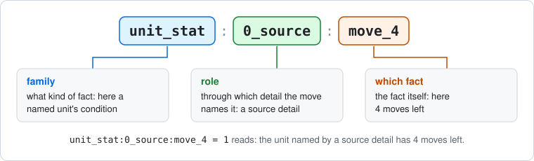

# The network's input

This page explains, layer by layer, how one decision of the game becomes the
numbers a network reads. It belongs to the [design document](README.md), whose
section 4 summarizes it. The encoder is C++ (`src/zone_encoding.cpp`);
`studies/campaign/features.py` turns its output into arrays and
`studies/campaign/neural.py` reads them. Measurements and the reasons for the
design are in the [zone encoding record](../stage_a/zone_encoding_2026_11_02.md).

## 1. When and how the input is built

Whenever the search reaches a decision it has not seen, it asks the deciding
alliance's network about it (see [search](README.md#3-choosing-a-move-search)).
Before that, the engine encodes the position once. Search copies of the same
position share that encoding, and a kept training sample stores it. The input
describes one decision: both the state of the game and the moves on offer.

**The encoder reads the engine's memory directly.** It is C++ code inside the
engine. It reads the live game state and receives the legal moves as the
engine's own move objects. Nothing is written out as text or parsed on the way.

**But the engine identifies everything by name.** Its state is not stored as
numbers:

- a unit's type, owner and zone are names: `cavalry`, `ccp`, `land_china_shensi`;
- a unit's marks are a table of names and numbers, such as `repairing` → 1;
- a battle's notes, and a legal move's details, are small trees of named
  entries, such as `target` → `rail_land_manchuria_northern__land_manchuria_western`
  and `damage` → 1.

So the encoder translates each name into a question number, using fixed lists of
the names it knows ([section 7](#7-names-the-encoder-doesnt-know)). That
translation is where "names" and "missing names" come from.
[Section 10](#10-why-the-encoder-translates-names) explains why the engine works
with names and what the alternatives are.

**Encoding is cheap.** In three random eleven-round games (4,786 decisions,
measured on 3 November 2026 on the M4 Max), encoding a decision took 0.17 ms on
average, against 0.64 ms to list its legal moves and 0.80 ms to play a move. A
self-play game encodes about 60,000 positions, one per network evaluation. That
is about 10 seconds of the roughly 260 CPU-seconds a game process spent per game
in the 2 November profile: about 4%, a rough estimate.

## 2. Three parts

The input for one decision is one bundle with three parts:

1. **The board:** each of the 37 zones (31 land and 6 sea) answers the same list
   of 42,737 zone questions.
2. **The position as a whole:** 6,637 questions about the round, the phase,
   whose turn it is, treasuries, wars and so on.
3. **Each legal move:** every move on the menu answers the same list of 12,673
   move questions about itself.

**A real decision** (game seed 5): the CCP's first Combat Movement decision of
round 1, chosen by the Comintern player. It has 13 legal moves, and its input
holds 326 board answers, 119 position answers and 244 answers across the 13
moves. Each earlier decision took the move that ends the phase, or else the first
listed move.

**Each part is filed differently:**

- **The board is filed by zone.** Every answer is kept with its zone, as (zone,
  question, answer), such as (Formosa, `units:japan:fighter`, 1). The zone is not
  in the question's name: it is the row the answer belongs to, and all 37 zones
  share the same questions.
- **The position** has one set of answers, as (question, answer).
- **Moves are filed by move.** Every answer is kept with its move, as (move,
  question, answer). A move is not in one zone: it can start in one, pass through
  others and end in another. So when a move's answer is about a zone, the zone is
  written into the question's name, such as `unit_zone:0_source:land_formosa`, and
  the move is linked to the zones it starts from, passes through and acts on.
  [Section 6](#the-same-fighter-on-the-board-and-in-a-move) shows one unit in both
  parts.

## 3. Questions and answers

**A question** is a numbered slot with one fixed meaning, also called a column.
Its name, such as `units:ccp:cavalry`, is a readable label for that meaning;
the network only sees the number. A name is built as `family:part:part`. The
family says what kind of question it is, and the parts say which nation, which
unit type, which zone and so on. The board has 40 families, the position 57 and
the moves 43.

**An answer** is a whole number: a count ("how many?"), 1 for "yes", or a value
such as the round. Almost every answer is 0, so only the non-zero answers are
stored.

These are all the non-zero board answers of the zone Shensi in that decision:

| Question | Answer | Meaning |
| --- | ---: | --- |
| `possessor:ccp` | 1 | the CCP possesses Shensi |
| `turn_start_possessor:ccp` | 1 | it did at the start of the turn too |
| `units:ccp:cavalry` | 1 | one CCP cavalry here |
| `units:ccp:militia` | 2 | two CCP militia |
| `units:ccp:mountain_infantry` | 2 | two CCP mountain infantry |
| `unit_stat:comintern:cavalry:count` | 1 | one Comintern cavalry |
| `unit_stat:comintern:cavalry:move_2` | 1 | ... with 2 moves left |
| `unit_stat:comintern:militia:count` | 2 | two Comintern militia |
| `unit_stat:comintern:militia:move_0` | 2 | ... with no moves left |
| `unit_stat:comintern:mountain_infantry:count` | 2 | two Comintern mountain infantry |
| `unit_stat:comintern:mountain_infantry:move_1` | 2 | ... with 1 move left |
| `rail_to:land_china_hopeh` | 1 | a railroad runs from here to Hopeh |

The network keeps a learned row of numbers for every question and adds each
answered question's row, weighted by sign(a) × log(1 + |a|): see
[what a network computes](README.md#5-what-a-network-computes).

## 4. The board part

The largest zone families:

| Family | Columns | Asks, for one zone |
| --- | ---: | --- |
| `unit_stat` | 13,321 | how many units of an alliance and type have a condition: damaged, moved, moves left, ... |
| `battle_data_unit`, `battle_data_zone` | 8,365 | what a battle's notes say about unit types and zones |
| `unit_reference_here` | 4,501 | how many units, by alliance and type, point at this zone, and why: a blitz destination, an assault target, a route, ... |
| `battle_data_word` | 3,706 | which words a battle's notes hold, such as its next step or its situation |
| `unit_flag` | 2,000 | how many units carry each mark, such as "landed after combat" |
| `facility_flag` | 1,792 | marks on a facility here |
| `unit_facility` | 1,601 | units inside a facility, by type and facility type |
| `units` | 586 | how many units of each nation and type are here |
| `carried` | 277 | carried units, by carrier type and cargo type |
| `possessor`, `capital_of` | 27 | who holds the zone, whose capital it is |
| `rail_to`, `rail_damage_toward`, `rail_repair_toward` | 106 | railroads to each neighbour, the damage on this side, and repairs under way |

**Units are counted, not named.** The engine gives every unit a unique name.
Units on the board from the start are named like `setup_japan_sea_p15_destroyer_2`:
on the board from the start, owned by Japan, started in sea zone P15, a
destroyer, the second of its kind there. Things created during play get counter
names, such as `economy_unit_112` for a unit bought during the game. Railroads
are the exception: a border holds at most one, so each is named by the two zones
it joins, such as `rail_land_china_hopeh__land_china_shensi`, whether it was on
the map from the start or built during play
([RCL-019](../../game_content/rules/clarifications.md#rcl-019-one-railroad-per-border-damaged-and-repaired-by-side)).
The network never reads these names. It sees counts and conditions, such as "one
Japanese destroyer here, undamaged, already moved".

**Battle notes.** While a battle is being fought, the engine keeps notes on it:
the round, the defenders, where the attackers came from, its next step and so
on. They become the `battle_data` families: a note's units are counted by type,
its zones by zone, its words, such as `movement_map` or `attacker_wins`, by word,
and its numbers are added up.
[Section 7](#a-battle-note-word-by-word) shows a real example.

**Turn numbers become ages.** A mark that stores the turn when something happened
is turned into "turns since", so equal situations in different turns look alike.

## 5. The position part

The position answers questions such as `round`, `rounds_left`, `phase:<phase>`,
`turn_nation:<nation>`, `treasury:<nation>`, `at_war:<nation>:<nation>`,
`technology_stage:<nation>:<technology>`, the kind of decision being taken
(`decision:<kind>`) and the purpose of a pending dice roll. In the seed-5 decision
these include:

| Question | Answer | Meaning |
| --- | ---: | --- |
| `round` | 1 | the round |
| `rounds_left` | 11 | rounds still to play |
| `phase:combat_movement` | 1 | the Combat Movement phase |
| `turn_nation:ccp` | 1 | the CCP's turn |
| `nation_present:<nation>` | 1 | one answer for each nation in the game |

## 6. The move part

### Every move has the same format

Every legal move answers the same fixed list of 12,673 move questions. So every
move is a row of the same length, almost all zeros, and only its non-zero answers
are stored. A move fills in only the questions that apply to it: the fighter
attacking Hunan fills in 17, the airbase purchase 10.

**A toy version.** Suppose the game had two unit types, infantry and tank, and
three zones, a, b and c. Part of a move's row would be these eight questions:

The real format works the same way, with three differences from a plain
"which unit, which zones" row:

- **Zones come with roles.** There is one question per zone and role, not one
  per zone. A row with just "infantry, a, c" could not tell "a to c" from "c to
  a". Here `unit_zone` says where the unit stands, so where the move starts,
  and the link says which zone it acts on. Between the start and the end, the
  path's zones are marked as a set, not in order.
- **Units are described, not numbered.** A question says "an infantry", with
  its condition (moves left, damage, ...) and its rank among identical units
  there, never "unit 1".
- **A row says more than units and zones:** the kind of move (a movement, an air
  attack, a purchase, ...), who chooses, which labels the move has, and its plain
  values, such as `true:combat = 1` or `number:range = 2`. Answers can be counts,
  not only 0 or 1.

### How the engine writes a move

A legal move is a kind plus labelled details. Each detail has a label on the
left and a value on the right. The engine's rule code chose the labels:

| Label | Value |
| --- | --- |
| `kind` | `economy_repair` |
| `target` | `rail_land_manchuria_northern__land_manchuria_western` |
| `endpoint` | `land_manchuria_northern` |
| `damage` | `1` |

### How each detail becomes answers

Every move first says who chooses and what kind of move it is, for example
`schedule:play = 1`, `player:axis = 1`, `nation:japan = 1` and
`kind:air_start_patrol = 1`. Then, for each detail, the encoder records that a
detail with this label exists, such as `parameter:range = 1`, and then the
detail's value. How it records the value depends on what the value is.

All the examples below are details of real legal moves from random games: seed
7001, except the railroad repair (seed 7004).

**Plain values:**

| Value | Real example | Answers |
| --- | --- | --- |
| A number | A Japanese seaplane in Okinawa starts a patrol over sea zone P33: `range = 2` | `number:range = 2` |
| True | A Japanese infantry moves from Rehe into Beiping to attack: `combat = true` | `true:combat = 1` |
| False | A Japanese transport enters Formosa's port without unloading: `unload = false` | `false:unload = 1` |
| Nothing | A Japanese heavy cruiser moves from sea zone P16 to P15, starting and ending at sea, not in a port: `origin_facility = null`, `destination_facility = null` | `null:origin_facility = 1`, `null:destination_facility = 1` |
| A list | A Japanese fighter flies from Formosa over P32 to attack Hunan: `path = [land_formosa, sea_p32, land_china_hunan]` | `list_length:path = 3`, then each item as its own value: `zone:1_path:land_formosa = 1`, `zone:1_path:sea_p32 = 1`, `zone:1_path:land_china_hunan = 1` |
| A group of details | The cruiser's move keeps its details in one group: `request = {combat = true, strategic = false, path = [sea_p16, sea_p15], units = [setup_japan_sea_p16_heavy_cruiser_1], ...}` | `parameter:request = 1`, then each inner detail as if it stood alone: `true:combat = 1`, `false:strategic = 1`, `list_length:path = 2`, `zone:1_path:sea_p16 = 1`, ..., `unit:0_source:japan:heavy_cruiser = 1`, ... |

**Names of things.** A name is replaced by what the thing is; the name itself
never reaches the network.

| Value | Real example | Answers |
| --- | --- | --- |
| A unit's name | The fighter attacking Hunan: `unit = setup_japan_land_formosa_fighter_1` | `unit:0_source:japan:fighter = 1` (a Japanese fighter), `unit_stat:0_source:count = 1`, `unit_stat:0_source:move_4 = 1` (4 moves left), `unit_zone:0_source:land_formosa = 1` (it is in Formosa), `unit_turn_origin:0_source:land_formosa = 1` (it started the turn there), `unit_rank:0_source:0 = 1` (the first Japanese fighter there), `unit_later_peers:0_source:militia = 1` (one militia comes after it in unit order) |
| A zone's name | Japan buys an airbase to build in Formosa: `zone = land_formosa` | `zone:2_target:land_formosa = 1` |
| A facility's name | The transport entering port: `facility = facility_land_formosa_major_port` | `facility:0_source:major_port = 1` |
| A battle's name | The CCP starts its battle in Hopeh: `battle = land_battle_2` | `battle_stage:0_source:awaiting_combat_rules = 1`, `battle_attacker:0_source:ccp = 1`, `battle_defender:0_source:warlord_beiping_hopeh = 1`, `battle_units:0_source:cavalry = 1`, `battle_units:0_source:militia = 1`, `battle_place:0_source:land_china_shensi = 2` (the battle's notes name Shensi twice) |
| A construction project's name | Japan pays the next instalment on a fleet carrier it is building: `project = japan_queue_fleet_carrier` | `project:0_source:fleet_carrier = 1`, `project_owner:0_source:japan = 1`, `project_stat:0_source:paid_ipp = 5` (5 IPP paid), `project_stat:0_source:payments_left = 2`, `project_stat:0_source:remaining_payments = 10` (two payments, 10 IPP, to go), `project_stat:0_source:queue_position = 3`, `project_stat:0_source:count = 1` |
| A railroad's name | Japan repairs the railroad between Manchuria Northern and Manchuria Western ([example 2](#example-2-a-railroad-repair)): `target = rail_land_manchuria_northern__land_manchuria_western` | `rail_endpoint:2_target:land_manchuria_northern = 1` and `rail_endpoint:2_target:land_manchuria_western = 1` (its two endpoints, the zones it joins), `rail_damage:2_target:land_manchuria_northern = 1` (1 damage on the Manchuria Northern side) |
| A build-chart row | The airbase purchase: `row = japan_major_airbase` | `row:japan_major_airbase = 1` |
| A nation's name | The KMT declares war on Japan: `target = japan` | `nation_named:2_target:japan = 1` |
| A technology | Japan starts research at its Tokyo factory: `technology = advanced_artillery` | `technology:advanced_artillery = 1` |
| Any other name, on the list of known values | The airbase purchase, at the printed price: `price = printed` | `value:price:printed = 1` |
| Any other name, not on the list | None occurs in 480 random games since 4 November. A name a rule adds later would be counted and reported ([section 7](#keeping-the-lists-complete)) | `value:<label>:other = 1` |

The `0_source`, `1_path` and `2_target` parts of these names are roles, explained
below.

### The same fighter on the board and in a move

The board is filed by zone, but a move is filed by move. The fighter attacking
Hunan shows the difference. This is decision 41 of game seed 7001: Japan's
Combat Movement in round 1, with 106 legal moves.

**On the board**, Formosa's row lists everything in Formosa, counted by nation,
alliance and type. These are all 9 of its answers:

| Question | Answer | Meaning |
| --- | ---: | --- |
| `possessor:japan` | 1 | Japan holds Formosa |
| `turn_start_possessor:japan` | 1 | and held it when the turn began |
| `units:japan:fighter` | 1 | one Japanese fighter |
| `units:japan:militia` | 1 | one Japanese militia |
| `unit_stat:axis:fighter:count` | 1 | one Axis fighter |
| `unit_stat:axis:fighter:move_4` | 1 | the fighter has 4 moves left |
| `unit_stat:axis:militia:count` | 1 | one Axis militia |
| `unit_stat:axis:militia:move_0` | 1 | the militia has none |
| `facility:major_port:count` | 1 | a major port |

Hunan's row says that the KMT holds it with two infantry, and P32's row lists a
Japanese destroyer, light cruiser and transport.

**In the move**, the answers describe the one unit the move uses and its route.
The zones appear inside the names, because one move involves several zones:

| Question | Answer | Meaning |
| --- | ---: | --- |
| `unit:0_source:japan:fighter` | 1 | the unit that acts is a Japanese fighter |
| `unit_stat:0_source:count` | 1 | one unit |
| `unit_stat:0_source:move_4` | 1 | with 4 moves left |
| `unit_zone:0_source:land_formosa` | 1 | standing in Formosa |
| `unit_turn_origin:0_source:land_formosa` | 1 | where it started the turn |
| `unit_rank:0_source:0` | 1 | the first Japanese fighter there |
| `unit_later_peers:0_source:militia` | 1 | a militia comes after it in unit order |
| `zone:1_path:land_formosa` | 1 | the route: Formosa, |
| `zone:1_path:sea_p32` | 1 | sea zone P32, |
| `zone:1_path:land_china_hunan` | 1 | Hunan |
| `list_length:path` | 3 | the route has 3 zones |

Plus the answers every move has: `schedule:play`, `player:axis`, `nation:japan`,
`kind:air_ground_attack`, `parameter:unit` and `parameter:path`.

**The links join the two.** The move starts in Formosa, acts on Hunan and travels
through Formosa, P32 and Hunan, so the network reads those zones' board vectors
with the move's own answers. Together they say: this fighter, with 4 moves left,
flies from Japanese Formosa, which also holds a militia and a major port, over
P32 to attack Hunan, held by two KMT infantry.

Moves are not filed under zones for three reasons:

- one move involves several zones;
- many moves share a zone: of these 106 moves, 58 start in sea zone P15, 18 in
  Tokyo and 7 in Formosa, and filed under their zones they would blur together;
- the network must score each move separately, so each move needs its own answers.

### Roles

**Reading a move question's name.** Most move questions have three parts:

- **The family** says what kind of fact it is: `unit` is a named unit's nation
  and type, `unit_stat` its condition, `unit_zone` where it stands, `zone` a
  named zone, and so on.
- **The role** says through which detail the move names that unit or zone. It
  comes from that detail's label, and every question written about the detail's
  value carries it.
- **The rest** says which fact: `count` is how many units, `move_4` "4 moves
  left".

So `unit_stat:0_source:count = 1` reads: "the unit named by a source detail is
one unit". In the fighter's attack above, that detail is `unit = ...`, and its
label `unit` is a source label. `unit_stat` is not a label; it is the family.

**The four roles** say how the move relates to the unit or zone a detail names:

- `0_source`: what acts, or where the move starts;
- `1_path`: the route the move travels;
- `2_target`: what the move acts on, or where it goes;
- `3_other`: the move mentions it, but the encoder cannot say how.

**One move, two units, two roles.** A Japanese tactical bomber lands on a light
carrier (game seed 7004):

| Kind | Label | Value |
| --- | --- | --- |
| `air_land_noncombat` | `unit` | `japan_tactical_bomber_p15_fleet_carrier_1` |
| | `destination` | `japan_light_carrier_p15_setup_1` |

Both details name a unit, so both produce the same families, each with its own
detail's role:

| Detail | Label and role | Some of its answers |
| --- | --- | --- |
| `unit = japan_tactical_bomber_p15_fleet_carrier_1` | `unit`: `0_source` | `unit:0_source:japan:tactical_bomber = 1`, `unit_stat:0_source:count = 1`, `unit_stat:0_source:move_4 = 1`, `unit_stat:0_source:aboard = 1`, `unit_zone:0_source:sea_p41 = 1` |
| `destination = japan_light_carrier_p15_setup_1` | `destination`: `2_target` | `unit:2_target:japan:light_carrier = 1`, `unit_stat:2_target:count = 1`, `unit_stat:2_target:move_3 = 1`, `unit_zone:2_target:sea_p14 = 1` |

Without roles, the bomber's and the carrier's facts would land in the same
questions, and the network could not tell which unit has 4 moves left or which
one is in P41.

**How the role is chosen.** The encoder cannot understand what a label means: to
it, `endpoint` is just a string of letters. So the role comes from a fixed table
in `src/zone_encoding.cpp` that pairs labels with roles. The table lists labels,
the words on the left of a move's details, not families:

| Label | Role |
| --- | --- |
| artillery, battle, facility, factory, origin_facility, plan, project, row, source, transport, unit, units | `0_source` |
| path | `1_path` |
| beneficiary, border, border2, declaring_nation, destination, destination_facility, endpoint, neighbor, recipient, sea, target, technology, zone, zones | `2_target` |
| any label not in the table | `3_other` |

Some labels that name units are missing from the table. When a Japanese air
transport loads a mountain infantry (`air_load`, game seed 7006), the infantry is
named by `cargo = setup_japan_land_manchuria_northern_mountain_infantry_1`.
`cargo` is not in the table, so the infantry's answers read
`unit:3_other:japan:mountain_infantry = 1`, `unit_stat:3_other:count = 1` and so
on. `towed` (a unit towed along a move) is another such label.

**A route's last zone is a path zone.** The fighter attacking Hunan has no
detail labelled `target`. The engine writes its whole route as one detail,
`path = [land_formosa, sea_p32, land_china_hunan]`, and the attacked zone is
simply the route's last zone. Roles come from labels, one per detail, so all
three zones get the role of `path`: `zone:1_path:land_china_hunan = 1`, the
same kind of answer as for Formosa and P32. Movement moves that attack, such as
the cavalry in [example 1](#example-1-a-cavalry-attack), are written the same way.

The network still learns where such a move ends in two ways:

- **The link.** For a move with a path, the zone it acts on is the path's last
  zone. So the network reads Hunan's board row in the "acts on" slot, just as it
  reads a `2_target` zone for a move without a path.
- **The kind.** `kind:air_ground_attack = 1`, or `true:combat = 1` for a
  movement move, says that the move is an attack.

What is lost is narrower: among the move's own answers, "passes through Hunan"
and "ends in Hunan" look the same, and the "what it acts on" probability stage
has nothing for such moves; their destinations separate them only in the "how
it travels" stage, which lists the path zones in order. Also writing the last
path zone as a `2_target` zone would make the destination explicit there. That
is an untested idea, not a known fault.

The role changes three things:

1. **The question.** `zone:2_target:land_china_beiping` and
   `zone:3_other:land_china_beiping` are different questions with different
   learned rows.
2. **The links to zones.** The network reads three zones' board vectors with each
   move: the zone it starts from (the first `0_source` zone, or else the first
   `3_other` zone), the zone it acts on (the last path zone, or else the first
   `2_target` zone) and the average of its path zones.
3. **The probability stages.** "What acts" is built from the `0_source` details,
   "how it travels" from the `1_path` details and path zones, and "what it acts on"
   from the `2_target` details. `3_other` details belong to no stage.

The encoder keeps two separate lists of labels. The list of known labels (93 of
them) decides questions like `parameter:cargo`. The role table (27 labels)
decides roles. A label can be on the first and missing from the second, as
`cargo` is.

### Example 1: a cavalry attack

The CCP cavalry in Shensi attacks Hopeh. In the engine's form:

| Kind | Label | Value |
| --- | --- | --- |
| `movement_route` | `unit` | `setup_ccp_land_china_shensi_cavalry_1` |
| | `path` | `[land_china_shensi, land_china_hopeh]` |
| | `combat` | `true` |
| | `mode` | `ordinary` |

It becomes 21 answers:

| Question | Answer | Meaning |
| --- | ---: | --- |
| `schedule:play` | 1 | an ordinary move in play |
| `player:comintern` | 1 | the Comintern player chooses |
| `kind:movement_route` | 1 | a movement move |
| `nation:ccp` | 1 | for the CCP |
| `parameter:unit`, `parameter:path`, `parameter:combat`, `parameter:mode` | 1 each | it has these four details |
| `unit:0_source:ccp:cavalry` | 1 | the unit that acts is a CCP cavalry |
| `unit_stat:0_source:count` | 1 | one unit |
| `unit_stat:0_source:move_2` | 1 | with 2 moves left |
| `unit_zone:0_source:land_china_shensi` | 1 | standing in Shensi |
| `unit_turn_origin:0_source:land_china_shensi` | 1 | where it started the turn |
| `unit_rank:0_source:0` | 1 | the first of the identical cavalry there |
| `unit_later_peers:0_source:militia` | 2 | after it in unit order come 2 militia |
| `unit_later_peers:0_source:mountain_infantry` | 2 | and 2 mountain infantry |
| `zone:1_path:land_china_shensi` | 1 | the path goes through Shensi |
| `zone:1_path:land_china_hopeh` | 1 | and Hopeh |
| `list_length:path` | 2 | the path has 2 zones |
| `value:mode:ordinary` | 1 | ordinary movement |
| `true:combat` | 1 | it starts a combat |

Links: it starts in Shensi (the unit's zone, role `0_source`), acts on Hopeh (the
last path zone) and its path is Shensi and Hopeh. So the network combines this
move's answers with what it knows about Shensi and Hopeh from the board part.

### Example 2: a railroad repair

**What the move means in the game** (game seed 7004): Japan repairs 1 point of
damage on the railroad between Manchuria Northern and Manchuria Western, on the
Manchuria Northern side of the border.

- Railroads sit on the borders between land zones, at most one per border. The
  starting map has one on each border with a railway. Building one is not
  offered where one stands, damaged or not, or is being built.
- Bombing a zone's railroads damages the railroad on one chosen border of that
  zone, on the bombed zone's side (rulebook 10.6.2). Each side holds its own
  damage, up to the border terrain's limit: 1 in normal terrain, 2 in desert,
  jungle, marsh, mountain or tundra (rulebook 13.2.8). A railroad with damage on
  either side cannot be used.
- The nation that holds the zone on a damaged side may repair that side, at 1 IPP
  per point. It pays in the Production Phase, and the repair is done in the Place
  Units Phase if it still holds the zone.
- The rulebook leaves some of this open. The user settled it on 3 and 4 November
  2026, as rule
  [RCL-019](../../game_content/rules/clarifications.md#rcl-019-one-railroad-per-border-damaged-and-repaired-by-side):
  one railroad per border, because a second would give nothing that a repair
  does not, and damage and repair by side, each side's limit set by the border's
  terrain.

Because a border holds one railroad, a railroad is named by the two zones it
joins, in alphabetical order:
`rail_land_manchuria_northern__land_manchuria_western`. The engine calls each
side of the border an `endpoint`, and the questions about a railroad's two zones
are named after it. The move's details mean:

- `target`: the railroad;
- `endpoint`: the side being repaired;
- `damage`: how many points.

**What the network receives:**

| Question | Answer | Meaning |
| --- | ---: | --- |
| `schedule:play`, `player:axis`, `nation:japan` | 1 each | an ordinary move, the Axis player choosing for Japan |
| `kind:economy_repair` | 1 | a repair |
| `parameter:damage`, `parameter:endpoint`, `parameter:target` | 1 each | it has these three details |
| `zone:2_target:land_manchuria_northern` | 1 | it acts on Manchuria Northern, the side being repaired |
| `rail_endpoint:2_target:land_manchuria_northern` | 1 | the railroad it acts on has one endpoint in Manchuria Northern ... |
| `rail_endpoint:2_target:land_manchuria_western` | 1 | ... and the other in Manchuria Western |
| `rail_damage:2_target:land_manchuria_northern` | 1 | that railroad has 1 damage on the Manchuria Northern side; the other side has none, so it has no answer |
| `number:damage` | 1 | it repairs 1 point |

**Detail by detail:**

- `endpoint = land_manchuria_northern` is a zone, and `endpoint` is a `2_target`
  label, so it becomes `zone:2_target:land_manchuria_northern`.
- `target = rail_land_...` names a railroad. The encoder looks the railroad up
  in the game state and writes its two endpoints (`rail_endpoint`) and the
  damage on each side (`rail_damage`), with the role of `target`, `2_target`.
  The name itself never reaches the network, so a railroad built during play is
  described the same way as one on the starting map.
- `damage = 1` is a number under a known label: `number:damage = 1`.

**Links and stages.** The encoder reads a move's details in alphabetical order of
their labels, so `endpoint` comes before `target`, and the first `2_target` zone
is the side being repaired. The move is linked to Manchuria Northern as the zone
it acts on, and the network reads that zone's board answers with it, including
`rail_damage_toward:land_manchuria_western = 1`. All its zones are `2_target`,
so repairs of different railroads, or of different sides, fall into different
"what it acts on" groups. Repairs of the same side that differ only in how many
points they mend are told apart at the last stage.

**On the board.** Once bought, the repair is under way until the Place Units
Phase. Manchuria Northern's board row then also says
`repair:japan:rail:count = 1`, `repair:japan:rail:remaining_damage = 1` and
`rail_repair_toward:land_manchuria_western = 1`: Japan is repairing 1 point on
its side of the railroad toward Manchuria Western.

Until 4 November 2026 this move reached the network as `value:target:other`, with
the zone's role unknown and the amount as an unknown number, so which railroad
it repaired was lost ([record](../stage_a/rail_repair_encoding_2026_11_04.md)).

## 7. Names the encoder doesn't know

### Fixed lists and "other" questions

Names come from fixed lists: nations, unit types, facilities, technologies,
projects, decision kinds, marks, battle notes, the words battle notes use,
labels and known values. A name not on its list goes into that list's one shared
"other" question, so the network sees "some unlisted name is present" but not
which one. The encoder counts every such name, and
`gwrl_cpp.zone_encoding_unknowns()` reports them.

In a battle note, the encoder first tries a name as a unit, zone, facility,
construction project or railroad. A name ending in a number that is none of
these belongs to something no longer in the game, such as a unit lost earlier
this turn, and is skipped; words never contain digits. Any other name is a word.
Only some notes hold words, such as `context`, `result` or `rolling_phase`; a
word in another note goes to an "other" row and is reported, like an unlisted
word.

### A battle note, word by word

A real naval battle in sea zone P33 (game seed 7019): an enemy submarine moved in
from P32, and a Japanese fighter on patrol, from a light carrier, attacked it. A
Japanese destroyer was also in P33. Some of the battle's notes, mid-way, and the
answers they give on P33's row:

| Note | Its answers on P33's row |
| --- | --- |
| `round = 1` | `battle_data:round = 2` |
| `defenders = [the Japanese fighter]` | `battle_data_unit:defenders:fighter = 1` |
| `origins = {the submarine: sea_p32}` | `battle_data_unit:origins:submarine = 1`, `battle_data_zone:origins:sea_p32 = 1` |
| `context = "movement_map"` | `battle_data_word:context:movement_map = 1` |
| `submarines_initiated = false` | `battle_data:submarines_initiated = 1` |
| `naval_pairing_done = {the destroyer: true}` | `battle_data:naval_pairing_done = 2`, `battle_data_unit:naval_pairing_done:destroyer = 1` |

- Every note answers `battle_data:<note> = 1` for being there, and its numbers
  and true values are added in: `round = 1` gives 2, `false` adds nothing.
- `context = "movement_map"`: the battle is a patrol plane meeting moving ships.
- `submarines_initiated = false`: a sea battle can start while ships move through
  a zone in two ways. Either submarines already there attack the passing ships
  (`true`), or a patrol plane does, as here (`false`). A few rules change when
  submarines start the fight: they do not get their usual choice to stay
  submerged, and a submerged submarine's usual protection does not apply.
- `naval_pairing_done`: a submarine that stays submerged can only be hit by
  patrol planes or by a destroyer teamed with one, so before any shooting the
  engine asked the destroyer whether to team up with the fighter. This note says
  the destroyer has answered.

Until 4 November 2026 `naval_pairing_done` was missing from the list of notes and
arrived only as `battle_data:other`, and the word `movement_map` was dropped
without being counted.

### Keeping the lists complete

Encoding every decision of 240 random eleven-round games (seeds 7000 to 7239,
373,049 decisions) meets no unlisted name, and neither do 240 more (seeds 9000
to 9239, 372,113 decisions), measured on 4 November 2026.

Before that day the lists lacked names in four groups. On 3 November the random
check found 31: 16 battle notes, 12 railroad names, the label `damage`, a city as
a repair target and the value `local`. Two prices that come with Improved
Construction turned up on 4 November. The engine's source named 20 more battle
notes that random games had not reached, such as those of a fleet slipping out
of a damaged port. And the words in battle notes were dropped without being
counted, so no check could see them. The
[record](../stage_a/zone_names_2026_11_04.md) lists them all. The lists had been
collected from the engine code and a few short games when the encoder was
written on 2 November.

Three checks keep the lists complete:

- **The engine's source.** Tests read the rule code for the usual ways it writes
  battle notes, marks, the words in battle notes and moves, battle stages and
  prices, and fail on a name without a question (`tests/test_campaign_zone_encoding.py`).
- **Whole games.** The encoding test plays two whole random games and fails on
  any unlisted name.
- **Many games.** `tools/check_zone_names.py` plays hundreds of random games,
  240 in about two minutes on 8 workers. Run it before a long self-play run.

A name written another way, and met in no random game, can still slip into an
"other" question, but it is counted and reported, never dropped.

Some details are summarized on purpose rather than named:

- a mark's argument, unless it is a place or a nation: which railroad or
  facility was damaged this turn, for example, is counted for the whole position;
- the numbers and true values in a battle note are added into one answer;
- the field names inside a note, and things no longer in the game.

## 8. Questions removed as impossible

On 3 November 2026 the layout dropped 24,974 questions, following the user's rule:
remove a question only when the rules of the whole game rule it out, judged per
nation; a rare situation keeps its question.

| Part | Before | After (3 November) |
| --- | ---: | ---: |
| Board, per zone | 59,322 | 35,407 |
| Position | 6,763 | 6,621 |
| Each move | 13,031 | 12,114 |

- **Other nations' special units.** A unit type the rulebook reserves for some
  nations belongs to them alone: Tiger I and Panzergrenadier are German, T-34 and
  Katyusha Soviet, B-29 American, Gurkha FEC; Foreign Legion and colonial
  infantry belong to the French and Commonwealth nations and Italy. No nation of
  this scenario may own one. A scenario with Germany would keep Germany's.
- **Carried units.** Only pairs the loading rules allow remain, 69 of 2,809:
  transports carry land units, a Japanese destroyer one marine, carriers fighters
  and tactical bombers (medium bombers only on heavy fleet carriers), and air
  transports and strategic bombers the cargo their rules accept.
- **Units in facilities.** Only ships and aircraft are ever inside a facility,
  and only naval facilities, which face the sea, have borders a unit can see.
- **Railroads at sea.** Railroads join land zones only, so the railroad questions
  added on 4 November (`rail_repair_toward`, `rail_endpoint`, `rail_damage`) have
  no sea-zone versions.
- **Kept on purpose:** the coastal defense ship, reserved for nobody and
  capturable; and "warlords never own ships or planes", which lend-lease and
  recruitment might break, so it could not be proved.

Each family that lost questions keeps one `~impossible` question. A removed
combination that occurs anyway is counted there and reported as unknown, never
dropped; 240 random games met none.

## 9. Fixed facts and the layout version

Facts that never change come with the layout, not with each position:

- 39 facts per zone, such as terrain, production value, capitals, victory
  cities, original owners and home countries;
- the 160 directed borders, with 22 facts each, such as rivers, narrow crossings,
  railway connections and terrain.

The layout version, now `campaign-zone-v1-1d3c25d19abf2937`, is a hash of every
question name and every fixed fact. A network refuses inputs of another layout,
and a run cannot resume across a layout change. It last changed on 4 November
2026, for a patrol plane's own choice in a sea battle
([record](../stage_a/patrol_choice_2026_11_04.md)).

## 10. Why the encoder translates names

The engine came first. It was written (milestones M0 to M11) to follow the
rulebook, and many parts of the project use it: the Python interface, the tests,
saved games and replays, the map viewer, and training checkpoints, which store
the whole game as JSON. Names keep all of these readable, let the engine load its
units, map and rules from JSON files, and let a rule add a new mark or battle
note without changing a shared format. The networks came later.

The first network input, used until 2 November 2026, really did read text: it
printed each position as JSON, cut every name into word pieces and hashed the
pieces into 16,384 slots. The zone encoding replaced it with a fixed list of
questions built straight from the engine's memory: 49 to 64 times smaller and 5
to 6 times faster to build ([record](../stage_a/zone_encoding_2026_11_02.md)). It
left the engine's names as they were and translates them instead.

Reading a move's named details also lets one piece of code describe all 144
kinds of move, and kinds added later. Without it, every kind of move would need
its own encoder code, kept in step with its rule by hand.

**What names cost:**

- **Speed: little.** Encoding is about 4% of a game process's work (section 1),
  and the name lookups are only part of encoding.
- **Correctness: the real cost.** The engine and the encoder agree only through
  names. A rule can write a name the encoder's lists lack, and the name falls
  into an "other" question and is only counted. That is how the missing names of
  [section 7](#keeping-the-lists-complete) arose; since 4 November tests check
  the names the engine's source writes.

**The alternatives:**

| Option | What it means | Assessment |
| --- | --- | --- |
| The engine writes the network's numbers itself | every rules module also fills input questions as it plays | Spreads learning code through the rules: every rule change becomes an input change, and the rules get harder to check against the rulebook. Not recommended. |
| The engine stores numbers instead of names | unit types, nations, zones and marks become numbered constants | A rewrite of every rules module, with risk to rule correctness, for at most the few percent of speed above. The measurements do not justify it. |
| Keep the names, but check them | a test scans the engine's source for the names it writes and compares them with the encoder's lists, and full random games fail on any unknown name | Closes the missing-names gap without touching the rules. Built on 4 November for the usual ways the engine writes names ([section 7](#keeping-the-lists-complete)). |

A stricter form of the last option is one register of names, each declared once
with its meaning and used by both the engine and the encoder, so that the engine
cannot write an undeclared name. It is a larger change and has not been
designed.
